# Oltre l'App: Guida Completa alle Architetture Dati Enterprise

Questa dispensa accompagna il percorso di orientamento sulle architetture dei dati moderne (*Data Evolution*) per le classi quinte dell'indirizzo Informatica. L'obiettivo è costruire un ponte chiaro e graduale tra le tecnologie studiate nel [programma del corso](../../../README.md) — database relazionali SQL, API REST, container Docker, sicurezza web, cloud e Intelligenza Artificiale — e le piattaforme utilizzate oggi nelle grandi aziende per gestire miliardi di eventi in tempo reale e petabyte di dati storici.

Per una visione sintetica e visiva dei concetti trattati in queste pagine, puoi affiancare alla lettura la presentazione di 30 slide [Architetture_Dati_Enterprise.pdf](./Architetture_Dati_Enterprise.pdf)[^7], che ripercorre graficamente l'intero percorso dai database scolastici fino a Kafka, Data Lakehouse, Data Fabric, Streamhouse e Agentic AI.

> [!NOTE]
> Ogni acronimo e ogni termine specialistico viene introdotto partendo da zero, collegandolo a esempi concreti e agli argomenti già affrontati in classe. Alla fine della guida trovi inoltre una [mappa di raccordo con il programma della classe 5ª](#62-mappa-di-raccordo-con-il-programma-di-informatica-della-classe-5ª) e un [glossario ragionato degli acronimi](#64-glossario-ragionato-degli-acronimi-e-dei-termini-chiave).

## Indice dei contenuti

- [Oltre l'App: Guida Completa alle Architetture Dati Enterprise](#oltre-lapp-guida-completa-alle-architetture-dati-enterprise)
  - [Indice dei contenuti](#indice-dei-contenuti)
  - [1. Dal Nostro Stack Scolastico al Punto di Rottura Enterprise](#1-dal-nostro-stack-scolastico-al-punto-di-rottura-enterprise)
    - [1.1 Il punto di partenza del perito informatico: l'architettura tradizionale](#11-il-punto-di-partenza-del-perito-informatico-larchitettura-tradizionale)
    - [1.2 Quando l'applicazione diventa enterprise: il punto di rottura](#12-quando-lapplicazione-diventa-enterprise-il-punto-di-rottura)
    - [1.3 OLTP vs OLAP: due mondi con obiettivi opposti](#13-oltp-vs-olap-due-mondi-con-obiettivi-opposti)
    - [1.4 L'anatomia dei dati aziendali nella nuova era: i tre pilastri](#14-lanatomia-dei-dati-aziendali-nella-nuova-era-i-tre-pilastri)
  - [2. L'Evoluzione dello Storage Analitico: da RDBMS a Data Lakehouse](#2-levoluzione-dello-storage-analitico-da-rdbms-a-data-lakehouse)
    - [2.1 Il Data Warehouse: oltre il singolo RDBMS](#21-il-data-warehouse-oltre-il-singolo-rdbms)
    - [2.2 Il Data Lake: archiviazione flessibile su Object Storage per Big Data e AI](#22-il-data-lake-archiviazione-flessibile-su-object-storage-per-big-data-e-ai)
    - [2.3 Matrice di confronto e il dilemma dei due mondi divisi](#23-matrice-di-confronto-e-il-dilemma-dei-due-mondi-divisi)
    - [2.4 Il Data Lakehouse: convergenza tra flessibilità e prestazioni](#24-il-data-lakehouse-convergenza-tra-flessibilità-e-prestazioni)
    - [2.5 Il segreto tecnico del Lakehouse: formati aperti e Open Table Formats](#25-il-segreto-tecnico-del-lakehouse-formati-aperti-e-open-table-formats)
    - [2.6 Caso reale di Data Lakehouse aperto: IBM watsonx.data](#26-caso-reale-di-data-lakehouse-aperto-ibm-watsonxdata)
  - [3. Data Gravity, Data Fabric, Governance e Integrazione dei Dati](#3-data-gravity-data-fabric-governance-e-integrazione-dei-dati)
    - [3.1 Il caos dell'Enterprise IT: silos informativi, Data Gravity e Dark Data](#31-il-caos-dellenterprise-it-silos-informativi-data-gravity-e-dark-data)
    - [3.2 Il paradigma Data Fabric: il tessuto connettivo intelligente](#32-il-paradigma-data-fabric-il-tessuto-connettivo-intelligente)
    - [3.3 Architettura a 6 livelli e 5 funzionalità chiave del Data Fabric](#33-architettura-a-6-livelli-e-5-funzionalità-chiave-del-data-fabric)
    - [3.4 Governance dei dati, Data Lineage, Data Quality e raccordo con sicurezza e GDPR](#34-governance-dei-dati-data-lineage-data-quality-e-raccordo-con-sicurezza-e-gdpr)
    - [3.5 Data Fabric, Data Mesh e Data Lakehouse a confronto](#35-data-fabric-data-mesh-e-data-lakehouse-a-confronto)
    - [3.6 Dizionario dell'ingegnere dei dati: ETL, ELT, CDC e Virtualizzazione](#36-dizionario-dellingegnere-dei-dati-etl-elt-cdc-e-virtualizzazione)
  - [4. Data in Motion: Architetture Event-Driven e Apache Kafka](#4-data-in-motion-architetture-event-driven-e-apache-kafka)
    - [4.1 I limiti del paradigma REST sincrono e a chiamata](#41-i-limiti-del-paradigma-rest-sincrono-e-a-chiamata)
    - [4.2 L'inversione di marcia: Architettura Event-Driven e Publish/Subscribe](#42-linversione-di-marcia-architettura-event-driven-e-publishsubscribe)
    - [4.3 Apache Kafka: il cuore pulsante dell'Event Streaming](#43-apache-kafka-il-cuore-pulsante-dellevent-streaming)
    - [4.4 Sotto il cofano di Apache Kafka moderno (versione 4.4.x)](#44-sotto-il-cofano-di-apache-kafka-moderno-versione-44x)
    - [4.5 L'ecosistema Kafka: Kafka Connect, Kafka Streams e Schema Registry](#45-lecosistema-kafka-kafka-connect-kafka-streams-e-schema-registry)
    - [4.6 Piattaforme Enterprise Gestite: Confluent e IBM Event Streams](#46-piattaforme-enterprise-gestite-confluent-e-ibm-event-streams)
  - [5. Integrazione Applicativa Ibrida (iPaaS), Paradigma Streamhouse e AI in Tempo Reale](#5-integrazione-applicativa-ibrida-ipaas-paradigma-streamhouse-e-ai-in-tempo-reale)
    - [5.1 Integrazione applicativa aziendale: iPaaS e IBM App Connect](#51-integrazione-applicativa-aziendale-ipaas-e-ibm-app-connect)
    - [5.2 Il dilemma architetturale: il Presente (Streaming) vs la Storia (Lakehouse)](#52-il-dilemma-architetturale-il-presente-streaming-vs-la-storia-lakehouse)
    - [5.3 La convergenza: il paradigma Streamhouse](#53-la-convergenza-il-paradigma-streamhouse)
    - [5.4 Dati freschi per l'Intelligenza Artificiale: Context Engineering, RAG, OpenRAG e Agenti AI](#54-dati-freschi-per-lintelligenza-artificiale-context-engineering-rag-openrag-e-agenti-ai)
    - [5.5 The Enterprise Blueprint: la visione d'insieme end-to-end](#55-the-enterprise-blueprint-la-visione-dinsieme-end-to-end)
  - [6. Casi d'Uso Reali, Raccordo con il Programma, Orientamento Professionale e Glossario](#6-casi-duso-reali-raccordo-con-il-programma-orientamento-professionale-e-glossario)
    - [6.1 Casi d'uso reali e impatti misurati dalle fonti](#61-casi-duso-reali-e-impatti-misurati-dalle-fonti)
    - [6.2 Mappa di raccordo con il programma di Informatica della classe 5ª](#62-mappa-di-raccordo-con-il-programma-di-informatica-della-classe-5ª)
    - [6.3 Orientamento professionale: quale percorso dopo il diploma?](#63-orientamento-professionale-quale-percorso-dopo-il-diploma)
    - [6.4 Glossario ragionato degli acronimi e dei termini chiave](#64-glossario-ragionato-degli-acronimi-e-dei-termini-chiave)
    - [6.5 Conclusioni](#65-conclusioni)
  - [Riferimenti bibliografici e fonti](#riferimenti-bibliografici-e-fonti)

---

## 1. Dal Nostro Stack Scolastico al Punto di Rottura Enterprise

Quando si studia programmazione web e basi di dati al quinto anno di un istituto tecnico informatico, si impara a progettare applicazioni solide, ben organizzate e pronte per essere eseguite in container o nel cloud. Tuttavia, tra un progetto scolastico o una piccola applicazione aziendale e l'infrastruttura digitale di una banca, di una catena logistica internazionale o di una scuderia di Formula 1 esiste un salto di scala enorme.

Per comprendere perché siano nate architetture dai nomi apparentemente esotici come *Data Lakehouse*, *Data Fabric*, *Apache Kafka* e *Streamhouse*, conviene partire esattamente da ciò che già padroneggiamo, portarlo al limite e osservare che cosa si rompe quando i numeri crescono di diversi ordini di grandezza.

### 1.1 Il punto di partenza del perito informatico: l'architettura tradizionale

Nel percorso scolastico costruiamo tipicamente applicazioni web e mobili basate su un'architettura a tre livelli (*three-tier*), molto pulita ed efficace:

1. **Client (Frontend)**: un browser web (HTML, CSS, JavaScript) oppure un'applicazione mobile che interagisce con l'utente finale e invia richieste tramite il [protocollo HTTP/HTTPS](../../../web/web-docs/http-protocol/index.md).
2. **Backend applicativo (API REST)**: un servizio scritto ad esempio con le [Minimal API di ASP.NET Core](../../../asp.net/api-docs/minimal-api/getting-started/index.md) (oppure Node.js, Spring Boot, FastAPI) che espone endpoint **REST** (*Representational State Transfer*), spesso protetti da [token JWT](../../../web/web-docs/user-identity/jwt-token-based-authentication-authorization/index.md) o da protocolli [OAuth 2.0 e OpenID Connect](../../../web/web-docs/oauth-oidc/index.md), impacchettati in container [Docker](../../../docker/docker-docs/getting-started/index.md), orchestrati localmente con [Docker Compose](../../../docker/docker-docs/local-dev/examples/educationalgames/index.md) dietro un reverse proxy [Nginx](../../../web/web-docs/distributed-systems/reverse-proxy/nginx/intro/index.md) o pubblicati su servizi gestiti come [Azure Container Apps](../../../azure/containers/docs/aci-vs-aca/aci-vs-aca.md).
3. **Database Relazionale (RDBMS)**: un **RDBMS** (*Relational Database Management System*, sistema di gestione di basi di dati relazionali) come MariaDB, MySQL, PostgreSQL o Microsoft SQL Server, interrogato tramite [query SQL](../../../sql/sql-docs/sql-p1/index.md) o un **ORM** (*Object-Relational Mapping*) come [Entity Framework Core](../../../asp.net/api-docs/minimal-api/use-databases-p1/index.md), eventualmente affiancato da una cache in memoria come Redis ([caching in ASP.NET Core](../../../asp.net/api-docs/minimal-api/configure-api-p7/index.md)).

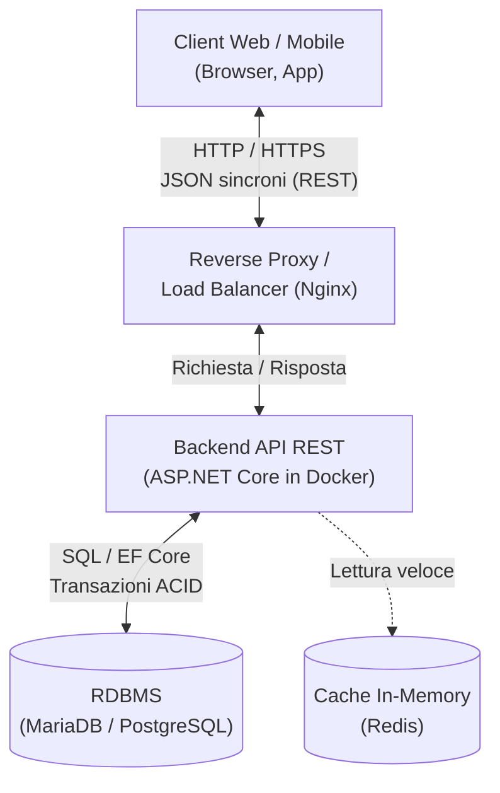

Questo stack funziona in modo eccellente per migliaia di utenti, decine o centinaia di richieste al secondo e qualche gigabyte di dati ben strutturati in tabelle normalizzate. Il punto di forza di un RDBMS classico risiede nelle sue **garanzie ACID** (studiate in [Transazioni SQL](../../../sql/sql-docs/sql-p9/index.md)):

- **Atomicity (Atomicità)**: una transazione (per esempio il trasferimento di denaro tra due conti o la creazione di un ordine con il relativo aggiornamento delle scorte) viene eseguita per intero oppure annullata completamente (`ROLLBACK`), senza lasciare stati intermedi corrotti.
- **Consistency (Consistenza)**: ogni transazione porta il database da uno stato valido a un altro stato valido, rispettando tutti i vincoli di integrità (`PRIMARY KEY`, `FOREIGN KEY`, `CHECK`, `UNIQUE`, trattati in [Vincoli e indici SQL](../../../sql/sql-docs/sql-p3/index.md)).
- **Isolation (Isolamento)**: più utenti che operano in parallelo non interferiscono tra loro leggendo dati parziali o sporchi, grazie a meccanismi di *lock* o di controllo della concorrenza multi-versione (**MVCC**, *Multi-Version Concurrency Control*).
- **Durability (Durabilità)**: una volta confermata (`COMMIT`), la modifica resta salvata su disco permanente anche in caso di blackout o crash del server.

La domanda chiave per capire il mondo *enterprise* (cioè delle grandi organizzazioni aziendali) è però la seguente: **cosa succede quando questa architettura deve reggere milioni di utenti simultanei, decine di applicazioni diverse, sensori industriali continui, petabyte di file multimediali e modelli di Intelligenza Artificiale che vogliono risposte aggiornate al millisecondo?**

### 1.2 Quando l'applicazione diventa enterprise: il punto di rottura

Quando un sistema cresce da progetto applicativo a piattaforma aziendale su larga scala, l'architettura tradizionale a singolo stack `API REST + RDBMS` entra in crisi su tre fronti distinti, ben evidenziati nella presentazione di riferimento[^7]:

1. **Colli di bottiglia della comunicazione sincrona (REST)**:
   Nel modello HTTP/REST classico, la comunicazione è *sincrona*: il client invia una richiesta e resta in attesa bloccato finché il server non ha completato l'elaborazione e restituito una risposta. Se il servizio `Ordini` deve chiamare in cascata il servizio `Magazzino`, poi il servizio `Pagamenti`, poi il servizio `Fatturazione` e infine il servizio `Email`, basta che uno solo di questi nodi rallenti o vada offline per generare un effetto domino di timeout e thread bloccati. Sotto picchi di traffico improvvisi (come il *Black Friday* o la pubblicazione dei risultati di un concorso), il sistema si satura e crolla.

2. **Limiti di storage e varietà dei dati (strutturati, semi-strutturati, non strutturati)**:
   Un database relazionale nasce per conservare tabelle rigide composte da righe e colonne definite in anticipo (numeri, date, stringhe brevi). Oggi, però, la maggior parte dei dati generati da un'azienda non entra comodamente in una tabella normalizzata:
   - **Dati strutturati**: tabelle SQL con schema fisso (clienti, fatture, righe d'ordine).
   - **Dati semi-strutturati**: documenti JSON provenienti da API o sensori **IoT** (*Internet of Things*, Internet delle Cose), file XML, file di log delle applicazioni web, eventi di clic degli utenti (*clickstream*). Hanno una struttura riconoscibile (chiavi/valori o tag), ma i campi possono cambiare da un record all'altro.
   - **Dati non strutturati**: immagini ad alta risoluzione, flussi video di telecamere di controllo qualità, registrazioni audio di call center, PDF di contratti legali, email, documenti testuali lunghi.
   Memorizzare *petabyte* (1 petabyte = 1.024 terabyte ≈ 1 milione di gigabyte) di file JSON, log o immagini dentro un RDBMS su dischi SSD aziendali ad altissime prestazioni sarebbe tecnicamente inefficiente ed economicamente insostenibile.

3. **Conflitto tra carichi transazionali e carichi analitici (OLTP vs OLAP)**:
   Immaginiamo che mentre 5.000 clienti al secondo stanno pagando il proprio carrello sul nostro sito e-commerce, un analista aziendale lanci una query SQL complessa per calcolare il fatturato medio degli ultimi 5 anni raggruppato per categoria merceologica, provincia e fascia oraria, unendo 8 tabelle da centinaia di milioni di righe ciascuna.
   Sul medesimo database relazionale, questa singola query analitica satura la CPU, riempie la RAM di cache (*buffer pool*) espellendo i dati caldi degli ordini correnti, occupa l'I/O del disco per minuti interi e può bloccare le scritture dei clienti. Il risultato è il peggiore possibile: l'analisi è lenta e, contemporaneamente, l'applicazione di vendita si blocca per gli utenti.

> [!IMPORTANT]
> Il punto di rottura non significa che l'RDBMS o le API REST siano "obsoleti": restano insostituibili per il loro scopo specifico (le transazioni applicative e l'interazione diretta con l'utente). Significa piuttosto che **un solo strumento non può più fare tutto** quando volumi, velocità e varietà dei dati esplodono.

### 1.3 OLTP vs OLAP: due mondi con obiettivi opposti

Per capire l'intera evoluzione delle architetture dati moderne, bisogna fissare con chiarezza una distinzione fondamentale dell'ingegneria dei dati: la differenza tra carichi di lavoro **OLTP** e carichi di lavoro **OLAP**[^7].

- **OLTP (*Online Transaction Processing* — Elaborazione Transazionale Online)**:
  È il mondo che conosciamo già dal corso di database e sviluppo web. Riguarda tutte le operazioni quotidiane e operative di un'applicazione in tempo reale: registrare un nuovo utente, inserire un ordine, aggiornare la disponibilità di un prodotto in magazzino, registrare un pagamento con carta.
  - Caratteristiche: moltissime operazioni brevissime (millisecondi), sia di lettura puntuale sia di scrittura (`INSERT`, `UPDATE`, `DELETE`), su **pochissime righe per volta** (ad esempio l'ordine `id = 482910`).
  - Priorità assoluta: bassa latenza, alta concorrenza di migliaia di utenti simultanei, integrità rigorosa dei dati (**ACID**) e assenza di anomalie di aggiornamento (motivo per cui si applica la [normalizzazione fino alla 3NF/BCNF](../../../rasd/normalizzazione/index.md)).

- **OLAP (*Online Analytical Processing* — Elaborazione Analitica Online)**:
  È il mondo della **BI** (*Business Intelligence*, analisi dei dati aziendali a supporto delle decisioni), del reporting direzionale, dell'analisi storica e della preparazione dei dati per il Machine Learning.
  - Caratteristiche: un numero relativamente contenuto di query, ma ciascuna estremamente pesante e complessa (`SELECT` con molte `JOIN`, filtri su intervalli temporali pluriennali, funzioni di aggregazione `SUM`, `AVG`, `COUNT`, `GROUP BY` su **milioni o miliardi di righe**).
  - Priorità assoluta: altissima velocità di scansione su enormi volumi storici, lettura di poche colonne su tantissime righe, capacità di integrare dati provenienti da più reparti aziendali.

Possiamo visualizzare la differenza confrontando direttamente due query SQL scritte nello stesso linguaggio che usiamo in laboratorio:

```sql
-- Esempio OLTP: operazione operativa puntuale (pochi millisecondi, tocca 1-2 righe)
START TRANSACTION;

UPDATE prodotti
SET giacenza = giacenza - 1
WHERE id_prodotto = 8421 AND giacenza >= 1;

INSERT INTO ordini (id_cliente, data_ordine, totale, stato)
VALUES (10492, NOW(), 79.90, 'CONFERMATO');

COMMIT;
```

```sql
-- Esempio OLAP: interrogazione analitica storica (scansiona milioni di righe, legge poche colonne)
SELECT
    YEAR(o.data_ordine) AS anno,
    c.nome_categoria,
    cl.regione,
    COUNT(DISTINCT o.id_ordine) AS numero_ordini,
    SUM(d.quantita * d.prezzo_unitario) AS fatturato_totale
FROM ordini o
JOIN dettagli_ordine d ON o.id_ordine = d.id_ordine
JOIN prodotti p ON d.id_prodotto = p.id_prodotto
JOIN categorie c ON p.id_categoria = c.id_categoria
JOIN clienti cl ON o.id_cliente = cl.id_cliente
WHERE o.data_ordine >= '2021-01-01'
GROUP BY YEAR(o.data_ordine), c.nome_categoria, cl.regione
ORDER BY anno DESC, fatturato_totale DESC;
```

Come si intuisce subito confrontando i due blocchi di codice, progettare indici, struttura fisica dei file su disco e schema delle tabelle per far volare la prima query (OLTP) porta a scelte architetturali spesso opposte rispetto a quelle necessarie per far volare la seconda query (OLAP).

##### Perché la stessa tabella si comporta in modo opposto in OLTP e OLAP?

Nel modulo su [Vincoli e indici SQL](../../../sql/sql-docs/sql-p3/index.md) abbiamo studiato gli **indici B-Tree**. In una query **OLTP** (`WHERE id_prodotto = 8421`), l'indice B-Tree permette al DBMS di trovare l'unica riga desiderata in 3 o 4 accessi al disco, toccando pochi kilobyte di RAM. Se però la tabella ha 10 indici per accelerare tutte le possibili ricerche, ogni `INSERT` o `UPDATE` diventa più lento perché il DBMS deve aggiornare tutti e 10 gli indici in modo sincrono.

In una query **OLAP** su 5 anni di ordini (`WHERE data_ordine >= '2021-01-01'`), invece, vengono selezionati decine di milioni di record: l'indice B-Tree diventa quasi inutile, il DBMS effettua una scansione massiccia dei dati (*Full Table Scan*), satura il *buffer pool* della RAM cacciando fuori dalla memoria i dati caldi degli utenti attivi e genera attese di I/O su tutto il sistema. Ecco perché i sistemi moderni separano fisicamente il database transazionale dall'infrastruttura analitica.

| Criterio | OLTP (Elaborazione Transazionale) | OLAP (Elaborazione Analitica) |
| :--- | :--- | :--- |
| **Scopo principale** | Far funzionare l'applicazione operativa giorno per giorno | Analizzare andamenti storici, KPI e prendere decisioni di business |
| **Tipo di operazioni** | `INSERT`, `UPDATE`, `DELETE` e `SELECT` puntuali | Prevalentemente `SELECT` complesse con aggregazioni e `JOIN` multipli |
| **Volume per singola query** | Pochissime righe (1–50 record) | Milioni o miliardi di righe (mesi o anni di storico) |
| **Latenza attesa** | Pochissimi millisecondi | Da secondi a minuti (o sub-secondo con motori distribuiti moderni) |
| **Modello dati tipico** | Normalizzato (3NF / BCNF) per evitare anomalie di scrittura | Denormalizzato (es. Schema a Stella / *Star Schema*) per ridurre i `JOIN` |
| **Organizzazione fisica ideale** | Orientata alle righe (*Row-oriented*), su SSD veloci | Orientata alle colonne (*Columnar*), su cluster distribuiti o Object Storage |
| **Utenti tipici** | Utenti finali tramite App Web/Mobile, microservizi | Business Analyst, Manager, Data Engineer, Data Scientist, sistemi AI |

> [!TIP]
> **Raccordo con il programma del corso**: nei moduli SQL ([Elementi di base](../../../sql/sql-docs/sql-p1/index.md), [JOIN](../../../sql/sql-docs/sql-p6/index.md), [Raggruppamento](../../../sql/sql-docs/sql-p7/index.md), [Normalizzazione](../../../rasd/normalizzazione/index.md) e [Considerazioni sulla ridondanza](../../../sql/sql-docs/sql-cumulative-exercizes-overview/index.md)) abbiamo visto quanto la normalizzazione protegga dalle anomalie di inserimento, aggiornamento e cancellazione (mondo OLTP), mentre la ridondanza controllata velocizzi le letture aggregate. In ambito enterprise questa separazione porta a costruire sistemi dedicati per l'OLAP accanto ai database OLTP, e persino a studiare la [replicazione Master-Slave](../../../web/web-docs/distributed-systems/databases/scalability-falut-tolerance/index.md) proprio per non sovraccaricare il nodo primario con le query analitiche.

### 1.4 L'anatomia dei dati aziendali nella nuova era: i tre pilastri

Per superare i tre colli di bottiglia visti nel paragrafo 1.2 (comunicazione sincrona rigida, esplosione di dati non strutturati, conflitto OLTP/OLAP), le architetture dati aziendali moderne si organizzano attorno a **tre pilastri complementari**, ciascuno dei quali risponde a una domanda precisa[^7]:

1. **Storage Analitico (*Data at Rest* — i dati a riposo)**:
   Come archiviare ed elaborare in modo economico, affidabile e governato petabyte di dati storici strutturati e non strutturati per Business Intelligence, Machine Learning e AI?
   È l'evoluzione che porta dal **Data Warehouse** al **Data Lake** fino al **Data Lakehouse** aperto (come **IBM watsonx.data**), basato su formati tabellari aperti come **Apache Iceberg** e **Delta Lake**.

2. **Data in Motion (*Event Streaming* — i dati in movimento)**:
   Come far comunicare centinaia di microservizi e applicazioni in tempo reale, senza blocchi sincroni, gestendo picchi di milioni di eventi al secondo?
   È il mondo delle architetture **Event-Driven** (guidate dagli eventi), dei bus di eventi distribuiti come **Apache Kafka** e delle piattaforme gestite come **Confluent** e **IBM Event Streams**, che oggi convergono con il Lakehouse nel paradigma **Streamhouse**.

3. **Data Fabric e Integrazione Applicativa (*Tessuto Connettivo e Governance*)**:
   Come collegare, governare, mettere in sicurezza e rendere facilmente ricercabili dati sparsi tra server locali (*on-premise*), cloud pubblici diversi (AWS, Azure, IBM Cloud) e applicazioni **SaaS** (*Software as a Service*) senza doverli copiare continuamente?
   È il ruolo del **Data Fabric** (basato su virtualizzazione dei dati, metadati attivi e automazione tramite AI) e delle piattaforme di integrazione **iPaaS** (*Integration Platform as a Service*) come **IBM App Connect**.

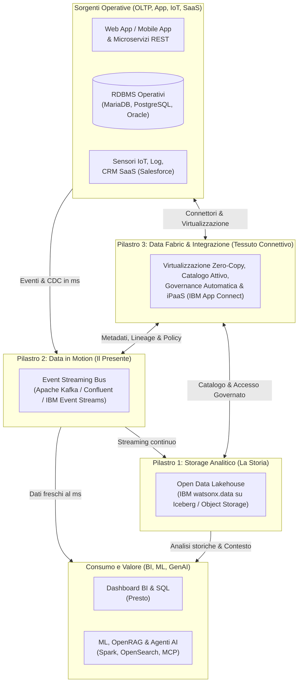

Nei prossimi capitoli esploreremo ciascuno di questi tre pilastri passo dopo passo, partendo dal primo: l'evoluzione dello storage analitico.

---

## 2. L'Evoluzione dello Storage Analitico: da RDBMS a Data Lakehouse

Per capire come le aziende conservino ed elaborino oggi i propri dati analitici, è utile seguire l'evoluzione storica avvenuta negli ultimi quarant'anni: dagli RDBMS degli anni '80 ai **Data Warehouse** degli anni '90, dai **Data Lake** degli anni 2010 fino ai moderni **Data Lakehouse** aperti[^7]. Ogni passaggio non è nato per moda, ma per risolvere un limite tecnico ed economico preciso del modello precedente.

### 2.1 Il Data Warehouse: oltre il singolo RDBMS

Quando negli anni '90 le aziende si resero conto che eseguire report complessi direttamente sul database dell'applicazione (l'RDBMS OLTP) rallentava le operazioni quotidiane dei clienti, nacque l'idea di separare i due ambienti creando un **Data Warehouse** (*magazzino di dati*, spesso abbreviato in **DWH**): un sistema centralizzato dedicato esclusivamente all'analisi storica (**OLAP**) e alla Business Intelligence.

Un errore frequente tra i principianti è pensare che un Data Warehouse sia semplicemente "un database MySQL o PostgreSQL su un server con più RAM e un disco più grande". In realtà, un Data Warehouse moderno (come Snowflake, Amazon Redshift, Google BigQuery, Teradata o IBM Netezza[^2]) è progettato su principi radicalmente diversi rispetto a un RDBMS tradizionale:

1. **Architettura distribuita MPP (*Massively Parallel Processing* — Elaborazione Massivamente Parallela)**:
   Un singolo server RDBMS scala soprattutto in modo *verticale* (aggiungendo CPU e RAM alla stessa macchina), ma oltre una certa soglia incontra limiti fisici e costi esponenziali (come studiato in [Scalabilità verticale vs orizzontale](../../../web/web-docs/distributed-systems/databases/scalability-falut-tolerance/index.md)). Un Data Warehouse moderno è invece un **cluster distribuito** formato da tre ruoli cooperanti[^7]:
   - **Nodo Coordinatore (*Coordinator / Leader Node*)**: riceve la query SQL dall'utente o dallo strumento di BI, ne analizza la sintassi, costruisce il piano di esecuzione ottimizzato (*Query Plan*) e distribuisce il lavoro ai nodi sottostanti, raccogliendone infine i risultati parziali.
   - **Nodi di Calcolo (*Compute Nodes*)**: eseguono la query in parallelo (*Massively Parallel Processing*), ciascuno lavorando simultaneamente su una fetta dei dati.
   - **Nodi di Storage (*Storage Nodes*)**: conservano i dati partizionati e replicati su più macchine per garantire tolleranza ai guasti e velocità di lettura parallela.

2. **Storage orientato alle colonne (*Columnar Storage*) vs orientato alle righe (*Row-Oriented*)**:
   Questo è uno dei concetti più importanti dell'ingegneria dei dati. In un RDBMS tradizionale (come MariaDB InnoDB), i dati di una tabella vengono scritti su disco **riga per riga** (*row-oriented*). Immaginiamo una tabella `Vendite`:

   | `id_vendita` | `data` | `regione` | `categoria` | `importo` |
   | :--- | :--- | :--- | :--- | :--- |
   | 1001 | 2026-01-10 | Lombardia | Elettronica | 499.00 |
   | 1002 | 2026-01-10 | Lazio | Libri | 24.50 |
   | 1003 | 2026-01-11 | Lombardia | Elettronica | 129.00 |

   - **Su disco *Row-oriented* (OLTP)**: i byte vengono memorizzati in sequenza come `[1001, 2026-01-10, Lombardia, Elettronica, 499.00] [1002, 2026-01-10, Lazio, Libri, 24.50] ...`. Questo è velocissimo quando devi inserire un nuovo ordine completo o leggere tutti i dettagli della vendita `1001`, perché i campi stanno tutti nello stesso blocco di disco. Ma se un analista esegue `SELECT SUM(importo) FROM Vendite`, il database è costretto a caricare da disco anche `id_vendita`, `data`, `regione` e `categoria`, sprecando banda I/O!
   - **Su disco *Columnar* (OLAP / Data Warehouse)**: ogni colonna viene memorizzata separatamente insieme alle altre celle della stessa colonna:
     - Colonna `regione`: `[Lombardia, Lazio, Lombardia, ...]`
     - Colonna `importo`: `[499.00, 24.50, 129.00, ...]`
     Se la query chiede `SELECT regione, SUM(importo) FROM Vendite GROUP BY regione`, il motore legge **solo** i blocchi delle colonne `regione` e `importo`, ignorando completamente tutte le altre 50 colonne della tabella. Inoltre, poiché valori dello stesso tipo e spesso ripetitivi (come `"Lombardia"`, `"Lombardia"`, `"Lombardia"`) stanno vicini, gli algoritmi di **compressione colonnare** (come *Run-Length Encoding* o *Dictionary Encoding*) riducono lo spazio su disco fino a 5–10 volte e accelerano enormemente i calcoli in CPU.

3. **Modello *Schema-on-Write* (Schema alla scrittura)**:
   Come in un RDBMS scolastico, nel Data Warehouse la struttura delle tabelle (nomi delle colonne, tipi di dato, vincoli) deve essere progettata e definita **prima** che i dati possano essere inseriti. I dati provenienti dalle sorgenti aziendali devono quindi essere estratti, ripuliti, normalizzati o modellati (spesso in uno *Schema a Stella* con tabelle dei fatti e delle dimensioni) e caricati nel Warehouse. Questo garantisce altissima coerenza e query velocissime per i Business Analyst, ma rende il sistema **rigido**: se cambia la struttura di una sorgente o arrivano dati non tabellari (un PDF, un'immagine, un JSON annidato variabile), il caricamento fallisce.

4. **I *Data Mart***:
   All'interno di un grande Data Warehouse aziendale si creano spesso sottoinsiemi specializzati chiamati **Data Mart**, dedicati a uno specifico reparto (es. Data Mart Vendite, Data Mart Risorse Umane, Data Mart Logistica). Ogni reparto interroga così un perimetro più piccolo, veloce e mirato alle proprie metriche di business.

> [!TIP]
> **Raccordo con il programma del corso**: in 5ª abbiamo studiato come la [normalizzazione](../../../rasd/normalizzazione/index.md) elimini le ridondanze in un database OLTP e come lo [sharding](../../../web/web-docs/distributed-systems/databases/scalability-falut-tolerance/index.md#32-partizionamento-dei-dati-sharding) distribuisca le righe su più server. Il Data Warehouse applica il partizionamento distribuito su scala massiccia (MPP) e abbraccia spesso la denormalizzazione controllata per evitare `JOIN` troppo costosi su miliardi di record.

### 2.2 Il Data Lake: archiviazione flessibile su Object Storage per Big Data e AI

Intorno agli anni 2010, la diffusione di smartphone, applicazioni web ad alto traffico, social media e sensori **IoT** (*Internet of Things*) ha provocato l'esplosione dei **Big Data**, tradizionalmente descritti attraverso le cosiddette "V" (Volume, Velocità, Varietà). Il Data Warehouse tradizionale mostrò due limiti evidenti:

- **Costo elevato**: archiviare decine di petabyte su nodi Data Warehouse specializzati (con storage ad alte prestazioni accoppiato alla potenza di calcolo) diventava proibitivo.
- **Incapacità di gestire dati semi-strutturati e non strutturati**: i modelli di **Machine Learning** e di **Deep Learning** (approfonditi in [Educazione Civica — Intelligenza Artificiale](../../../civica/ai/index.md)) hanno bisogno non solo di tabelle ordinate, ma anche di log testuali grezzi, documenti JSON, immagini, audio, video e serie temporali di sensori.

Nacque così il concetto di **Data Lake** (*lago di dati*): un repository centralizzato capace di raccogliere e conservare **qualsiasi tipo di dato** (strutturato, semi-strutturato e non strutturato) nella sua forma originale e grezza (*raw data*), a qualsiasi scala e a costi estremamente contenuti[^1][^7].

#### Che cos'è l'Object Storage e perché cambia le regole del gioco

Per comprendere il Data Lake bisogna capire la tecnologia su cui poggia quasi sempre oggi: l'**Object Storage** (*archiviazione a oggetti*), come **Amazon S3** (*Simple Storage Service*) o **IBM Cloud Object Storage (COS)**[^2][^7].

A differenza del filesystem gerarchico di Linux o Windows (cartelle annidate e file modificabili byte per byte) o dei volumi locali di un container Docker, un sistema di Object Storage funziona in modo più simile a un enorme dizionario chiave-valore accessibile via API HTTP/HTTPS:

- I file vengono salvati dentro contenitori logici chiamati **bucket** (secchi) come **oggetti** composti da tre elementi: i dati binari grezzi (il contenuto), un **identificatore univoco** (la chiave, es. `logs/2026/11/25/app-01.json`) e **metadati** descrittivi.
- È progettato per una durabilità altissima (replicando automaticamente i dati tra più dischi e zone geografiche), una scalabilità praticamente infinita e un **costo per gigabyte drasticamente inferiore** rispetto ai dischi SSD dei database relazionali o dei Data Warehouse classici.
- **Caratteristica cruciale**: gli oggetti su Object Storage sono **immutabili**. Non puoi aprire un file da 5 GB su S3 e modificarne tre byte nel mezzo; puoi solo leggerne porzioni, sovrascrivere l'intero oggetto o crearne una nuova versione. Vedremo tra poco quanto questo dettaglio tecnico sia decisivo.

#### *Schema-on-Read* vs *Schema-on-Write*

Mentre l'RDBMS e il Data Warehouse applicano il principio **Schema-on-Write** (devi definire le colonne e pulire il dato *prima* di salvarlo), il Data Lake adotta il principio opposto, detto **Schema-on-Read** (*schema alla lettura*)[^7]:

- In fase di ingestione, puoi versare nel Data Lake file CSV, JSON provenienti da sensori IoT, log di Nginx, tabelle estratte da database esterni, immagini e documenti di testo così come sono, senza dover progettare in anticipo uno schema rigido.
- Solo nel momento in cui un Data Scientist o un programma legge i dati per analizzarli o addestrare un modello di AI, il codice applica uno schema interpretativo (decidendo quali campi estrarre, con quali tipi e come filtrare i valori mancanti).

#### Il lato oscuro del Data Lake: *Data Swamp* e *Dark Data*

La totale libertà dello *Schema-on-Read* ha tuttavia un effetto collaterale pericoloso. Se un'azienda riversa per anni milioni di file in un Data Lake senza catalogarli, senza verificarne la qualità, senza documentarne i metadati e senza controllare chi può accedervi, il "lago di dati" cristallino si trasforma rapidamente in una **Data Swamp** (*palude di dati*): un deposito caotico dove nessuno sa quali file siano aggiornati, quali siano corrotti e dove si trovino le informazioni affidabili[^1][^7].

Come documentato nelle fonti IBM citando lo studio *The State of Dark Data* di Splunk[^1][^8], questa mancanza di visibilità e governance genera enormi accumuli di **Dark Data** (*dati oscuri*): dati raccolti e pagati per essere conservati, ma trascurati, ritenuti inaffidabili e di fatto mai analizzati. Le stime indicano che **circa il 60% dei dati aziendali resti inutilizzato** sotto forma di *dark data*[^1][^8].

### 2.3 Matrice di confronto e il dilemma dei due mondi divisi

Mettiamo ora a confronto diretto le tre architetture viste fin qui, così da fissarne con precisione ruolo, costi e compromessi[^7]:

| Caratteristica | RDBMS (es. MariaDB, PostgreSQL) | Data Warehouse (es. Snowflake, BigQuery, Redshift) | Data Lake (es. Object Storage S3 / IBM COS) |
| :--- | :--- | :--- | :--- |
| **Scopo principale** | Transazioni operative in tempo reale (**OLTP**) | Analisi storiche e reportistica BI (**OLAP**) | Big Data, dati grezzi, Machine Learning e AI |
| **Tipo di dati** | Strutturati (tabelle relazionali rigide) | Strutturati (ottimizzati per letture aggregate) | Qualsiasi: strutturati, semi-strutturati (JSON, CSV) e non strutturati (immagini, testo, audio) |
| **Organizzazione fisica** | Orientata alle righe (*Row-oriented*) | Orientata alle colonne (*Columnar*) su cluster MPP | File e oggetti immutabili su Object Storage |
| **Modello di schema** | *Schema-on-Write* (rigido all'ingresso) | *Schema-on-Write* (trasformazione prima del carico) | *Schema-on-Read* (flessibile al momento dell'analisi) |
| **Transazioni ACID** | Complete e native | Supportate sui carichi analitici | Assenti nello storage puro (file grezzi senza lock) |
| **Costo di storage** | Molto alto (SSD veloci, calcolo accoppiato) | Alto | Molto basso (Object Storage cloud/on-prem) |
| **Utente tipico** | Applicazioni web/mobile e microservizi | Business Analyst e manager | Data Scientist, Data Engineer, sistemi di AI/ML |

Negli anni 2010 molte grandi aziende hanno provato a risolvere il problema adottando **entrambi** i sistemi in parallelo (la cosiddetta *architettura a due livelli*): prima raccoglievano tutti i dati grezzi nel **Data Lake** economico, poi scrivevano pipeline notturne per pulire, trasformare e **copiare** i dati strutturati dentro il **Data Warehouse** per la Business Intelligence.

Questa coesistenza forzata ha creato quello che la presentazione definisce il **dilemma dei due mondi divisi**[^7]:

1. **Dati duplicati e costi raddoppiati**: gli stessi dati vengono pagati due volte per lo storage (una volta nel Lake e una volta nel Warehouse) e spesso in formati proprietari diversi. Qual è la "versione corretta della verità" se una correzione viene fatta sul Warehouse ma non sul Lake?
2. **Latenza strutturale**: spostare e trasformare terabyte di dati dal Lake al Warehouse richiede job programmati (*batch job*) che girano di notte o ogni diverse ore. Le dashboard di business lavorano quindi su una fotografia vecchia di ieri.
3. **Pipeline fragili**: ogni cambiamento di schema nelle applicazioni sorgenti può rompere le pipeline di trasferimento tra i due sistemi.
4. **Team isolati**: i Data Engineer e i Data Scientist lavorano sul Data Lake (spesso con Python e Spark), mentre i Business Analyst lavorano sul Data Warehouse (con SQL e strumenti di BI), parlando lingue diverse su copie diverse dei dati.

Da questo vicolo cieco nasce una domanda naturale: *e se potessimo portare l'affidabilità transazionale (ACID), la governance e le alte prestazioni SQL del Data Warehouse direttamente sopra i dati economici, aperti e flessibili del Data Lake, senza doverli duplicare?*

### 2.4 Il Data Lakehouse: convergenza tra flessibilità e prestazioni

La risposta a quella domanda è il **Data Lakehouse** (crasi tra *Data Lake* e *Data Warehouse*)[^1][^2][^7]. Non si tratta semplicemente di mettere un altro database sopra un disco, ma di una vera rivoluzione architetturale fondata su tre pilastri tecnici:

1. **Disaccoppiamento fisico tra Storage e Calcolo (*Compute-Storage Separation*)**:
   I dati restano archiviati in un unico strato di **Object Storage a basso costo** (ad esempio Amazon S3 o IBM Cloud Object Storage). I motori di elaborazione (chiamati *compute engine*) sono invece cluster separati, avviati e scalati dinamicamente solo quando servono per eseguire query SQL, trasformazioni dati o addestramento AI. Se non stai eseguendo calcoli di notte, puoi spegnere i nodi di calcolo pagando solo pochi centesimi per lo storage, mentre durante il giorno puoi scalare orizzontalmente più motori in parallelo sullo stesso patrimonio dati.

2. **Accesso *Zero-Copy* e architettura multi-motore**:
   Poiché i dati risiedono in **formati aperti** standardizzati su Object Storage, motori diversi possono leggere e interrogare esattamente gli stessi file senza doverli copiare, esportare o importare in formati proprietari[^2][^7]. Un motore SQL distribuito come **Presto** può servire una dashboard di Business Intelligence, mentre contemporaneamente **Apache Spark** legge la stessa tabella per addestrare un modello di Machine Learning e **OpenSearch** indicizza i testi per l'Intelligenza Artificiale. Questo elimina il **vendor lock-in** (la dipendenza tecnologica da un unico fornitore commerciale, un rischio che abbiamo già incontrato parlando di GPU e cloud in [Educazione Civica — AI](../../../civica/ai/index.md#il-mercato-delle-gpu-e-il-predominio-di-nvidia)).

3. **Dati *AI-ready* e governance unificata**:
   Un Data Lakehouse moderno integra fin dalla progettazione controlli di accesso, tracciamento dell'origine dei dati (*data lineage*) e qualità verificata, offrendo ad analisti e agenti AI un contesto aziendale affidabile su larga scala[^2].

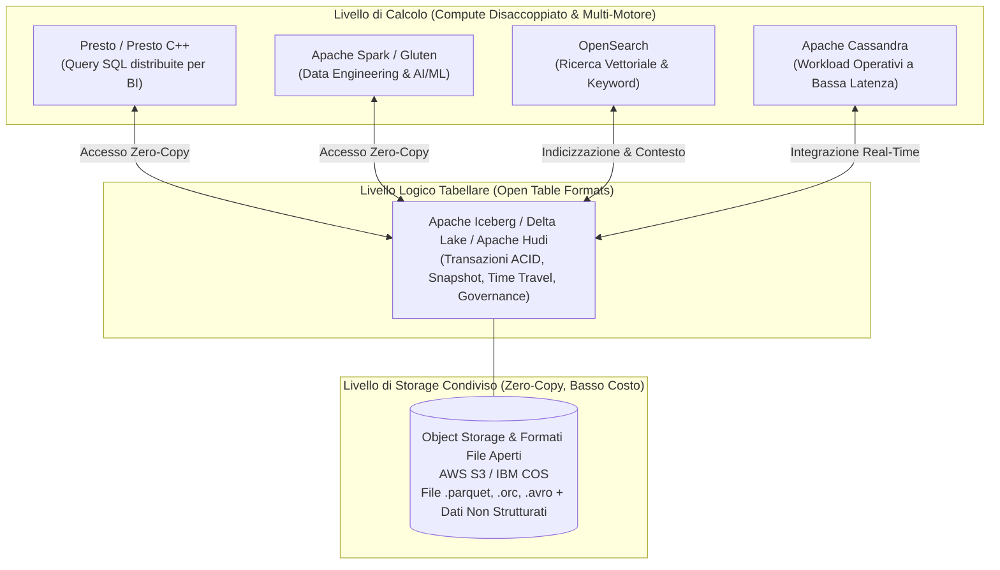

Guardando la storia nel suo insieme, l'evoluzione dello storage analitico si riassume in quattro tappe chiare[^7]:
- **Anni '80 — RDBMS**: strutturato, transazionale (OLTP), centrato sulla singola applicazione.
- **Anni '90 — Data Warehouse**: specializzato per Business Intelligence (OLAP), potente ma costoso e limitato ai dati strutturati.
- **2010s — Data Lake**: esplosione dei Big Data, storage economico di dati grezzi eterogenei su Object Storage, ma rischio di *Data Swamp* e assenza di ACID.
- **Oggi — Data Lakehouse**: convergenza tra i due mondi grazie a formati tabellari aperti, calcolo disaccoppiato multi-motore, accesso *zero-copy* e preparazione dati per l'Intelligenza Artificiale generativa.

### 2.5 Il segreto tecnico del Lakehouse: formati aperti e Open Table Formats

Arriviamo ora a uno dei concetti tecnici più interessanti dell'intera guida: **come fa un Data Lakehouse a offrire `UPDATE`, `DELETE`, `MERGE` e transazioni ACID sopra file su Object Storage (come S3) che per natura sono immutabili?**[^7]

Per capirlo, dobbiamo distinguere due livelli che spesso vengono confusi: il **formato dei file** e il **formato delle tabelle (Open Table Format)**.

#### Livello 1: I formati di file aperti (*Parquet, ORC, Avro*)

Su un Object Storage i dati non stanno in un formato segreto di un singolo vendor, ma in formati open source standardizzati[^2]:

- **Apache Parquet**: è oggi il formato colonnare aperto più diffuso nell'ecosistema Big Data e Lakehouse. Memorizza le tabelle per colonne (con statistiche min/max per ogni blocco di righe e compressione elevata), permettendo ai motori come Spark e Presto di saltare interi blocchi di dati inutili (*predicate pushdown*).
- **Apache ORC (*Optimized Row Columnar*)**: un altro formato colonnare ad altissima compressione, molto diffuso nell'ecosistema Hadoop/Hive.
- **Apache Avro**: formato binario aperto *orientato alle righe* con schema JSON integrato; è particolarmente adatto per trasmettere e serializzare eventi uno dopo l'altro in streaming (ad esempio con Apache Kafka) prima della conversione analitica.

##### Come fa un file Apache Parquet a far volare le query SQL?

Per capire perché Parquet sia molto più veloce di un enorme file CSV su Object Storage, osserviamo come è organizzato internamente:
- Un file `.parquet` viene suddiviso orizzontalmente in blocchi chiamati **Row Groups** (gruppi di righe, ad esempio da 128 MB ciascuno).
- All'interno di ogni *Row Group*, i dati non sono mescolati riga per riga, ma raggruppati in **Column Chunks** (un blocco per la sola colonna `data`, uno per `regione`, uno per `importo`).
- Alla fine del file (nel **Footer**), Parquet conserva i metadati con i valori **minimo e massimo** di ciascuna colonna per ogni *Row Group*.

Immagina di lanciare la query:

```sql
SELECT SUM(importo)
FROM vendite_parquet
WHERE regione = 'Lombardia' AND anno = 2026;
```

Un file CSV costringerebbe il computer a leggere ogni singolo carattere dall'inizio alla fine per cercare `'Lombardia'` e `2026`. Con Parquet, invece, il motore di query legge prima il piccolo *Footer*:
1. Scarta subito tutte le colonne diverse da `regione`, `anno` e `importo` (*column pruning*).
2. Se nel *Row Group 1* il valore massimo di `anno` è `2024`, salta interamente quel blocco senza nemmeno scaricarlo dall'Object Storage (*row group skipping* / *predicate pushdown*).
3. Scarica e decomprime dalla rete solo i piccoli chunk rilevanti di `2026`!

#### Livello 2: Il problema dell'immutabilità e gli *Open Table Formats*

Immagina di avere una tabella `Clienti` memorizzata su AWS S3 come una cartella contenente 200 file `.parquet` da 5 GB ciascuno. Un utente esercita il proprio [diritto alla cancellazione previsto dal GDPR](../../../web/web-docs/gdpr/index.md#diritti-degli-interessati-%EF%B8%8F) e tu devi eseguire `DELETE FROM Clienti WHERE id_cliente = 99412`, oppure un `UPDATE` su una singola riga.

Sui file grezzi di un Data Lake classico nasce un problema enorme:
1. I file `.parquet` su Object Storage sono **immutabili**: non puoi modificare una singola riga dentro un file da 5 GB senza riscrivere l'intero file.
2. Mentre riscrivi i file, un altro motore di query che sta leggendo la cartella potrebbe vedere metà file vecchi e metà file nuovi, leggendo dati **incoerenti** (violazione dell'isolamento ACID!).
3. Se il job di scrittura va in crash a metà operazione, la tabella resta corrotta.

La soluzione a questo problema si chiama **Open Table Format (OTF)** — formato tabellare aperto. I tre principali standard open source citati nelle fonti sono **Apache Iceberg**, **Delta Lake** e **Apache Hudi**[^2][^7].

Invece di far leggere direttamente ai motori una lista disordinata di file in una cartella, un Open Table Format come **Apache Iceberg** introduce un **registro logico di metadati a più livelli** che trasforma un insieme di file statici immutabili in una vera tabella transazionale:

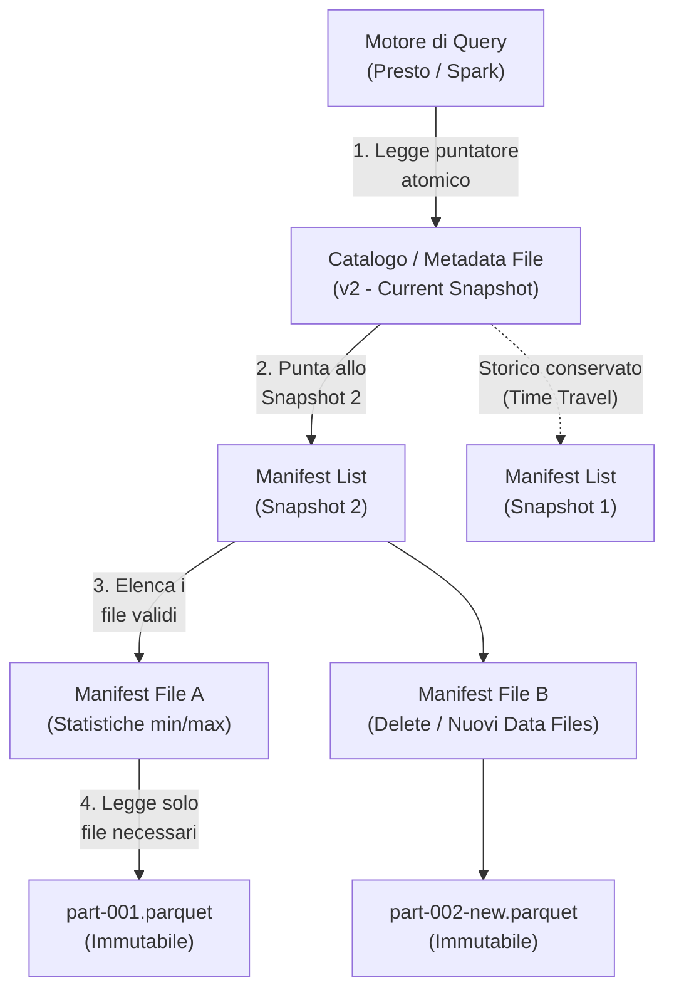

Ecco che cosa abilita concretamente questa architettura a **Snapshot** (fotografie immutabili dello stato della tabella)[^7]:

1. **Transazioni ACID su trilioni di righe**:
   Quando esegui un `UPDATE`, un `DELETE` o un `MERGE`, il motore non tocca i vecchi file `.parquet` che gli altri utenti stanno ancora leggendo. Crea invece nuovi file di dati (o piccoli *delete files* che marcano le righe eliminate), scrive nuovi *Manifest* e infine aggiorna **con un'unica operazione atomica** il puntatore al `Current Snapshot` nel catalogo. Chi stava già leggendo lo `Snapshot 1` continua a vedere uno stato perfettamente coerente; chi avvia una query un millisecondo dopo vede lo `Snapshot 2`. Se l'operazione fallisce prima del commit finale, lo `Snapshot 1` resta intatto.
2. **Time Travel (*Viaggio nel tempo*)**:
   Poiché gli snapshot precedenti restano tracciati finché non vengono ripuliti (*expiration*), è possibile interrogare esattamente lo stato della tabella com'era ieri, la settimana scorsa o prima di un bug applicativo:
   ```sql
   -- Esempio concettuale di Time Travel e MERGE INTO su una tabella Apache Iceberg
   SELECT COUNT(*), SUM(importo)
   FROM lakehouse.vendite.ordini
   FOR TIMESTAMP AS OF '2026-11-24 23:59:59';

   -- Aggiornamento incrementale ACID (Upsert) dai nuovi eventi giornalieri
   MERGE INTO lakehouse.vendite.ordini AS target
   USING staging_ordini_oggi AS src
   ON target.id_ordine = src.id_ordine
   WHEN MATCHED THEN
       UPDATE SET target.stato = src.stato, target.importo = src.importo
   WHEN NOT MATCHED THEN
       INSERT (id_ordine, id_cliente, stato, importo)
       VALUES (src.id_ordine, src.id_cliente, src.stato, src.importo);
   ```
   Questo è preziosissimo sia per il debugging e gli audit legali, sia per la **riproducibilità dei modelli di Machine Learning** (poter rigenerare esattamente il dataset usato per addestrare un modello tre mesi fa).

##### Esempio passo-passo: che cosa succede su disco durante un `DELETE` GDPR in Iceberg?

Supponiamo che la tabella `Clienti` nello `Snapshot 1` punti a tre file immutabili: `part-001.parquet`, `part-002.parquet` e `part-003.parquet`. Arriva una richiesta di cancellazione (`DELETE FROM Clienti WHERE id_cliente = 99412`), e sappiamo che quel cliente si trova dentro `part-002.parquet`:
1. **Nessuna modifica distruttiva**: `part-002.parquet` non viene toccato.
2. **Strategia *Copy-on-Write* oppure *Merge-on-Read***:
   - In modalità *Copy-on-Write* (ideale per letture velocissime), Iceberg scrive un nuovo file `part-002-v2.parquet` identico al precedente ma senza la riga `99412`, poi crea uno `Snapshot 2` che punta a `part-001.parquet`, `part-002-v2.parquet` e `part-003.parquet`.
   - In modalità *Merge-on-Read* (ideale per scritture e cancellazioni molto frequenti), Iceberg scrive soltanto un piccolissimo **Delete File** che annota *"nel file `part-002.parquet` ignora la riga con `id_cliente = 99412`"* e pubblica lo `Snapshot 2` in pochi millisecondi. In seguito, un processo periodico di **compattazione** (*compaction*) ripulirà fisicamente i file obsoleti fondendoli in nuovi file Parquet puliti.
3. **Schema Evolution e Partition Evolution senza riscrivere i dati**:
   Puoi aggiungere, rinominare o cambiare tipo a una colonna — o persino cambiare il criterio di partizionamento (ad esempio passare da partizionamento mensile a giornaliero) — aggiornando solo i metadati di Iceberg, senza dover riscrivere petabyte di file storici.
4. **Addio al Vendor Lock-in**:
   Poiché Apache Iceberg e Delta Lake sono standard aperti supportati da decine di piattaforme (IBM watsonx.data, Spark, Presto, Trino, Snowflake, Databricks, Confluent Tableflow), i dati restano sempre di proprietà dell'azienda e leggibili da motori diversi.

> [!TIP]
> **Raccordo con il programma del corso**: nel modulo sulle [Transazioni SQL](../../../sql/sql-docs/sql-p9/index.md) hai imparato che `START TRANSACTION` / `COMMIT` / `ROLLBACK` garantiscono le proprietà ACID in un singolo RDBMS. Gli Open Table Formats come Apache Iceberg portano esattamente quelle stesse garanzie ACID su file immutabili distribuiti nell'Object Storage del cloud.

### 2.6 Caso reale di Data Lakehouse aperto: IBM watsonx.data

Per vedere come tutti questi concetti teorici prendano forma in una piattaforma reale adottata dalle aziende, analizziamo **IBM watsonx.data**, uno dei prodotti centrali documentati nelle fonti del notebook[^2][^7].

**IBM watsonx.data** è definito come un **data lakehouse ibrido e aperto** (*open hybrid data lakehouse*) progettato per eseguire carichi di lavoro di Intelligenza Artificiale, Business Intelligence, ricerca e applicazioni operative scegliendo di volta in volta il motore più adatto al compito, sopra dati conservati in formati aperti con accesso *zero-copy* e governance integrata[^2].

#### Flessibilità di deployment (ibrido e multicloud)

A differenza di soluzioni legate a un solo fornitore cloud, watsonx.data può essere eseguito ovunque risiedano i dati aziendali, rispettando vincoli normativi (sovranità dei dati, GDPR), di sicurezza e di latenza[^2]:
- **SaaS (*Software as a Service*)**: servizio completamente gestito nel cloud (es. su AWS o IBM Cloud) per partire rapidamente senza gestire l'infrastruttura.
- **On-premise / Autogestito**: installabile nei data center privati dell'azienda (su container e cluster Kubernetes/OpenShift, collegandosi a quanto visto su [Docker e orchestrazione](../../../cloud/docs/virtualization-technologies/index.md)).
- **BYOC (*Bring Your Own Cloud*) e VPC gestiti dal cliente**: il piano di controllo gestito incontra i dati direttamente dentro il **VPC** (*Virtual Private Cloud*) controllato dal cliente, bilanciando comodità operativa e sovranità dei dati[^2].

#### Architettura multi-motore: un motore specializzato per ogni workload

In un'azienda non ha senso usare un martello per avvitare una vite: far eseguire query SQL interattive leggere a un motore pesante per il Machine Learning spreca soldi, così come usare un database transazionale per indicizzare milioni di PDF è inefficiente. watsonx.data risolve questo problema con un'**architettura multi-motore** (*fit-for-purpose*) che condivide lo stesso strato di formati aperti (**Apache Iceberg**, **Delta Lake**, **Apache Hudi**, **ORC**, **Avro**) su **AWS S3** e **IBM Cloud Object Storage**[^2]:

| Motore integrato in watsonx.data | Tipologia | Workload ideale | Punti di forza tecnici |
| :--- | :--- | :--- | :--- |
| **Presto** e **Presto C++** | Motore SQL distribuito | Business Intelligence (BI), reportistica, analisi interattive, federazione di query | Esecuzione SQL parallela ad alte prestazioni su più sorgenti; anteprima tecnica di **accelerazione GPU** per ridurre tempi e costi[^2] |
| **Apache Spark** e **Gluten (Spark C++)** | Motore di analytics unificato | Ingegneria dei dati, trasformazioni su larga scala (ELT), training modelli **AI/ML** | Elaborazione distribuita in memoria su petabyte; **Gluten** accelera Spark sfruttando codice nativo C++ |
| **OpenSearch** | Motore di ricerca distribuito | Applicazioni di ricerca enterprise, **Generative AI** e **RAG** (*Retrieval-Augmented Generation*) | Ricerca ibrida unificata di **vettori** (similarità semantica) e **parole chiave** (keyword) sensibile al contesto |
| **Apache Cassandra** (*DataStax Astra DB*) | Database NoSQL distribuito | Applicazioni web/mobile ad alto traffico e agenti AI in tempo reale | Letture e scritture operazionali rapidissime a bassa latenza e scalabilità lineare senza singolo punto di guasto |

Accanto a questi quattro motori centrali, watsonx.data funge da livello unificante capace di connettersi allo stack già presente in azienda: database relazionali (PostgreSQL, MySQL, Oracle, SQL Server), database NoSQL (MongoDB, Elasticsearch), Data Warehouse (Snowflake, Databricks, Teradata, Netezza), sistemi di streaming e orchestrazione (Apache Kafka, Apache Flink, Apache Airflow, Informatica, Talend, DataStage, Fivetran, Airbyte) e strumenti di governance (Collibra, Alation, Apache Ranger, Apache Atlas)[^2].

#### Governance nativa, modelli di utilizzo e riscontri di mercato

Un punto qualificante sottolineato nella documentazione di watsonx.data è che la **governance è integrata e non aggiunta in un secondo momento**: controlli di accesso, politiche di sicurezza, tracciamento del *data lineage* e segnali di qualità accompagnano il dato dall'origine fino all'output finale di BI o AI[^2]. Questo risponde direttamente all'allarme economico evidenziato da Forrester nel luglio 2024: milioni di dollari persi per la scarsa qualità dei dati rischiano di trasformarsi in miliardi persi con l'adozione dell'AI se non si interviene sulla qualità e sul governo dei dati[^12].

Dal punto di vista dell'adozione e dei costi, le fonti riportano piani flessibili (*Pay-Per-Use* a partire da \$1,00 USD per Resource Unit e *Subscription* a partire da \$83,30 USD al mese su AWS)[^2], oltre a diversi riconoscimenti di settore del periodo 2025–2026: *Leader* nel Gartner Magic Quadrant 2025 per gli strumenti di integrazione dei dati, vincitore del *TrustRadius 2026 Buyer's Choice Award* nella categoria Data Lakehouse e miglior prodotto di gestione IT nei *G2 Best Software Awards 2026*[^2].

Ma c'è un aspetto che il solo Lakehouse non può risolvere da solo: **i dati di un'azienda non vivono quasi mai in un unico luogo**. Nel prossimo capitolo vedremo come governare e collegare dati sparsi tra decine di sistemi diversi senza doverli spostare tutti fisicamente.

---

## 3. Data Gravity, Data Fabric, Governance e Integrazione dei Dati

Nei progetti scolastici tutti i dati di un'applicazione risiedono in un solo database MariaDB o SQL Server locale. Nel mondo reale, invece, la mappa dei dati di una media o grande azienda assomiglia a un arcipelago di isole scollegate tra loro. Capire perché questo accada e come si possa costruire un "tessuto connettivo" intelligente sopra questa frammentazione è il tema del presente capitolo.

### 3.1 Il caos dell'Enterprise IT: silos informativi, Data Gravity e Dark Data

Nel corso degli anni, un'organizzazione aziendale accumula sistemi informativi costruiti in epoche diverse e da fornitori diversi[^1][^7]:
- **Server *on-premise* (legacy)**: vecchi gestionali, database Oracle o SQL Server ospitati nei server interni dell'azienda, talvolta persino sistemi mainframe ancora vitali per la contabilità.
- **Ambienti *multicloud* e *hybrid cloud***: nuovi microservizi distribuiti su AWS, analisi su Azure, un Lakehouse su IBM Cloud.
- **Piattaforme SaaS (*Software as a Service*)**: applicativi in abbonamento esterni come Salesforce (per la gestione dei clienti, CRM), Workday (per le risorse umane), piattaforme di e-commerce o di ticket di assistenza.

Questa stratificazione produce due problemi critici che ogni architetto dei dati deve affrontare:

1. **Silos informativi (*Data Silos*) e frammentazione**:
   Il reparto Risorse Umane ha il proprio database, il reparto Vendite usa Salesforce, la Logistica usa un proprio gestionale e il sito web usa PostgreSQL. I dati relativi allo stesso cliente o allo stesso prodotto esistono in più posti con nomi e formati differenti, ma **i sistemi non si parlano**. Secondo uno studio del 2025 dell'IBM Institute for Business Value (IBV), il **50% dei CEO** dichiara che la tecnologia della propria organizzazione è disconnessa a causa del ritmo frenetico degli investimenti recenti[^1][^9]. Questa disconnessione alimenta l'accumulo di **Dark Data** (circa il **60% dei dati aziendali**, secondo Splunk[^1][^8]) e genera un forte divario di percezione sull'AI: uno studio IBM IBV del 2024 mostra che, mentre il **67% dei CFO** ritiene che i vertici aziendali dispongano dei dati necessari per capitalizzare le nuove tecnologie, **solo il 29% dei leader tecnologici** conferma che quei dati abbiano effettivamente la qualità, l'accessibilità e la sicurezza richieste per scalare l'Intelligenza Artificiale generativa[^1][^10].

2. **Data Gravity (*Gravità dei Dati*)**:
   In fisica, più un oggetto ha massa, più attrae gli altri corpi e più energia serve per spostarlo. Nell'informatica vale una metafora identica, formulata come *Data Gravity*: **più il volume dei dati cresce, più diventa difficile, costoso e lento spostarli**[^1][^7].
   Provare a copiare continuamente petabyte di dati da un cloud all'altro o dai server *on-premise* verso un unico database centrale si scontra con quattro muri reali:
   - **Banda e latenza di rete**: trasferire terabyte via rete richiede ore e satura i collegamenti.
   - **Costi di uscita (*egress fees*)**: i provider cloud fanno pagare profumatamente l'estrazione di grandi volumi di dati verso l'esterno.
   - **Duplicazione incontrollata**: ogni copia rischia di disallinearsi dall'originale nel giro di pochi minuti.
   - **Vincoli normativi**: leggi sulla privacy come il [GDPR](../../../web/web-docs/gdpr/index.md) o normative bancarie e sanitarie spesso **vietano** di esportare certi dati personali al di fuori di una specifica area geografica o di un data center certificato.

### 3.2 Il paradigma Data Fabric: il tessuto connettivo intelligente

Per superare sia la rigidità della centralizzazione forzata (copiare tutto in un unico posto) sia il caos della frammentazione totale, nasce il paradigma del **Data Fabric** (*tessuto di dati*)[^1][^7].

> [!IMPORTANT]
> **Che cos'è — e che cosa NON è — un Data Fabric**:
> Un Data Fabric **non è un singolo prodotto software e non è un nuovo database** in cui riversare i dati[^1]. È un **approccio architetturale logico e unificato** che si stende *sopra* gli ambienti on-premise, multicloud e SaaS esistenti, collegandoli come un tessuto intelligente. L'obiettivo è **democratizzare l'accesso ai dati** (renderli scopribili e usabili in sicurezza anche da chi non è uno sviluppatore) **lasciando i dati esattamente dove si trovano**[^1][^7].

Come fa un Data Fabric a realizzare questa apparente magia? Secondo la documentazione IBM[^1], poggia su **tre pilastri tecnologici cooperanti**:

#### 1. Virtualizzazione dei dati (*Data Virtualization*)

La **virtualizzazione dei dati** consente di interrogare fonti eterogenee distribuite senza spostare fisicamente i dati (*zero-ETL* / *zero-copy*)[^1][^7]. Invece di copiare le tabelle da Oracle on-premise, dai documenti JSON di MongoDB su Cloud A e dalle tabelle Iceberg del Lakehouse su Cloud B dentro un altro server, un motore di virtualizzazione si connette alle sorgenti, legge solo i metadati di struttura ed espone all'utente finale o all'applicazione una **vista logica unificata** (*Virtual View*).

Immagina di scrivere una semplice query SQL:

```sql
SELECT *
FROM clienti_globali
WHERE paese = 'Italia' AND stato_ordine = 'IN_RITARDO';
```

Dietro le quinte, il "nodo virtuale" traduce questa singola richiesta nelle chiamate native verso Oracle, MongoDB e il Lakehouse, applica i filtri direttamente sulle sorgenti quando possibile (*pushdown*), combina i risultati al volo in memoria e restituisce un'unica tabella coerente in tempo reale — non un backup vecchio di ventiquattr'ore[^7].

> [!TIP]
> **Raccordo con il programma del corso**: nelle lezioni di SQL avanzato sulle [Viste (`CREATE VIEW`)](../../../sql/sql-docs/sql-p8/index.md) abbiamo visto come una vista sia una tabella virtuale che nasconde all'utente la complessità dei `JOIN` sottostanti senza duplicare i dati. La Data Virtualization estende esattamente l'idea della `VIEW` SQL dal singolo database locale a decine di database e cloud eterogenei distribuiti nel mondo!

#### 2. Metadati attivi federati (*Federated Active Metadata*)

I **metadati** sono "i dati sui dati": ci dicono come si chiama una colonna, qual è il suo tipo, chi ne è il proprietario aziendale, se contiene informazioni personali riservate e quando è stata aggiornata l'ultima volta.
- Nei sistemi tradizionali i metadati sono **passivi**: vengono scritti a mano da un amministratore in un documento Excel o in una wiki e diventano obsoleti nel momento stesso in cui qualcuno aggiunge una colonna al database.
- Nel Data Fabric i metadati sono **attivi e federati**: il sistema usa **grafi di conoscenza (*Knowledge Graphs*)** semantici e algoritmi di AI/ML per scansionare continuamente tutte le sorgenti connesse, scoprire relazioni nascoste (ad esempio capire automaticamente che la colonna `cust_tax_id` in un DB e `codice_fiscale` in un altro indicano lo stesso concetto di business), profilare la qualità dei valori, classificare i dati sensibili e generare avvisi automatici quando qualcosa cambia[^1].

#### 3. Intelligenza Artificiale e Machine Learning integrati

Il Machine Learning trasforma il tessuto connettivo da semplice elenco passivo in un sistema parzialmente autogestito: suggerisce automaticamente quali dataset possono essere uniti tra loro, rileva anomalie improvvise nei flussi, applica automaticamente le regole di mascheramento sui campi sensibili riconosciuti e ricostruisce il percorso completo (*data lineage*) di ogni dato dall'origine fino al report finale[^1].

### 3.3 Architettura a 6 livelli e 5 funzionalità chiave del Data Fabric

Secondo l'analisi di settore Forrester citata nelle fonti (*Enterprise Data Fabric Enables DataOps*)[^1][^11], un'architettura Data Fabric completa si articola tipicamente in **sei livelli funzionali**:

1. **Gestione dei dati (*Data Management*)**: il livello trasversale responsabile della governance, delle politiche di sicurezza, della privacy e del controllo della qualità dei dati.
2. **Acquisizione dei dati (*Data Ingestion*)**: raccoglie e collega nel fabric i flussi provenienti dalle sorgenti on-premise, cloud e SaaS (in batch, in streaming o tramite Change Data Capture).
3. **Trattamento dei dati (*Data Processing & Preparation*)**: pulisce, convalida, riconcilia, arricchisce e trasforma i dati grezzi (*data wrangling*), rendendoli coerenti e affidabili per gli utenti aziendali.
4. **Orchestrazione dei dati (*Data Orchestration*)**: coordina la sequenza di esecuzione e le dipendenze tra i vari compiti di trasformazione e movimento dati. In ambito professionale questa orchestrazione viene quasi sempre modellata come un **DAG** (*Directed Acyclic Graph* — Grafo Aciclico Diretto): un grafo orientato privo di cicli dove ogni nodo è un'operazione (es. "estrai tabella", "pulisci nulli", "calcola aggregato", "aggiorna catalogo") e le frecce indicano quali compiti devono terminare prima che altri possano partire.
5. **Scoperta dei dati (*Data Discovery*)**: mette a disposizione un **Data Catalog** potenziato dai metadati attivi per cercare, esplorare e comprendere gli asset disponibili senza dover chiedere ogni volta al reparto IT dove si trovi una certa informazione.
6. **Accesso ai dati (*Data Access*)**: espone i dati pronti attraverso dashboard di BI, query SQL, API REST/GraphQL o connettori per l'AI, facendo rispettare rigorosamente le autorizzazioni di accesso.

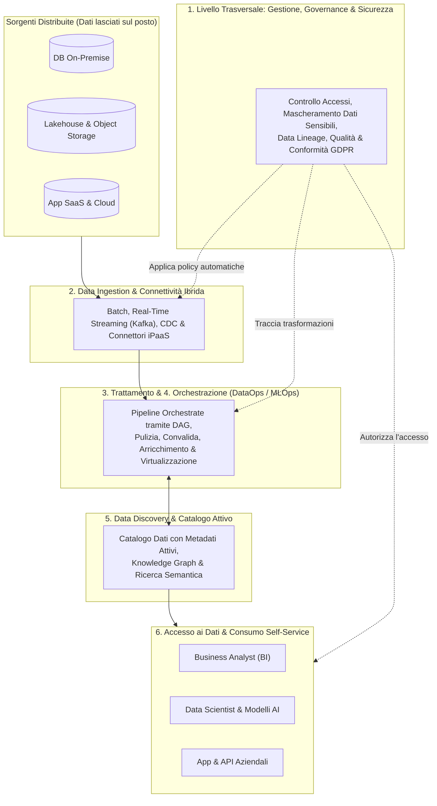

Dal punto di vista operativo, IBM sintetizza il valore di un Data Fabric attraverso **cinque funzionalità principali** e **quattro benefici aziendali**[^1]:

- **Le 5 funzionalità principali**:
  1. **Cataloghi dati**: librerie ricercabili organizzate tramite metadati attivi, tassonomie di business, proprietari e asset correlati.
  2. **Integrazione dei dati**: combinazione intelligente tra elaborazione *batch*, integrazione *in tempo reale* e *Change Data Capture (CDC)*, ottimizzando costi e prestazioni.
  3. **Governance e sicurezza dei dati**: applicazione automatica di regole di accesso e protezione legate ai tag dei metadati.
  4. **Accesso ai dati self-service**: un vero **Data Marketplace interno** in cui data engineer, data scientist e analisti possono cercare, profilare, etichettare, annotare e commentare i dataset, riducendo drasticamente i colli di bottiglia verso il reparto IT.
  5. **Ciclo di vita unificato**: gestione integrata dalla creazione al monitoraggio continuo delle pipeline dati e AI attraverso pratiche **DataOps** (l'applicazione dei principi DevOps all'automazione, test e qualità delle pipeline di dati) e **MLOps** (*Machine Learning Operations*, la gestione continua del ciclo di vita dei modelli di ML in produzione).

- **I 4 benefici aziendali concreti**:
  - **Aumenti di efficienza**: meno lavoro manuale ripetitivo, meno duplicazione di storage, decisioni più rapide.
  - **Democratizzazione dei dati**: accesso sicuro esteso anche a chi non scrive codice complesso.
  - **Rischio ridotto**: maggiore visibilità sui dati sensibili e applicazione coerente delle norme di sicurezza.
  - **Scalabilità e agilità**: architettura modulare che scala sia orizzontalmente (volumi crescenti) sia verticalmente (prestazioni di elaborazione).

### 3.4 Governance dei dati, Data Lineage, Data Quality e raccordo con sicurezza e GDPR

Un dubbio legittimo per chi ha studiato sicurezza web e privacy è il seguente: *se il Data Fabric "democratizza" i dati permettendo a molti utenti di cercarli in autonomia, non aumenta enormemente il rischio di fughe di dati o violazioni della privacy?*

La risposta è no **solo se** la **Data Governance** è automatizzata e applicata prima che il dato raggiunga l'utente o il modello AI[^1][^2][^7]. In un sistema enterprise moderno la governance comprende quattro pilastri tecnici precisi:

1. **Controlli di accesso basati su metadati e ruoli**:
   In SQL scolastico abbiamo studiato i comandi `GRANT` e `REVOKE` in [DBMS e sicurezza](../../../sql/sql-docs/sql-p4/index.md) e la creazione di utenti con privilegi minimi nel progetto [EducationalGames](../../../docker/docker-docs/local-dev/examples/educationalgames/index.md). Su centinaia di sistemi eterogenei, gestire manualmente i permessi tabella per tabella diventa impossibile. Strumenti come **Apache Ranger** (spesso affiancato a **Apache Atlas**, **Collibra** o **Alation**[^2]) permettono di scrivere regole centralizzate basate su attributi e tag: ad esempio, *"qualsiasi colonna etichettata nei metadati come `PII` (Personally Identifiable Information) può essere letta in chiaro solo dal gruppo `HR_Payroll`"*.

2. **Mascheramento dinamico dei dati (*Dynamic Data Masking*) e crittografia**:
   Quando un analista marketing o un modello di AI interroga una tabella virtualizzata o un Lakehouse, il motore di governance applica automaticamente il **mascheramento** sui campi sensibili prima che il risultato esca dal sistema (mostrando ad esempio `mario.r***@azienda.it` oppure `****-****-****-1234`), garantendo al contempo la crittografia dei dati sia **a riposo (*at rest*)** su disco sia **in movimento (*in transit*)** sulla rete[^1][^5][^7].

3. **Data Lineage (*Lignaggio / Tracciabilità dei Dati*)**:
   Il **Data Lineage** è la "carta d'identità storica" di ogni dato: ricostruisce automaticamente da quale tabella sorgente proviene un numero mostrato in una dashboard, quali pipeline lo hanno trasformato, quali formule sono state applicate e chi lo ha consultato. In caso di verifica legale, errore di bilancio o audit di un sistema di Intelligenza Artificiale (come richiesto dall'**AI Act europeo** studiato in [Educazione Civica — AI](../../../civica/ai/index.md#il-quadro-normativo-ai-act-e-risoluzione-onu)), il *lineage* permette di dimostrare con precisione l'affidabilità dei dati utilizzati.

4. **Data Quality e Data Observability**:
   Le fonti classificano la qualità dei dati su più dimensioni fondamentali — **accuratezza**, **integrità**, **affidabilità** — contrapposte ai problemi di **dati sporchi** (*dirty data*), **dati errati** (*bad data*), **dati obsoleti** (*stale data*) e **dark data**[^1]. La **Data Observability** monitora in modo continuo la salute delle pipeline dati (esattamente come Prometheus e Grafana monitorano le prestazioni dei container in [EducationalGames](../../../docker/docker-docs/local-dev/examples/educationalgames/index.md)), avvisando i team se un flusso si interrompe o se improvvisamente il 40% dei record arriva con campi `NULL`.

> [!TIP]
> **Raccordo con il programma del corso — GDPR**: nel modulo [Cenni al GDPR](../../../web/web-docs/gdpr/index.md) abbiamo studiato i principi di *minimizzazione*, *esattezza*, *limitazione della conservazione*, *integrità e riservatezza* e *responsabilizzazione (accountability)*, oltre alle pesanti sanzioni (fino a 20 milioni di euro o il 4% del fatturato mondiale annuo). Il Data Fabric, i cataloghi con metadati attivi, la Data Virtualization e il Data Lineage sono proprio gli strumenti tecnici che consentono a una grande azienda di rispettare il GDPR su migliaia di dataset distribuiti, evitando copie incontrollate e garantendo di sapere sempre dove si trovano i dati personali di un cittadino.

### 3.5 Data Fabric, Data Mesh e Data Lakehouse a confronto

Nella letteratura moderna sui dati si incontrano spesso tre termini dal suono simile: **Data Lakehouse**, **Data Fabric** e **Data Mesh**. Poiché anche le fonti IBM li confrontano esplicitamente[^1], è fondamentale non confonderli: **non sono tecnologie concorrenti tra cui sceglierne una sola, ma concetti che operano su piani diversi** (rispettivamente piano dello storage/calcolo, piano dell'integrazione/metadati e piano organizzativo).

- **Data Lakehouse**: è la **piattaforma fisica e logica di storage e calcolo** (come watsonx.data) che unifica su Object Storage e Open Table Formats (Iceberg/Delta) sia i carichi analitici da Warehouse sia i dati flessibili da Data Lake.
- **Data Fabric**: è lo **strato tecnologico connettivo intelligente** che abbraccia *tutte* le piattaforme aziendali (Lakehouse inclusi, ma anche vecchi DB on-premise e app SaaS), usando metadati attivi, virtualizzazione e AI per automatizzare integrazione, scoperta e governance.
- **Data Mesh**: è un **modello architetturale e organizzativo decentralizzato**[^1]. Invece di avere un unico team centrale di Data Engineer che riceve richieste da tutta l'azienda (creando un collo di bottiglia), il Data Mesh assegna la proprietà dei dati direttamente ai singoli **domini aziendali** (es. il dominio *Vendite*, il dominio *Logistica*, il dominio *Servizio Clienti*). Ogni dominio pubblica i propri dati puliti, documentati e affidabili come veri e propri **Data Products (*prodotti di dati*)** consumabili dagli altri reparti tramite interfacce standard.

Come nota IBM[^1], **Data Fabric e Data Mesh coesistono e si potenziano a vicenda**: mentre il Data Mesh stabilisce *chi è responsabile* di quali dati per dominio aziendale, il Data Fabric fornisce gli strumenti tecnici automatizzati (catalogo federato, virtualizzazione, regole di governance condivise) affinché i diversi domini possano creare Data Products coerenti e sicuri senza reinventare tutto da zero.

| Dimensione | Data Lakehouse | Data Fabric | Data Mesh |
| :--- | :--- | :--- | :--- |
| **Che cos'è in sintesi** | Piattaforma di storage + calcolo multi-motore su formati aperti | Architettura logica di integrazione, virtualizzazione e governance automatizzata | Modello organizzativo e architetturale decentralizzato per domini |
| **Problema risolto** | Eliminare la separazione e duplicazione tra Data Lake e Data Warehouse | Superare i silos informativi e la *Data Gravity* attraverso ambienti ibridi | Evitare il collo di bottiglia del team dati centralizzato |
| **Approccio ai dati** | Dati archiviati in formati aperti (Iceberg/Delta) su Object Storage | Dati lasciati nelle sorgenti (RDBMS, SaaS, Lakehouse) e connessi logicamente | Ogni dominio aziendale produce e gestisce i propri *Data Products* |
| **Elemento chiave** | Open Table Formats, disaccoppiamento storage/calcolo, motori multipli | Metadati attivi federati, Knowledge Graph, Data Virtualization, AI/ML | Proprietà per dominio, governance federata computazionale |
| **Esempio / Riferimento** | IBM watsonx.data, Apache Iceberg, Spark, Presto | Architettura Data Fabric IBM (con cataloghi attivi e virtualizzazione) | Organizzazione aziendale per domini *Vendite*, *Ordini*, *Logistica* |

### 3.6 Dizionario dell'ingegnere dei dati: ETL, ELT, CDC e Virtualizzazione

Per collegare fisicamente o logicamente i database delle applicazioni ai sistemi analitici (Warehouse, Lakehouse) o ad altri servizi, gli ingegneri dei dati utilizzano quattro pattern fondamentali[^1][^7]. Conoscerli permette di leggere qualsiasi schema architetturale aziendale:

1. **ETL (*Extract, Transform, Load* — Estrai, Trasforma, Carica)**:
   È l'approccio classico nato con i Data Warehouse degli anni '90.
   - *Come funziona*: un server intermedio **estrae** i dati dai database sorgente, li **trasforma** in memoria (pulizia, conversioni di formato, calcoli, rimozione duplicati) secondo lo schema rigido di destinazione, e infine li **carica** già puliti nel Data Warehouse.
   - *Pro e contro*: fornisce dati già perfettamente ordinati per la BI, ma il server di trasformazione intermedio diventa lento e costoso su grandi volumi e i dati grezzi originali non vengono conservati (se scopri che ti serviva un campo scartato ieri, non puoi recuperarlo).

2. **ELT (*Extract, Load, Transform* — Estrai, Carica, Trasforma)**:
   È l'approccio moderno reso possibile dal Data Lakehouse e dalla potenza parallela di motori come Spark e Presto.
   - *Come funziona*: si **estraggono** i dati dalle sorgenti e li si **carica** subito nel Data Lakehouse così come sono (veloce, conservando anche lo storico grezzo); poi si **trasformano** direttamente dentro il Lakehouse usando la potenza elastica dei motori di query distribuiti.
   - *Pro e contro*: molto più veloce in ingresso, flessibile (puoi applicare trasformazioni diverse agli stessi dati grezzi per BI e per ML) e privo di server intermedi dedicati alla sola trasformazione.

3. **CDC (*Change Data Capture* — Cattura delle Modifiche ai Dati)**:
   È il ponte tecnologico tra i database operativi tradizionali (OLTP) e il mondo del tempo reale.
   - *Come funziona*: invece di lanciare ogni notte una pesante query `SELECT * FROM ordini` che rallenterebbe il database di produzione, un agente CDC **legge silenziosamente il log transazionale interno del DBMS** (il diario binario in cui il database annota automaticamente ogni operazione prima di confermarla) ed emette in tempo reale un flusso continuo di soli cambiamenti (`INSERT`, `UPDATE`, `DELETE`) verso un bus di eventi come Apache Kafka o verso il Lakehouse[^1][^7].
   - *Pro e contro*: carico quasi nullo sul database sorgente, latenza di pochi millisecondi, cattura fedele anche delle cancellazioni (`DELETE`).

   > [!TIP]
   > **Raccordo con il programma del corso**: nella dispensa sulla [Replicazione dei database in MariaDB](../../../web/web-docs/distributed-systems/databases/scalability-falut-tolerance/index.md#31-replicazione-dei-dati) abbiamo visto come il nodo Master scriva ogni modifica nel proprio **Binary Log** (*binlog*) per propagarla alle repliche Slave. Il **Change Data Capture (CDC)** sfrutta esattamente quel medesimo meccanismo (il *binlog* di MySQL/MariaDB, il *WAL — Write-Ahead Log* di PostgreSQL o i *redo log* di Oracle), ma invece di replicare i dati solo verso un altro database identico, li trasforma in **eventi** utilizzabili da qualsiasi applicazione o Lakehouse!

##### Come appare un vero evento CDC catturato da un database?

Quando un utente aggiorna il proprio stato ordine da `'IN_ELABORAZIONE'` a `'SPEDITO'` su MariaDB, il connettore CDC (come Debezium dentro Kafka Connect) legge il record dal log binario e produce un messaggio strutturato che contiene sia lo stato precedente (`before`) sia il nuovo stato (`after`), insieme al tipo di operazione (`op: "u"` per update, `"c"` per create/insert, `"d"` per delete):

```json
{
  "op": "u",
  "source": {
    "db": "ecommerce",
    "table": "ordini",
    "ts_ms": 1764089112450
  },
  "before": {
    "id_ordine": 9042,
    "stato": "IN_ELABORAZIONE",
    "totale": 149.90
  },
  "after": {
    "id_ordine": 9042,
    "stato": "SPEDITO",
    "totale": 149.90
  }
}
```

Un sistema a valle sa così *esattamente* che cosa è cambiato, senza aver dovuto interrogare il database operativo con nessuna `SELECT` pesante!

4. **Data Virtualization (*Virtualizzazione dei Dati*)**:
   Come visto nel paragrafo 3.2, non sposta né copia i dati, ma esegue query federate direttamente sulle sorgenti tramite viste logiche unificate. Ideale quando i vincoli normativi o i costi impediscono la copia, meno adatta quando servono scansioni massive ripetute su petabyte storici (dove conviene materializzare in un Lakehouse).

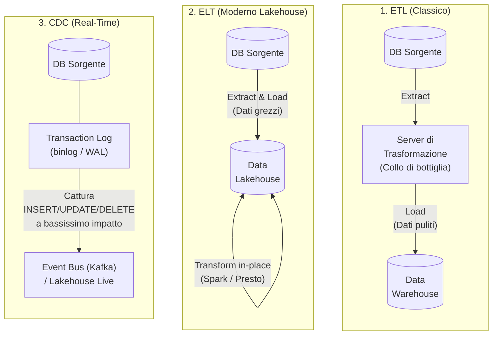

| Pattern | Ordine delle fasi | Latenza tipica | Impatto sul DB sorgente | Quando sceglierlo |
| :--- | :--- | :--- | :--- | :--- |
| **ETL** | Estrai → Trasforma → Carica | Ore / Giorno (batch) | Medio-alto durante l'estrazione | Data Warehouse rigidi con regole di conformità stringenti prima del salvataggio |
| **ELT** | Estrai → Carica → Trasforma | Minuti / Ore | Medio | Data Lakehouse moderni con Spark/Presto dove servono sia dati grezzi sia viste curate |
| **CDC** | Ascolto log → Streaming modifiche | **Millisecondi / Secondi** | **Minimo** (legge il log, non fa query pesanti) | Sincronizzazione in tempo reale tra microservizi, cache, dashboard live e Lakehouse |
| **Virtualizzazione** | Query federata al volo (zero copia) | Tempo reale (dipende dalla sorgente) | Dipende dal traffico delle query | Accesso rapido a fonti disparate senza duplicare dati soggetti a vincoli GDPR / Data Gravity |

Nelle aziende reali, questi pattern vengono implementati mediante strumenti dedicati citati nelle fonti — come **Apache Airflow** (per orchestrare DAG batch), **Fivetran**, **Airbyte**, **Informatica**, **Talend**, **IBM DataStage**, **IBM StreamSets**[^1][^2] e il framework **Kafka Connect**, che incontreremo nel prossimo capitolo dedicato interamente al mondo dei dati in movimento.

---

## 4. Data in Motion: Architetture Event-Driven e Apache Kafka

Nei capitoli 2 e 3 abbiamo imparato come conservare grandi masse di dati storici (*Data at Rest*) e come collegarli con il Data Fabric. Ora spostiamo l'attenzione sul **presente**: come viaggiano le informazioni tra applicazioni e microservizi nel millisecondo esatto in cui accadono (*Data in Motion*)?

### 4.1 I limiti del paradigma REST sincrono e a chiamata

Nel nostro corso abbiamo imparato a progettare Web API seguendo lo stile **REST** su protocollo HTTP ([Minimal API ASP.NET Core](../../../asp.net/api-docs/minimal-api/getting-started/index.md), [Protocollo HTTP](../../../web/web-docs/http-protocol/index.md)). Il paradigma REST si basa sul modello **richiesta-risposta sincrono** (*request-response*): un client (o un servizio chiamante) invia una richiesta HTTP `GET` o `POST` a un indirizzo URL preciso e attende che il server risponda.

Questo modello è perfetto per l'interazione diretta con l'utente — ad esempio quando l'app chiede `GET /api/prodotti/42` per mostrare una scheda prodotto, o invia `POST /api/login` per ottenere un token JWT — ma mostra **tre limiti strutturali gravi** quando diventa l'unico modo con cui decine di servizi aziendali si scambiano dati continui[^4][^7]:

1. **Polling inefficiente (*Modello Pull*)**:
   Se l'app o un microservizio vuole sapere "è arrivato un nuovo aggiornamento?", in REST deve continuare a chiedere al server a intervalli regolari (`GET /api/aggiornamenti` ogni secondo). Se non ci sono novità, il 99% delle richieste viaggia a vuoto sprecando banda di rete, connessioni aperte e cicli di CPU.

2. **Accoppiamento stretto (*Tight Coupling*) e blocco sincrono (*Synchronous Blocking*)**:
   Affinché il Servizio A possa chiamare in REST il Servizio B, il Servizio A deve conoscere l'indirizzo di rete del Servizio B, il formato esatto della sua API e — soprattutto — il Servizio B deve essere **acceso e raggiungibile in quell'istante**. Se il Servizio B va offline per un riavvio o un guasto, il Servizio A resta bloccato in attesa fino al timeout e può fallire a sua volta, propagando il guasto a catena.

3. **Latenza accumulata e "Spaghetti REST"**:
   Quando un'azienda cresce e adotta un'architettura a microservizi (Servizio Utenti, Servizio Ordini, Servizio Pagamenti, Servizio Spedizioni, Servizio Email, Dashboard Analytics), collegarli tutti direttamente uno con l'altro tramite chiamate REST crea una ragnatela ingovernabile di frecce bidirezionali (*Spaghetti REST*[^7]). Ogni nuovo servizio richiede di modificare il codice dei servizi esistenti affinché lo chiamino, e se un'operazione attraversa cinque chiamate HTTP sincrone in sequenza, la latenza totale è la somma di tutte le attese più i picchi di traffico non ammortizzati.

### 4.2 L'inversione di marcia: Architettura Event-Driven e Publish/Subscribe

Per superare questi limiti si ribalta completamente la prospettiva adottando un'**Architettura Event-Driven (EDA — *Event-Driven Architecture*, architettura guidata dagli eventi)**[^4][^5][^7].

Invece di avere servizi che *chiedono* continuamente i dati (*pull*), in un sistema event-driven **i dati si annunciano nel momento esatto in cui accadono**, scorrendo come un flusso continuo (*stream*) attraverso un bus centrale degli eventi.

#### Che cos'è tecnicamente un "evento"?

Un **evento** è la registrazione immutabile di un fatto significativo già accaduto nel sistema (un cambiamento di stato)[^4]. A differenza di un comando ("Esegui il pagamento!"), un evento è un'affermazione al passato ("L'ordine #9042 è stato pagato alle 17:42:08"). In formato JSON, un evento assomiglia a questo:

```json
{
  "eventId": "evt-8a91c3d0-441b-4c22-9f1a-09a12b45e801",
  "eventType": "OrdineConfermato",
  "eventTime": "2026-11-25T16:42:08.314Z",
  "source": "servizio-ordini",
  "payload": {
    "idOrdine": 9042,
    "idCliente": 10492,
    "importoTotale": 149.90,
    "valuta": "EUR",
    "articoli": [
      { "sku": "SSD-NVME-1TB", "quantita": 1, "prezzo": 149.90 }
    ]
  }
}
```

#### Il modello *Publish/Subscribe (Pub/Sub)*: Orchestrazione vs Coreografia

Alla base delle architetture event-driven c'è il pattern **Publish/Subscribe (Pub/Sub)**[^7]:
- Chi genera un evento (**Publisher** o **Producer**) lo pubblica su un canale centrale (**Event Bus**), senza sapere *chi* lo leggerà, *quanti* servizi siano in ascolto né *se* siano online in quel momento.
- Chi è interessato a reagire a quel tipo di evento (**Subscriber** o **Consumer**) si iscrive al canale e riceve gli eventi in modo asincrono, lavorandoli al proprio ritmo.

Questo trasforma radicalmente il coordinamento tra microservizi, passando dall'**Orchestrazione** alla **Coreografia**[^7]:
- Nell'**Orchestrazione (REST)**: esiste un "direttore d'orchestra" (ad esempio il Servizio Ordini) che chiama esplicitamente `POST /pagamenti`, attende la risposta, poi chiama `POST /spedizioni`, attende, poi chiama `POST /email`. Se il Servizio Email è offline per manutenzione, l'intero processo di checkout rischia di andare in errore!
- Nella **Coreografia (Event-Bus)**: il Servizio Ordini si limita a pubblicare l'evento `OrdineConfermato` sul bus e risponde subito al cliente. Da quel momento, in totale autonomia e in parallelo, il Servizio Spedizioni legge l'evento per preparare il pacco, il Servizio Email legge lo stesso evento per inviare la ricevuta e il sistema di Machine Learning lo legge per aggiornare le raccomandazioni. **Se il Servizio Email va offline per dieci minuti, gli eventi si accumulano al sicuro sul bus; appena torna online, riprende da dove si era interrotto e invia tutte le email senza perdere un solo ordine.**

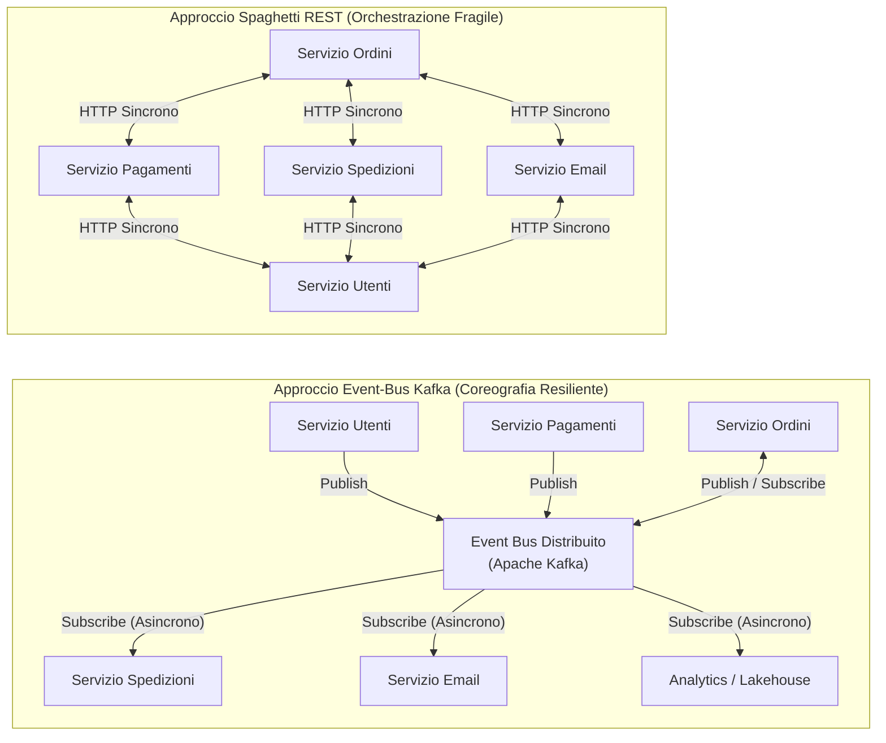

La matrice seguente riassume le differenze tra API REST e Event Streaming[^4][^7]:

| Parametro | API REST (HTTP Sincrono) | Event Streaming (Apache Kafka) |
| :--- | :--- | :--- |
| **Modello di comunicazione** | Richiesta / Risposta (*Pull*, sincrono) | Pubblica / Sottoscrivi (*Pub/Sub*, asincrono) |
| **Accoppiamento (*Coupling*)** | **Forte** (occorre conoscere IP/URL, contratto API e disponibilità immediata) | **Nullo** (totale disaccoppiamento logico e temporale tra producer e consumer) |
| **Persistenza dei dati** | Transitoria (in RAM per la durata della chiamata HTTP) | **Persistente su disco** (gli eventi restano conservati per giorni, mesi o anni) |
| **Gestione picchi di carico** | Rischio di saturazione thread, timeout e crash | **Buffer naturale** (il bus assorbe il picco; ogni consumer legge al proprio ritmo) |
| **Uso ideale** | Interazione diretta con l'utente (login, CRUD puntuali, consultazione immediata) | Pipeline dati in tempo reale, microservizi disaccoppiati, analytics live, IoT, AI |

### 4.3 Apache Kafka: il cuore pulsante dell'Event Streaming

**Apache Kafka** è la piattaforma open source (rilasciata con licenza **Apache License v2.0**) diventata lo standard industriale *de facto* per l'**Event Streaming** aziendale[^3][^4][^5]. Nata originariamente in LinkedIn e oggi mantenuta dalla Apache Software Foundation (giunta alla serie di release **4.4.x** nelle fonti[^3]), Kafka è capace di gestire flussi continui da diversi gigabyte al secondo con latenze di pochissimi millisecondi.

#### Perché Kafka NON è una semplice coda di messaggi

Chi ha già sentito parlare di *message queue* (code di messaggi tradizionali, come RabbitMQ) spesso pensa che Kafka sia "solo un'altra coda". In realtà c'è una differenza architetturale profonda[^7]:
- In una **coda di messaggi tradizionale**, quando un consumatore legge ed elabora un messaggio, **il messaggio viene cancellato** dalla coda. Un secondo consumatore non potrà più rileggere quello stesso evento storico.
- In **Apache Kafka**, il cuore del sistema è un **Commit Log distribuito, persistente e immutabile** (*Append-Only Log*)[^3][^7]. Quando un evento viene scritto in Kafka, **non viene cancellato dopo la lettura**: rimane conservato su disco per un periodo configurabile (*retention policy*, ad esempio 7 giorni, 30 giorni o persino a tempo indeterminato). Questo significa che dieci applicazioni diverse possono leggere lo stesso flusso indipendentemente, ciascuna alla propria velocità, e un nuovo servizio attivato oggi può rileggere tutta la storia degli ultimi giorni.

#### Anatomia di Kafka: Broker, Topic, Partizioni, Producer, Consumer e Offset

Per padroneggiare Kafka senza timore, basta imparare sei concetti fondamentali[^3][^7]:

1. **Producer (*Produttore*)**: l'applicazione, il microservizio, il sensore IoT o il connettore CDC che invia (pubblica) eventi a Kafka.
2. **Broker e Cluster**: un **Broker** è un server (o container) che esegue Kafka, riceve i messaggi dai producer, li salva su disco e li serve ai consumer. Più broker collaborano formando un **Cluster Kafka**, garantendo scalabilità orizzontale e tolleranza ai guasti.
3. **Topic (*Argomento*)**: è la categoria logica o il "canale" in cui vengono organizzati gli eventi dello stesso tipo (ad esempio un topic `ordini-confermati`, un topic `pagamenti-pos`, un topic `telemetria-sensori`). Funziona concettualmente in modo simile a una tabella di un database, ma sotto forma di flusso ordinato nel tempo.
4. **Partizioni (*Partitions*) e Log *Append-Only***:
   Per non restare limitato alla capacità di un solo disco o di un solo server, ogni Topic è suddiviso in una o più **Partizioni** (`Partizione 0`, `Partizione 1`, `Partizione 2`, ...), distribuite sui diversi broker del cluster[^3][^7].
   - Ogni partizione è fisicamente un file di log **Append-Only**: i nuovi eventi vengono aggiunti *esclusivamente in coda* al file, mai modificati al centro. La scrittura sequenziale su disco è straordinariamente veloce (evita i salti casuali delle testine o delle pagine SSD) e permette a Kafka di sostenere milioni di scritture al secondo.
   - Se il producer specifica una **chiave (*key*)** sull'evento (es. `id_cliente = 10492`), Kafka garantisce che tutti gli eventi con la stessa chiave finiscano sempre nella **stessa partizione**, assicurandone così l'ordinamento rigoroso!
5. **Offset (*Il Segnalibro del Consumer*)**:
   All'interno di ciascuna partizione, ogni evento riceve un numero intero progressivo univoco e immutabile chiamato **Offset** (`0`, `1`, `2`, `3`, `4`, ...)[^7].
   Kafka non tiene traccia in modo invasivo di chi ha letto cosa per poi cancellare i record: **è il Consumer che ricorda il proprio Offset** (il numero dell'ultimo record elaborato, salvato periodicamente su un topic interno di Kafka). Se un consumer va in crash e si riavvia, riprende esattamente dall'offset successivo senza perdere dati — oppure può persino "riavvolgere il nastro" (*replay*) tornando all'offset `0` per rielaborare lo storico!
6. **Consumer e Consumer Group**:
   Un **Consumer** è un'applicazione che legge gli eventi da uno o più topic. Per elaborare flussi molto veloci in parallelo, più istanze della stessa applicazione (ad esempio 3 container Docker identici del `Servizio-Spedizioni`) formano un **Consumer Group**: Kafka assegna automaticamente partizioni diverse a istanze diverse del gruppo, moltiplicando la capacità di elaborazione (se una istanza si ferma, le sue partizioni vengono riassegnate automaticamente alle istanze superstiti tramite *rebalance*). Al contrario, applicazioni appartenenti a **Consumer Group diversi** (es. `Gruppo-Spedizioni` e `Gruppo-Lakehouse`) ricevono *entrambe* tutti gli eventi del topic in modo indipendente.

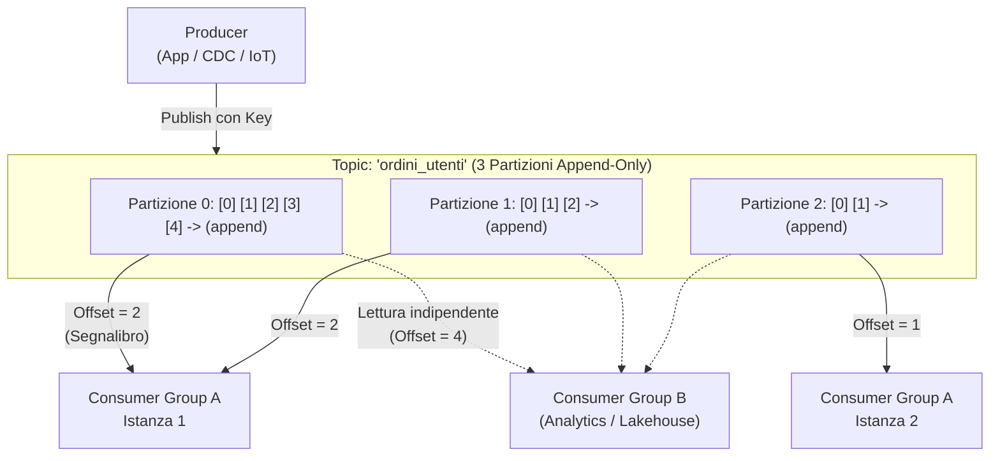

##### Come scala il parallelismo di un Consumer Group?

Un dubbio tipico di chi inizia a lavorare con Kafka riguarda il numero ideale di istanze in un Consumer Group rispetto al numero di partizioni del Topic. La regola fondamentale è semplice: **all'interno dello stesso Consumer Group, ogni partizione può essere assegnata a un solo Consumer alla volta** (così da preservare l'ordine degli eventi nella partizione).

Prendiamo il Topic `ordini_utenti` con **3 partizioni** (`P0`, `P1`, `P2`):

| Numero di istanze nel Consumer Group | Assegnazione delle partizioni | Effetto pratico |
| :--- | :--- | :--- |
| **1 Consumer** (`C1`) | `C1` legge `P0, P1, P2` | Tutto il carico grava su un solo container/thread |
| **2 Consumer** (`C1, C2`) | `C1` → `P0, P1`; `C2` → `P2` | Carico distribuito, tolleranza ai guasti immediata |
| **3 Consumer** (`C1, C2, C3`) | `C1` → `P0`; `C2` → `P1`; `C3` → `P2` | **Parallelismo massimo** per quel topic (rapporto 1:1) |
| **4 Consumer** (`C1, C2, C3, C4`) | `C1` → `P0`; `C2` → `P1`; `C3` → `P2`; `C4` → **Inattivo (Standby)** | La 4ª istanza resta ferma in attesa, pronta a subentrare se una delle altre 3 va in crash |

Questo spiega perché la scelta del numero di partizioni in fase di progettazione sia importante quanto lo sharding nei database relazionali: troppe poche partizioni limitano il parallelismo futuro dei consumer!

### 4.4 Sotto il cofano di Apache Kafka moderno (versione 4.4.x)

La documentazione ufficiale di Apache Kafka 4.4.x presente nelle fonti[^3] mostra come Kafka si sia evoluto profondamente negli ultimi anni per diventare ancora più semplice da gestire, più elastico e ancora più sicuro. Ecco le caratteristiche architetturali più rilevanti per un futuro tecnico o ingegnere:

1. **Da Apache ZooKeeper a KRaft (*Kafka Raft Metadata Mode*)**:
   Per oltre dieci anni, ogni cluster Kafka aveva bisogno di un secondo sistema distribuito esterno chiamato **Apache ZooKeeper** per eleggere il leader e gestire i metadati di configurazione (gestire due sistemi distribuiti in produzione raddoppiava la complessità). Con **KRaft**, basato sull'algoritmo di consenso distribuito *Raft*, Kafka gestisce i propri metadati **internamente**, eliminando completamente ZooKeeper[^3]. Il risultato è un'architettura più leggera, avvii più rapidi e supporto a milioni di partizioni.

2. **Replicazione delle partizioni ed ELR (*Eligible Leader Replicas*)**:
   Ogni partizione ha una replica **Leader** (che gestisce letture e scritture) e più repliche **Follower** su altri broker (in modo simile a quanto studiato nella [replicazione Master-Slave](../../../web/web-docs/distributed-systems/databases/scalability-falut-tolerance/index.md#31-replicazione-dei-dati)). Se il broker Leader si guasta, una replica sincronizzata (*ISR — In-Sync Replica*) subentra automaticamente. Kafka 4.4 introduce inoltre il meccanismo **ELR (*Eligible Leader Replicas*)** per rendere l'elezione del nuovo leader ancora più sicura contro eventuali perdite di dati anche in scenari complessi di guasti multipli[^3].

3. **Tiered Storage (*Archiviazione a Livelli*)**:
   Conservare mesi di eventi sui costosi dischi NVMe/SSD locali dei broker limitava la durata della retention e complicava il ridimensionamento dei nodi. Il **Tiered Storage** disaccoppia lo storage di Kafka in due livelli[^3]:
   - i dati caldi più recenti restano sui **dischi locali veloci** dei broker;
   - i segmenti meno recenti vengono scaricati automaticamente in background verso un **Object Storage remoto economico** (come AWS S3 o IBM COS), restando comunque interrogabili in modo trasparente dai consumer tramite il solito protocollo Kafka!

4. **Protocolli moderni: *Consumer Rebalance*, *Share Consumers* e *Transaction Protocol***:
   - Il nuovo **Consumer Rebalance Protocol** (e lo **Streams Rebalance Protocol**) riduce drasticamente le pause durante l'aggiunta o la rimozione di consumer in un gruppo[^3].
   - I **Share Consumers** ampliano i modelli di consumo consentendo a più consumer di cooperare in stile coda condivisa su singole partizioni quando l'ordine stretto per chiave non è vincolante[^3].
   - Il **Transaction Protocol** consente scritture atomiche su più topic e partizioni garantendo semantiche di elaborazione fino a **exactly-once** (elaborazione esattamente una volta, fondamentale in ambito bancario per evitare doppi addebiti)[^3].

5. **Geo-Replicazione (*MirrorMaker 2*)**:
   Consente di replicare automaticamente topic e offset tra cluster Kafka situati in data center o regioni geografiche diverse, per **Disaster Recovery** (continuità operativa se un'intera regione cloud va giù) o per avvicinare i dati agli utenti di altri continenti[^3][^5].

6. **Sicurezza nativa**:
   Kafka integra un modello di sicurezza completo: cifratura e autenticazione reciproca del traffico tramite **SSL/TLS** (lo stesso protocollo crittografico dell'HTTPS studiato nel corso), autenticazione dei client tramite **SASL** (*Simple Authentication and Security Layer*, inclusi meccanismi token/OAuth), e controllo granulare dei permessi tramite **ACL** (*Access Control Lists*, per decidere esattamente quale applicazione può scrivere o leggere uno specifico topic)[^3].

### 4.5 L'ecosistema Kafka: Kafka Connect, Kafka Streams e Schema Registry

Nella pratica aziendale, attorno al motore centrale dei broker ruotano tre componenti essenziali che trasformano Kafka da "semplice bus" in una piattaforma completa per pipeline dati end-to-end[^3][^4][^5][^7]:

1. **Kafka Connect (*Integrazione No-Code tramite connettori*)**:
   Scrivere da zero codice C# o Java per leggere modifiche da un database e riversarle su Kafka (e poi da Kafka dentro un Lakehouse) sarebbe ripetitivo e soggetto a bug. **Kafka Connect** è un framework standardizzato che permette di spostare dati dentro e fuori Kafka attraverso semplici file di configurazione JSON, usando connettori già pronti e testati[^3][^5][^7]:
   - **Source Connectors**: estraggono dati da sistemi esterni verso Kafka (es. connettori CDC come Debezium per leggere il binlog di MariaDB/MySQL, PostgreSQL o Oracle, oppure connettori verso Salesforce e file log).
   - **Sink Connectors**: consegnano i dati dai topic Kafka verso destinazioni finali (es. scrittura automatica di file `.parquet` / tabelle Iceberg su Object Storage S3/watsonx.data, inserimento in OpenSearch o Cassandra).

2. **Kafka Streams (*Elaborazione dei flussi in volo*)**:
   Mentre i dati attraversano Kafka, spesso serve trasformarli, filtrarli, arricchirli o calcolare statistiche in tempo reale (ad esempio: *"calcola la media mobile delle transazioni degli ultimi 5 minuti per ogni carta di credito"*). **Kafka Streams** è una libreria client (con **Streams DSL** ad alto livello e **Processor API** a basso livello, **Interactive Queries** e gestori di serializzazione **SerDes**) che gira direttamente dentro normali applicazioni containerizzate senza richiedere un cluster di calcolo separato[^3][^7]. Permette di eseguire `filter`, `map`, `join` tra flussi e aggregazioni su finestre temporali (*windowing*) millisecondo dopo millisecondo. (In ecosistemi di streaming su scala ancora più ampia, come in Confluent, si affianca spesso anche **Apache Flink** o **ksqlDB**[^4].)

3. **Schema Registry (*Registro degli Schemi e Contratti di Dati*)**:
   Un rischio classico nei sistemi disaccoppiati è che un team modifichi un campo JSON nell'evento del Producer (ad esempio rinominando `"importo"` in `"totaleEuro"`), mandando silenziosamente in crash tutti i Consumer a valle. Lo **Schema Registry** (presente sia in Confluent che in IBM Event Streams[^4][^5]) è un servizio centralizzato che archivia e versiona la struttura formale degli eventi (in formati come **Apache Avro**, **Protobuf** o **JSON Schema**). Prima che un producer possa inviare un evento incompatibile, il registro verifica le regole di **compatibilità** (*backward*, *forward*, *full*) bloccando modifiche distruttive e garantendo la qualità del flusso lungo tutto il ciclo di vita.

##### Esempio pratico: evoluzione sicura vs rottura del contratto nello Schema Registry

Immaginiamo lo schema Avro **v1** di un evento di pagamento:

```json
{
  "type": "record",
  "name": "PagamentoEffettuato",
  "namespace": "it.scuola.pagamenti",
  "fields": [
    { "name": "idPagamento", "type": "string" },
    { "name": "importo", "type": "double" }
  ]
}
```

- **Modifica valida (*Backward Compatible*) — v2**: il team aggiunge un nuovo campo opzionale `metodo` **con valore di default** (`"CARTA"`). I vecchi eventi v1 privi di `metodo` possono ancora essere letti dai nuovi consumer v2 senza errori, perché lo Schema Registry sa applicare il default!
- **Modifica bloccata (*Breaking Change*)**: il team prova a rinominare `importo` in `valoreEuro` oppure ad aggiungere un campo obbligatorio senza valore di default. Lo Schema Registry rifiuta la registrazione della nuova versione, impedendo in anticipo un guasto silenzioso in produzione.

##### Esempio concettuale di pipeline *Kafka Streams* in volo

Per comprendere che cosa fa una topologia **Kafka Streams** senza entrare nei dettagli sintattici di un solo linguaggio, ecco la logica di un servizio anti-frode in streaming:

```text
Flusso in ingresso (Topic "transazioni-pos")
  ├──> filter(importo > 0)
  ├──> groupBy(chiave = idCarta)
  ├──> windowedBy(finestra temporale scorrevole di 5 minuti)
  ├──> aggregate(conteggioTransazioni, sommaImporti, paesiDistinti)
  └──> filter(conteggioTransazioni >= 4 OR paesiDistinti.size() >= 2)
        └──> invia su Topic "allarmi-frode-immediati" (< 50 ms)
```

In poche operazioni dichiarative sulla finestra temporale di 5 minuti, il flusso grezzo dei pagamenti viene trasformato continuamente in segnali di allarme azionabili subito dalle applicazioni di sicurezza.

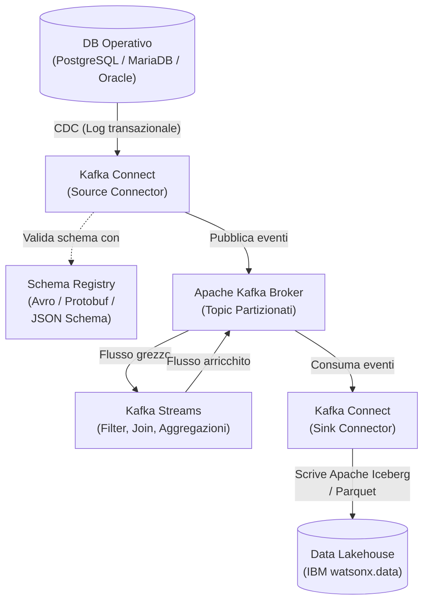

### 4.6 Piattaforme Enterprise Gestite: Confluent e IBM Event Streams

Se Apache Kafka è open source e chiunque può avviarlo in un container Docker sul proprio computer per imparare, **gestire un cluster Kafka critico in produzione** — con decine di broker, aggiornamenti senza fermi macchina, certificati di sicurezza, monitoraggio, backup multi-regione e conformità legale — richiede un notevole sforzo operativo. Per questo motivo le aziende scelgono spesso **piattaforme enterprise gestite**, di cui le due principali documentate nel notebook sono **Confluent** e **IBM Event Streams**[^4][^5].

#### Confluent (*Confluent Cloud & Confluent Platform*)

Fondata dai co-creatori originali di Apache Kafka (e oggi parte della famiglia IBM, come indicato nelle note del sito Confluent[^4]), **Confluent** estende Kafka open source trasformandolo in una piattaforma completa per il *data streaming* cloud-native[^4]:
- **Motore Kora (su Confluent Cloud)**: invece di gestire manualmente macchine virtuali statiche, Confluent Cloud utilizza il motore **Kora**, riprogettato per il cloud con **autoscaling elastico**, capacità di scalare **10 volte più velocemente** rispetto a Kafka tradizionale, gestione di carichi da **GBps+** (gigabyte al secondo), un accordo sul livello di servizio (**SLA**) del **99,99%** e risparmi sui costi di throughput dal **20% a oltre il 90%**[^4].
- **Opzioni di deployment flessibili**: *Confluent Cloud* (SaaS completamente gestito), *Confluent Platform* (self-managed on-premise), *Confluent Private Cloud*, *Confluent for Kubernetes* (orchestrazione su cluster Kubernetes) e **WarpStream** (architettura compatibile Kafka eseguita direttamente su Object Storage nel proprio cloud privato)[^4].
- **Funzionalità enterprise integrate**:
  - **Stream Governance**: include *Stream Quality* (con **Schema Registry** per Avro, Protobuf e JSON Schema), *Stream Lineage* e *Stream Catalog*.
  - **Stream Processing**: elaborazione avanzata con **Apache Flink** gestito e **ksqlDB**.
  - **Oltre 120 connettori predefiniti** verso database, Data Warehouse e applicazioni SaaS.
  - **Cluster Linking**: replica e migrazione di topic e metadati in tempo reale tra cluster diversi senza componenti aggiuntivi e senza downtime.
  - **Tableflow** e **Lightning Tables**: tecnologie che collegano direttamente gli stream Kafka al mondo analitico e all'AI (le approfondiremo nel capitolo 5 sullo *Streamhouse*).
- *(Curiosità chiarita dalle stesse FAQ Confluent[^4]: **Confluent** non va confuso con **Confluence** di Atlassian, che è uno strumento wiki per la documentazione di team!)*

#### IBM Event Streams

**IBM Event Streams** è la piattaforma enterprise di event streaming sviluppata da IBM a partire da Apache Kafka open source, frutto di anni di esperienza nella gestione di carichi mission-critical[^5]. È disponibile sia come servizio completamente gestito su **IBM Cloud**, sia on-premise/ibrido su **Red Hat OpenShift** all'interno di *IBM Event Automation* o di **IBM Cloud Pak for Integration (CP4I)**[^5]:
- **Elevata disponibilità e Disaster Recovery**: architettura distribuita su **3 zone** attraverso **10 regioni multizona (MZR)** con uno **SLA del 99,99%** e supporto nativo ad **Apache MirrorMaker 2** per la replica geografica automatica e la continuità operativa in caso di guasto di un'intera regione[^5].
- **API Kafka native + 3 API REST dedicate**: mantiene la piena compatibilità con tutti i client standard Kafka e aggiunge tre API proprie (*Admin REST API*, *REST Producer API* e *Schema Registry API*), oltre a CLI, automazione Infrastructure-as-Code con **Terraform** e integrazione con **IBM Cloud Monitoring** per l'*observability*[^5] (concetto analogo al monitoraggio con Prometheus e Grafana visto nel corso).
- **Schema Registry e Kafka Connect**: repository centralizzato con versionamento degli schemi e oltre **50 connettori** supportati da IBM o dalla community[^5].
- **Piani di scalabilità, sicurezza e conformità rigorosa**: offre un piano *Standard* (cluster multi-tenant con scalabilità automatica per partizioni) e un piano *Enterprise* (risorse dedicate con scaling indipendente di throughput e capacità storage), crittografia *at rest* e *in transit* integrata con **IBM Key Protect** e **IBM Cloud Hyper Protect Crypto Services**, restrizioni di rete basate sul contesto (**CBR**) e un pacchetto completo di certificazioni: **GDPR, PCI-DSS, HIPAA, SOC 2 Type 2, ISO 27001, ISO 27017, ISMAP, C5** e convalida per **IBM Financial Services**[^5].

#### Tabella comparativa: Kafka Open Source vs Confluent vs IBM Event Streams

| Caratteristica | Apache Kafka Open Source (4.4.x) | Confluent (Cloud / Platform) | IBM Event Streams |
| :--- | :--- | :--- | :--- |
| **Gestione operativa** | Completamente a carico del team (sizing, patching, monitoraggio cluster) | Fully managed su Cloud (motore **Kora** con autoscaling) o orchestrato con Kubernetes/Ansible | Fully managed su IBM Cloud o gestito su OpenShift (Event Automation / CP4I) |
| **Disponibilità e DR** | Replicazione KRaft / ELR e MirrorMaker 2 da configurare manualmente | SLA **99,99%**, *Cluster Linking* integrato per replica e migrazione zero-downtime | SLA **99,99%** su **3 zone** in **10 regioni multizona**, DR nativo con MirrorMaker 2 |
| **Governance & Schemi** | Non include Schema Registry o Lineage nativi nel core (richiede componenti terzi) | Suite *Stream Governance* completa (Schema Registry, Stream Quality, Lineage, Catalog) | *Schema Registry* nativo + REST API dedicate + osservabilità con IBM Cloud Monitoring |
| **Ecosistema & Connettori** | Framework Kafka Connect e libreria Kafka Streams open source | 120+ connettori gestiti, **Apache Flink**, **Tableflow**, **Lightning Tables**, WarpStream | 50+ connettori supportati, Admin/Producer REST API, integrazione Terraform |
| **Sicurezza e Compliance** | TLS, SASL, ACL da configurare manualmente | Crittografia enterprise, SOC 2, ISO 27001, PCI-DSS | Key Protect, Hyper Protect Crypto, CBR; **PCI-DSS, HIPAA, SOC 2 Type 2, ISO 27001/27017, GDPR, Financial Services** |

Ora che abbiamo visto come viaggiano i dati tra microservizi con Kafka, resta da capire come integrare rapidamente anche applicazioni aziendali complesse senza scrivere migliaia di righe di "codice colla" — e soprattutto come fondere il mondo veloce dello streaming con il mondo storico del Lakehouse per alimentare l'Intelligenza Artificiale moderna.

---

## 5. Integrazione Applicativa Ibrida (iPaaS), Paradigma Streamhouse e AI in Tempo Reale

Abbiamo visto finora come conservare e interrogare grandi moli di dati storici con il Data Lakehouse (Capitolo 2), come governare dati sparsi con il Data Fabric (Capitolo 3) e come trasportare milioni di eventi al secondo con Apache Kafka (Capitolo 4). Mancano ora due tasselli decisivi per completare il quadro enterprise:
1. come collegare velocemente **applicazioni aziendali diverse** (vecchie e nuove, SaaS e on-premise) senza scrivere montagne di codice personalizzato;
2. come unire il mondo in tempo reale dello streaming con quello storico del Lakehouse (**Streamhouse**) per alimentare applicazioni moderne e agenti di **Intelligenza Artificiale** privi di allucinazioni.

### 5.1 Integrazione applicativa aziendale: iPaaS e IBM App Connect

Mentre l'ingegneria dei dati analitici muove grandi tabelle verso Lakehouse e Warehouse, esiste un bisogno quotidiano altrettanto critico: far dialogare **tra loro** le applicazioni aziendali quando succede qualcosa nel business.

Immaginiamo uno scenario molto concreto in un'azienda reale[^6][^7]:
1. Un venditore registra un nuovo cliente su **Salesforce** (piattaforma CRM in cloud SaaS).
2. Quel cliente deve essere inserito automaticamente nel **database legacy on-premise** della contabilità (dove magari i campi hanno nomi completamente diversi, come `COD_CLI` invece di `customerId`, e formati data rigidi).
3. Contemporaneamente va pubblicato un evento su **Apache Kafka** (o **IBM MQ**) affinché il magazzino prepari il kit di benvenuto.
4. Infine, va inviata una notifica automatica su **Slack** o via **email** al responsabile commerciale.

Se gli sviluppatori dovessero scrivere a mano microservizi personalizzati in C#, Java o Node.js per ognuna delle centinaia di coppie di applicazioni aziendali (gestendo autenticazione OAuth, ritentativi su errore di rete, conversioni XML/JSON/CSV, paginazione API e logging), il reparto IT passerebbe tutto il tempo a scrivere e mantenere "codice colla" (*glue code*) fragile.

Per eliminare questo collo di bottiglia nasce la categoria delle piattaforme **iPaaS (*Integration Platform as a Service*)**, rappresentata nelle nostre fonti da **IBM App Connect** (giunto alla release **App Connect Enterprise 13.0.9.0**) e dalla sua estensione SaaS gestita **IBM webMethods Hybrid Integration**[^6].

#### Come funziona IBM App Connect: due approcci complementari

**IBM App Connect** funge da connettore universale per unificare applicazioni, API e dati in ambienti ibridi (on-premise, macchine virtuali, container Docker/Kubernetes e SaaS)[^6]. Poiché in azienda lavorano persone con competenze molto diverse — da analisti di processo fino a sviluppatori esperti — la piattaforma offre due ambienti complementari sullo stesso motore:

1. **No-code / Low-code — *App Connect Designer***:
   Pensato per tecnologi aziendali, analisti e team agili che devono collegare rapidamente servizi cloud e app interne senza scrivere codice da zero.
   - Interfaccia web grafica *drag-and-drop* (a trascinamento di blocchi).
   - Oltre **200 connettori predefiniti** pronti all'uso verso servizi SaaS, ERP, CRM, database relazionali, sistemi mainframe, **IBM MQ** e **Apache Kafka**[^6][^7].
   - **Mappatura dati assistita da AI**: quando colleghi i campi di Salesforce a quelli di un database interno o di Slack, l'Intelligenza Artificiale suggerisce automaticamente le corrispondenze tra campi diversi e le trasformazioni di formato.
   - Possibilità di esporre rapidamente flussi come nuove **API REST** governate in pochi clic.

2. **Advanced Pro-code — *App Connect Toolkit***:
   Pensato per gli sviluppatori di integrazione professionisti che devono gestire flussi complessi, protocolli legacy, trasformazioni articolate o altissimi volumi.
   - È un **IDE** (*Integrated Development Environment*) completo basato su Eclipse che unisce progettazione visuale del flusso e programmazione diretta.
   - Consente di scrivere logica di trasformazione avanzata in **ESQL** (*Extended Structured Query Language*, linguaggio progettato per manipolare alberi di messaggi XML/JSON/binari) e in **Java**[^6].
   - Include debugger integrato, gestione di policy centralizzate, test automatizzati e pacchettizzazione flessibile per eseguire le integrazioni su macchine virtuali, **container** (Docker/Kubernetes/OpenShift) o in modalità SaaS[^6].

Un breve esempio concettuale aiuta a capire che cosa fa una trasformazione in un nodo di integrazione: mentre in un'API REST scritta a mano dovresti definire classi DTO, deserializzare JSON, gestire campi `null` e ricostruire un payload diverso, in un flusso di integrazione definisci una mappa dichiarativa o poche istruzioni mirate:

```sql
-- Esempio concettuale in stile ESQL per mappare un evento CRM verso un sistema gestionale legacy
SET OutputRoot.JSON.Data.COD_CLI       = InputRoot.JSON.Data.customer.id;
SET OutputRoot.JSON.Data.RAG_SOCIALE   = UPPER(TRIM(InputRoot.JSON.Data.customer.companyName));
SET OutputRoot.JSON.Data.STATO_ATTIVO  = CASE InputRoot.JSON.Data.customer.status
                                            WHEN 'Active' THEN 'S'
                                            ELSE 'N'
                                         END;
SET OutputRoot.JSON.Data.DATA_INS      = CAST(CURRENT_TIMESTAMP AS CHARACTER FORMAT 'yyyy-MM-dd');
```

| Caratteristica | App Connect Designer (No-code / Low-code) | App Connect Toolkit (Advanced Pro-code) |
| :--- | :--- | :--- |
| **Utente destinatario** | Tecnologi aziendali, integratori SaaS, team applicativi | Sviluppatori software e specialisti di integrazione enterprise |
| **Interfaccia e approccio** | Browser web, flusso visuale *drag-and-drop*, mappatura AI | IDE completo con controllo totale su flusso, policy e codice |
| **Linguaggi supportati** | Configurazione visuale, espressioni di mappatura JSONata | **ESQL**, **Java** e linguaggi supportati dal toolkit[^6] |
| **Scenari tipici** | Automazioni SaaS-to-SaaS, esposizione rapida di API, notifiche | Integrazione mainframe, trasformazioni complesse ad alto carico, pattern ibridi complessi |
| **Modalità di esecuzione** | SaaS gestito, container in ambienti ibridi | Macchine virtuali, container (Docker/Kubernetes/OpenShift), SaaS |

#### L'evoluzione verso l'AI in IBM App Connect: Flow Pilot, Agenti AI e Server MCP

La versione moderna di App Connect documentata nelle fonti introduce tre innovazioni importanti che collegano direttamente il mondo dell'integrazione applicativa all'Intelligenza Artificiale[^6]:

1. **App Connect Flow Pilot (*Sviluppo assistito dall'AI*)**:
   Integra assistenti AI approvati a livello aziendale (come **IBM Bob**, **Claude** o **GitHub Copilot**) direttamente dentro App Connect Toolkit. Uno sviluppatore può spiegare in linguaggio naturale che cosa deve fare un flusso e ricevere spiegazioni di flussi legacy già esistenti oppure codice ESQL/Java generato nel rispetto delle policy di sicurezza aziendali[^6].

2. **Agenti AI App Connect (*Gestione operativa conversazionale*)**:
   Consentono ai team operativi di interrogare lo stato di salute e le prestazioni dell'intera infrastruttura di integrazione usando il linguaggio naturale, individuando rapidamente colli di bottiglia, errori nei flussi e opportunità di ottimizzazione[^6].

3. **Server MCP (*Model Context Protocol*) — App Connect come *Enterprise Context Enabler***:
   Questo è uno dei concetti più attuali dell'architettura AI moderna. Che cos'è **MCP (*Model Context Protocol*)**? Puoi pensarlo come a una "presa USB-C standardizzata" per i modelli e gli agenti di Intelligenza Artificiale: invece di scrivere integrazioni ad hoc per collegare un LLM a ogni programma aziendale, un server MCP espone in modo uniforme e sicuro strumenti (*tools*) e risorse che qualunque agente AI compatibile può scoprire e invocare.
   Attraverso il **server MCP di App Connect**, un'azienda può esporre **oltre 2.800 azioni di connettori** e i propri flussi API REST esistenti agli agenti AI[^6]. In questo modo un assistente AI non resta chiuso nelle sole conoscenze con cui è stato addestrato, ma diventa un agente consapevole del contesto aziendale capace, ad esempio, di verificare un ordine nell'ERP, controllare una fattura e avviare una procedura di reso — il tutto con autenticazione, tracciamento e governance garantiti dal runtime di App Connect[^6].

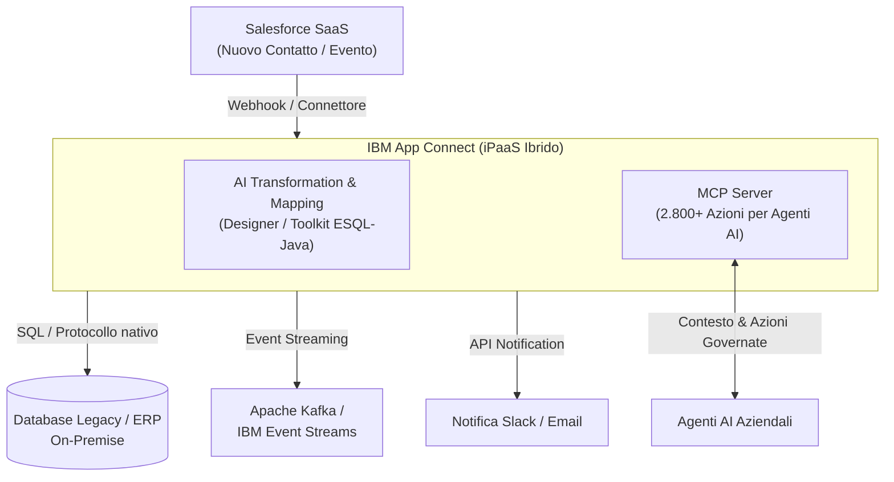

### 5.2 Il dilemma architetturale: il Presente (Streaming) vs la Storia (Lakehouse)

Ora che conosciamo sia il **Data Lakehouse** (il regno della storia: petabyte di dati analitici in tabelle Iceberg/Delta) sia **Apache Kafka** (il regno del presente: eventi in tempo reale in pochi millisecondi), emerge un grande dilemma architetturale[^7].

Consideriamo un esempio concreto della vita reale: **il rilevamento delle frodi bancarie**[^4][^7].
Un cliente striscia la carta di credito su un terminale POS a Tokyo.
- Da un lato, il sistema ha **meno di 50 millisecondi** prima che lo scontrino venga stampato per decidere se approvare o bloccare la transazione: serve dunque il dato fresco dal **Regno dello Streaming (il Presente)**.
- Dall'altro lato, per capire se quella spesa è anomala, il modello di Machine Learning deve confrontarla con il profilo comportamentale del cliente costruito sugli **ultimi 5 anni di transazioni, viaggi e abitudini di acquisto**: serve dunque il **Regno del Lakehouse (la Storia)**.

Per anni le aziende hanno cercato di collegare questi due mondi costruendo la cosiddetta **Architettura Lambda**, introdotta negli anni 2010:

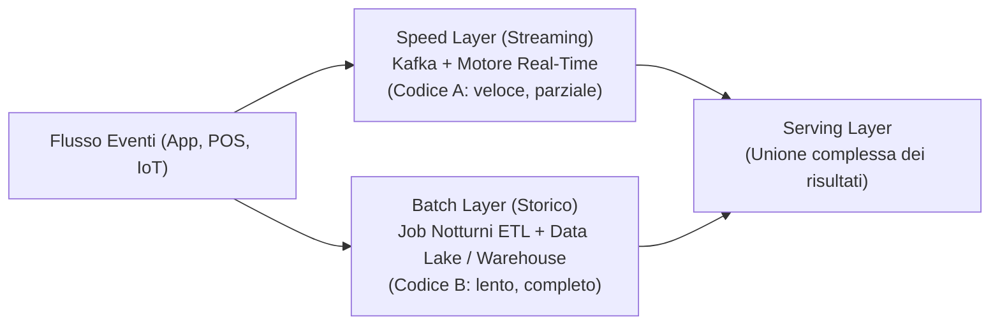

Pur avendo risolto temporaneamente il problema, l'Architettura Lambda si è rivelata nella pratica **estremamente costosa, complessa e fonte continua di errori**[^7]:
- **Doppio codice da mantenere**: per ogni regola di business (es. calcolo della spesa media mensile), il team doveva scrivere e testare *due volte* la stessa logica — una volta per il motore streaming e una seconda volta per il motore batch (spesso con linguaggi e API diverse).
- **Discrepanze numeriche**: i risultati dello *Speed Layer* e quelli del *Batch Layer* finivano inevitabilmente per divergere leggermente a causa di ritardi di rete, fusi orari o arrotondamenti diversi.
- **Costi raddoppiati**: occorreva mantenere attive e monitorate due infrastrutture parallele, oltre alle fragili pipeline ETL notturne per sincronizzare i dati.

Un tentativo intermedio fu l'**Architettura Kappa**, che provava a eliminare il *Batch Layer* usando il solo log di Kafka per tutto; tuttavia, eseguire scansioni analitiche pesanti su anni di storico direttamente dai topic di streaming non offriva né la compressione colonnare né l'indicizzazione SQL del Data Lakehouse. Serviva una vera **convergenza strutturale**.

### 5.3 La convergenza: il paradigma Streamhouse

La risposta moderna a questo dilemma si chiama **Streamhouse**[^4][^7][^13] — un termine nato dalla fusione tra *Data Streaming* e *Data Lakehouse* e promosso anche dallo **Streamhouse Working Group**, un'alleanza tecnologica composta da **Aiven, Confluent, Redpanda, StreamNative e Ververica** per definire una base dati condivisa nell'era dell'Intelligenza Artificiale[^13].

#### Che cos'è uno Streamhouse?

Uno **Streamhouse** è un'architettura dati unificata che **cattura, elabora e governa i dati continuamente mentre accadono (in streaming) e, nello stesso flusso, li rende immediatamente disponibili per le query analitiche storiche, la Business Intelligence e l'AI dentro tabelle aperte del Lakehouse**[^4][^7].

Invece di avere "prima Kafka per le app e poi un job notturno ETL che copia e trasforma i dati nel Lakehouse domani mattina", nello Streamhouse **il confine tra stream e tabella diventa fluido e continuo**:

1. **Un'unica sorgente di verità continua**:
   Quando un evento entra in un topic Kafka ed è validato dallo Schema Registry (es. in formato Avro o Protobuf), può essere trasformato e arricchito al volo (con Kafka Streams o Apache Flink) e **materializzato automaticamente** in una tabella aperta **Apache Iceberg** o **Delta Lake** su Object Storage.
2. **Tecnologie ponte reali (*Tableflow* e *Lightning Tables*)**:
   Le fonti Confluent mostrano due meccanismi emblematici di questa convergenza[^4]:
   - **Tableflow**: permette di trasformare i topic Kafka (e i relativi schemi) direttamente in tabelle Apache Iceberg o Delta Lake in pochi clic, eliminando le pipeline ETL personalizzate tra team streaming e team analytics. I dati scritti su Object Storage restano subito interrogabili dai motori del Lakehouse come Presto, Spark o IBM watsonx.data.
   - **Lightning Tables**: consentono di servire rapidamente lo **stato corrente** aggiornato di un'entità aziendale (ad esempio *"qual è in questo esatto secondo la giacenza del prodotto X o lo stato dell'ordine Y?"*) ad applicazioni e agenti AI con latenza minima, senza dover riscansionare l'intero log storico dall'inizio[^4].
3. **Collaborazione con Data Lake e Warehouse esistenti**:
   Uno Streamhouse non obbliga a buttare via il Data Lakehouse o il Data Warehouse già presenti: lavora al loro fianco alimentandoli con dati puliti alla fonte, aggiornati continuamente anziché a blocchi giornalieri[^4].

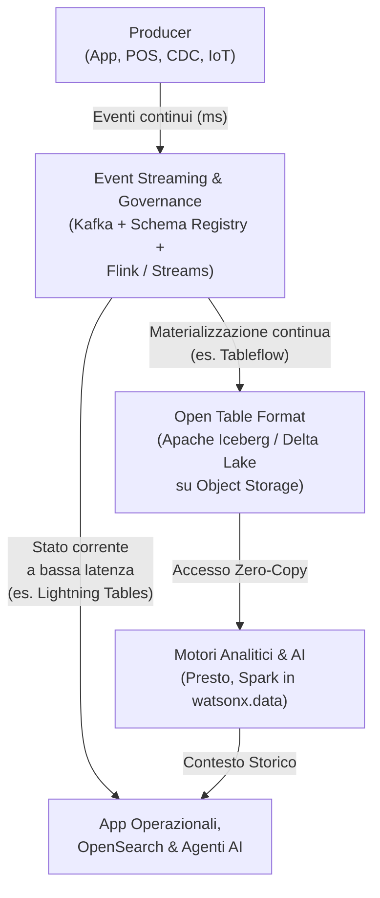

La tabella seguente chiarisce le differenze tra **Data Lakehouse** e **Streamhouse** (richiamando il confronto *"A Tale of Two Houses"* citato nelle fonti Confluent[^4]):

| Aspetto | Data Lakehouse | Streamhouse |
| :--- | :--- | :--- |
| **Focus principale** | Unificare analisi storiche (Warehouse) e flessibilità di storage (Lake) su tabelle aperte | Unificare l'elaborazione continua degli eventi in tempo reale con l'accesso analitico e AI |
| **Ingestione tipica** | Micro-batch o caricamenti periodici (ELT) verso Object Storage | **Streaming continuo** evento per evento fin dalla nascita del dato |
| **Latenza tipica del dato analizzabile** | Da qualche minuto a diverse ore | **Da millisecondi a pochi secondi** (*continuously current*) |
| **Pulizia e validazione** | Spesso eseguita *dopo* il caricamento (nella fase `T` di ELT) | **Shift-left (alla fonte)**: schemi e qualità validati prima di propagare l'evento[^4] |
| **Ruolo nell'architettura** | Fondamenta analitiche storiche aperte (es. IBM watsonx.data) | Sistema nervoso centrale in tempo reale che alimenta app, agenti AI e lo stesso Lakehouse |

### 5.4 Dati freschi per l'Intelligenza Artificiale: Context Engineering, RAG, OpenRAG e Agenti AI

Nel modulo di [Educazione Civica sull'Intelligenza Artificiale](../../../civica/ai/index.md) abbiamo studiato cosa sono il Machine Learning, le reti neurali profonde e i **Large Language Models (LLM)** basati sull'architettura Transformer. Abbiamo visto che l'addestramento di un LLM consiste nel comprimere enormi quantità di testo pubblico di internet dentro miliardi di parametri.

Proprio qui, però, nasce il principale ostacolo quando un'azienda vuole usare un LLM (come Claude, GPT o modelli open-weight su IBM watsonx) nei propri processi lavorativi: **un LLM pre-addestrato non conosce i dati privati dell'azienda e vive fotografato al passato della sua data di addestramento**. Se un utente chiede a un chatbot aziendale: *"Qual è lo stato attuale della mia spedizione #7842 e posso avere un rimborso immediato?"*, un LLM isolato o inventerà una risposta plausibile ma falsa (**allucinazione**), oppure risponderà di non poterlo sapere.

#### Dal RAG semplice all'OpenRAG su IBM watsonx.data

Per risolvere il problema delle allucinazioni è nata la tecnica **RAG (*Retrieval-Augmented Generation* — Generazione Aumentata dal Recupero)**[^2][^4][^7]:

1. **Indicizzazione della conoscenza**: i documenti aziendali (manuali, contratti PDF, schede prodotto, FAQ) vengono suddivisi in blocchi (*chunk*) e trasformati da un modello di **embedding** in vettori numerici che ne catturano il significato semantico.
2. **Archiviazione in un motore di ricerca vettoriale**: questi vettori vengono salvati in un database vettoriale o in un motore di ricerca ibrido come **OpenSearch** (integrato nativamente in IBM watsonx.data)[^2][^7].
3. **Recupero al momento della domanda**: quando l'utente fa una domanda, il sistema converte la domanda in vettore, cerca i documenti aziendali più rilevanti e li inserisce nel prompt inviato all'LLM come *contesto verificato*, chiedendogli di rispondere **solo** sulla base di quelle fonti.

Tuttavia, le fonti IBM watsonx.data evidenziano che il **RAG tradizionale basato solo su vettori è spesso rigido e insufficiente**[^2]: la sola ricerca vettoriale può perdere sigle esatte, codici prodotto o relazioni complesse tra più tabelle. Per questo watsonx.data introduce **OpenRAG**: un approccio avanzato che combina:
- elaborazione strutturata dei documenti;
- **ricerca ibrida** (vettori semantici + parole chiave esatte tramite **OpenSearch**);
- **recupero agentico (*agentic retrieval*)** e orchestrazione capace di decidere dinamicamente quali fonti interrogare (documenti, tabelle SQL via Presto, stato operativo via Cassandra) per produrre risposte AI molto più accurate e spiegabili[^2].

#### *Context Engineering*: perché l'AI ha bisogno dello Streaming in tempo reale

C'è però un secondo problema, ancora più sottile: **la freschezza del contesto**[^4][^7].
Immagina che il tuo sistema RAG aggiorni l'indice vettoriale una sola volta al giorno, a mezzanotte, con un job batch dal Data Lake. Alle 10:30 del mattino, un cliente scrive all'assistente AI perché il suo pacco si è bloccato al centro smistamento alle 09:15, oppure perché ha appena cambiato indirizzo alle 10:20. Con un indice aggiornato a mezzanotte, **l'agente AI fornirà all'utente informazioni vecchie di ore, prendendo decisioni sbagliate**!

Nasce così la disciplina del **Context Engineering** (*ingegneria del contesto per l'AI*)[^4][^7]: progettare l'infrastruttura dati affinché ogni modello o agente AI riceva al momento della richiesta un contesto:
- **fresco al millisecondo**, grazie a flussi **Apache Kafka / Confluent / Event Streams** che aggiornano continuamente indici OpenSearch e tabelle operative;
- **completo di memoria storica**, grazie all'integrazione con il **Data Lakehouse (watsonx.data / Iceberg)**;
- **governato e sicuro**, perché il **Data Fabric** applica mascheramento dei dati sensibili, controlli di accesso e *data lineage* prima che il dato entri nel prompt dell'LLM;
- **azionato in sicurezza**, tramite standard come **MCP** (*Model Context Protocol*, esposto da IBM App Connect) e orchestratori di **Agentic AI** come **IBM watsonx Orchestrate** o **Confluent Intelligence**[^2][^4][^6].

Questa centralità dello streaming in tempo reale per il successo dell'Intelligenza Artificiale trova riscontro anche nei dati di mercato raccolti nel *2026 Data Streaming Report* di Confluent (basato sulle risposte di 4.625 leader IT)[^1][^14] — le organizzazioni utilizzano sempre più il *data streaming* come infrastruttura di base affidabile in tempo reale per accelerare l'adozione dell'AI e trasformare modelli potenti in valore concreto di business.

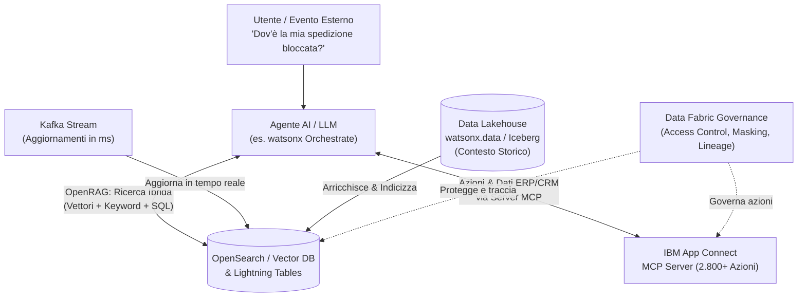

> [!TIP]
> **Raccordo con il programma del corso — AI Act**: in [Educazione Civica — AI Act](../../../civica/ai/index.md#lapproccio-basato-sul-rischio) abbiamo visto che il regolamento europeo impone per i sistemi ad alto rischio alta qualità dei dataset, tracciabilità (*logging*), trasparenza e supervisione umana. Costruire sistemi AI sopra un Lakehouse governato e un Data Fabric con *data lineage* completo non è solo buona ingegneria: è la base tecnica concreta per essere conformi alle normative europee.

##### Esempio concettuale: come un agente AI usa uno strumento esposto via MCP

Per rendere ancora più chiaro il ruolo del server **MCP** (*Model Context Protocol*) di **IBM App Connect**, osserviamo che cosa "vede" un agente AI quando si collega al server MCP aziendale:

```json
{
  "tool": "erp_verifica_stato_spedizione",
  "description": "Recupera in tempo reale lo stato della spedizione e il corriere assegnato dato l'ID ordine.",
  "inputSchema": {
    "type": "object",
    "properties": {
      "idOrdine": { "type": "integer", "description": "Identificativo numerico dell'ordine" }
    },
    "required": ["idOrdine"]
  }
}
```

Quando il cliente chiede *"Dov'è finito il mio ordine 9042?"*, l'LLM non inventa una risposta: genera una chiamata strutturata `erp_verifica_stato_spedizione(idOrdine=9042)`. Il runtime di App Connect verifica i permessi di sicurezza, interroga il sistema logistico reale (o i dati live), maschera eventuali campi sensibili non autorizzati e restituisce all'agente il risultato certificato su cui formulare la risposta finale.

### 5.5 The Enterprise Blueprint: la visione d'insieme end-to-end

Mettendo insieme tutti i capitoli visti finora, possiamo finalmente leggere dall'inizio alla fine la "grande mappa" (*The Enterprise Blueprint* nella slide 28 della presentazione[^7]) di un'architettura dati aziendale moderna:

1. **Generazione dei dati**: Web App, App Mobile, microservizi REST (come quelli che costruiamo con ASP.NET Core in Docker), database relazionali operativi (MariaDB, PostgreSQL, Oracle, SQL Server), sensori IoT e piattaforme SaaS generano continuamente transazioni ed eventi.
2. **Cattura e Movimento (*Data in Motion* & *iPaaS*)**: tramite connettori **CDC**, **Kafka Connect** o flussi **IBM App Connect**, ogni cambiamento viene catturato senza bloccare i database di origine e pubblicato su **Apache Kafka** (gestito con **Confluent** o **IBM Event Streams**), dove gli schemi vengono verificati dallo **Schema Registry**.
3. **Convergenza e Storage Aperto (*Streamhouse* & *Lakehouse*)**: i flussi vengono elaborati in tempo reale (con **Kafka Streams** o **Apache Flink**) per alimentare immediatamente microservizi reattivi e dashboard live, e contemporaneamente materializzati in formati aperti (**Apache Iceberg** / **Delta Lake**) su **Object Storage** a basso costo all'interno di un Data Lakehouse multi-motore come **IBM watsonx.data**.
4. **Tessuto Connettivo e Governance (*Data Fabric*)**: al di sopra di tutto l'ecosistema (inclusi eventuali server on-premise legacy mai migrati), il **Data Fabric** applica catalogazione con metadati attivi, virtualizzazione *zero-copy*, controlli di accesso, mascheramento dei dati sensibili e *data lineage*.
5. **Consumo Specializzato**: sullo stesso patrimonio governato e senza duplicazioni inutili lavorano in parallelo **Presto** (per query SQL e reportistica BI), **Apache Spark** (per trasformazioni pesanti e training ML), **OpenSearch** (per OpenRAG e ricerca ibrida), **Cassandra** (per letture/scritture operative a bassa latenza) e gli **Agenti AI** connessi tramite **MCP**.

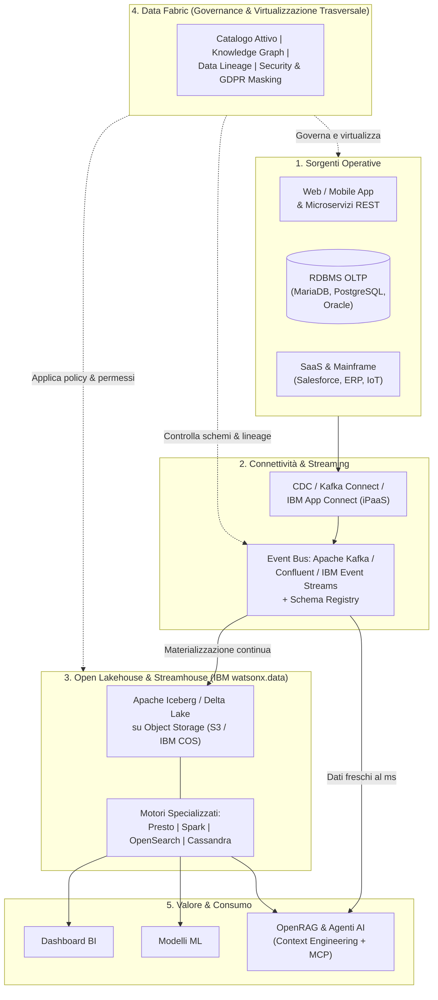

#### Check-list operativa in 5 passi per progettare un ecosistema moderno

Riprendendo la sintesi operativa del report generato nel notebook[^7], ecco i cinque passi logici con cui un team di ingegneri progetta un'architettura di questo tipo:

1. **Identificare gli eventi di business critici**: distinguere quali operazioni richiedono una chiamata REST sincrona all'utente e quali cambiamenti di stato generano valore se propagati come eventi in tempo reale (pagamenti, ordini, variazioni di magazzino, telemetria).
2. **Connettere le sorgenti senza riscrivere i sistemi esistenti**: preferire pattern **CDC** non invasivi e connettori standard (**Kafka Connect**, **IBM App Connect**) invece di riscrivere applicazioni legacy funzionanti o creare script fragili punto-a-punto.
3. **Scegliere infrastruttura gestita e affidabile per la produzione**: valutare piattaforme come **IBM Event Streams** o **Confluent** quando servono SLA al 99,99%, replica geografica multi-zona, autoscaling e certificazioni di sicurezza senza dover gestire manualmente cluster complessi.
4. **Imporre contratti di dati e governance fin dall'inizio**: attivare uno **Schema Registry**, classificare i campi sensibili nei metadati attivi, automatizzare mascheramento, controllo accessi e *data lineage* per evitare *Data Swamp* e garantire conformità al GDPR e all'AI Act.
5. **Convergere verso formati aperti e motori specializzati**: archiviare i dati in standard aperti (**Apache Iceberg** / **Parquet**) in un Data Lakehouse come **IBM watsonx.data** (sfruttando l'ecosistema open source di **Presto**, **Spark**, **OpenSearch**, **Cassandra**, **Docker** e **Kubernetes**[^15]), scegliendo il motore adatto a ogni carico per evitare costi inutili e *vendor lock-in*.

#### Tracciamento passo-passo di uno scenario reale lungo i 5 livelli

Per vedere come ogni componente cooperi senza frizioni, seguiamo il percorso completo di un'operazione dall'app sullo smartphone fino all'agente di supporto clienti:

1. **T = 0 ms — Azione utente (REST + OLTP)**: una cliente completa un ordine nell'App e-commerce. La richiesta HTTPS `POST /api/ordini` arriva alla Minimal API, che salva la transazione ACID nel database PostgreSQL/MariaDB e risponde `201 Created` in pochi millisecondi.
2. **T = +15 ms — Cattura CDC e Streaming**: il connettore **CDC** legge il commit dal log transazionale del database e pubblica l'evento `OrdineCreato` sul topic Kafka `ordini-ecommerce` (validato dallo **Schema Registry** su **IBM Event Streams** o **Confluent**).
3. **T = +40 ms — Coreografia tra microservizi e iPaaS**: in parallelo e senza bloccare l'utente, il servizio di magazzino prenota i colli, **IBM App Connect** aggiorna il CRM SaaS (Salesforce) e il servizio notifiche invia la conferma via email.
4. **T = +500 ms — Materializzazione nello Streamhouse / Lakehouse**: il flusso di eventi arricchiti viene scritto in formato **Apache Iceberg / Parquet** su Object Storage dentro **IBM watsonx.data**, aggiornando allo stesso tempo l'indice **OpenSearch** e lo stato operativo.
5. **T = +2 minuti — Query BI e Agente AI consapevole del contesto**: quando un manager apre la dashboard BI, **Presto** legge i dati già aggiornati nello stesso Lakehouse (*zero-copy*); se la cliente apre la chat di assistenza chiedendo *"Posso cambiare l'indirizzo dell'ordine appena fatto?"*, l'agente AI interroga **OpenRAG** su OpenSearch (trovando l'ordine di 2 minuti fa, non quello di ieri sera!) e usa un'azione governata sul server **MCP** di App Connect per verificare e aggiornare l'indirizzo rispettando tutte le policy di sicurezza del **Data Fabric**.

---

## 6. Casi d'Uso Reali, Raccordo con il Programma, Orientamento Professionale e Glossario

Per fissare definitivamente i concetti studiati, questo capitolo conclusivo raccoglie le applicazioni concrete documentate nelle fonti aziendali, collega punto per punto la teoria enterprise al nostro programma scolastico di quinta e offre una bussola per l'orientamento professionale dopo il diploma.

### 6.1 Casi d'uso reali e impatti misurati dalle fonti

Le architetture descritte in questa guida non sono esercizi teorici: governano quotidianamente servizi critici utilizzati da milioni di persone. Analizziamo i casi reali documentati nelle fonti del notebook[^2][^4][^5][^6][^7], suddivisi per settore applicativo, evidenziando sempre il **problema di partenza**, la **soluzione architetturale adottata** e l'**impatto misurato**.

#### Settore 1: Finanza, Banche e Conformità Fiscale

Il settore finanziario è uno dei più esigenti al mondo perché combina volumi enormi, latenze strettissime e normative rigidissime (come PCI-DSS e GDPR):

- **Rilevamento delle frodi bancarie in tempo reale (< 50 ms)**:
  - *Problema*: controllare i log delle transazioni POS a fine giornata in batch significa scoprire una carta clonata quando il truffatore ha già prelevato o acquistato merce.
  - *Soluzione*: ogni strisciata POS emette un evento su **Apache Kafka / Confluent**. Un modello di Machine Learning valuta la transazione in meno di 50 millisecondi incrociando l'evento corrente con lo storico comportamentale e può bloccare l'operazione prima ancora che lo scontrino venga stampato[^4][^7].
- **EY (*Ernst & Young*) — Validazione fiscale globale con IBM watsonx.data**:
  - *Problema*: consolidare informazioni fiscalmente critiche provenienti da numerosi sistemi eterogenei distribuiti in tutto il mondo per verificare la conformità delle fatture, riducendo le lente revisioni manuali.
  - *Soluzione*: utilizzo di **IBM watsonx.data** come base dati unificata per automatizzare i controlli sui dati consolidati.
  - *Risultato misurato*: oltre il **95% di accuratezza** nella validazione delle fatture al primo passaggio[^2].
- **DATEV — Integrazione finanziaria ad alta sovranità con IBM App Connect**:
  - *Problema*: integrare nuovi servizi digitali con l'infrastruttura IT esistente e la strategia API, rispettando requisiti stringenti di controllo diretto sui dati sensibili dei clienti.
  - *Soluzione*: piattaforma di integrazione basata su **IBM App Connect Enterprise** in modalità *self-hosted* (ospitata autonomamente), evitando esposizioni non controllate[^6].
- **Jana Small Finance Bank, Karnataka Bank, Al Rajhi Capital e neoleap**:
  - *Problema*: banche e società finanziarie in rapida trasformazione digitale dovevano collegare vecchi sistemi bancari interni (*core banking* on-premise / private cloud) con nuove app mobili, API aperte e prodotti finanziari digitali sicuri.
  - *Soluzione*: **IBM App Connect** come fulcro per il routing, la trasformazione, l'arricchimento e l'orchestrazione sicura tra data center privati e cloud, riducendo i costi di manutenzione e accelerando il rilascio di nuovi servizi[^6].

#### Settore 2: Logistica, Manifattura e Supply Chain

Nelle fabbriche e nei magazzini moderni, pochi secondi di ritardo o un dato errato provocano spedizioni sbagliate, fermi linea e costi enormi:

- **SIB Solutions — Controllo qualità in magazzino a zero errori**:
  - *Problema*: individuare errori di imballaggio e spedizione nei centri logistici prima che i colli lascino il magazzino.
  - *Soluzione*: utilizzo di **IBM Event Streams** (Apache Kafka gestito) per trasmettere e correlare in tempo reale i flussi delle telecamere video, le scansioni dei codici a barre e i microservizi di Intelligenza Artificiale, avvisando istantaneamente gli operatori su dashboard dedicate[^5][^7].
  - *Risultato misurato*: riduzione verso un **tasso di errore pari a zero** nei processi logistici monitorati[^5].
- **SAS, GEP, TINE, Tabadul e Highbroad Materials**:
  - **SAS**: sostituendo pipeline frammentate punto-a-punto e batch con la piattaforma unificata di streaming **Confluent**, ha ottenuto un **risparmio del 69%** sui costi infrastrutturali[^4].
  - **GEP** (*supply chain*): alimentando i sistemi di AI/ML con dati freschi in streaming tramite **Confluent**, ha raggiunto prestazioni predittive **14 volte superiori**[^4].
  - **TINE**: democratizzazione dei dati e semplificazione operativa in una complessa filiera alimentare mediante **IBM App Connect**[^6].
  - **Tabadul**: velocizzazione dello scambio informativo nelle procedure doganali di importazione ed esportazione con **App Connect**, riducendo il *time to market*[^6].
  - **Highbroad Materials**: efficientamento della produzione industriale di componenti elettronici integrando i sistemi di fabbrica con **App Connect**[^6].

#### Settore 3: Sport, Intrattenimento e Piattaforme Digitali Globali

Lo sport di altissimo livello e le piattaforme digitali con decine di milioni di utenti dimostrano in modo spettacolare il valore dell'unione tra *streaming in tempo reale* e *storico nel Lakehouse*:

- **Scuderia Ferrari — Telemetria di Formula 1 e coinvolgimento dei tifosi**:
  - *Problema*: durante un Gran Premio di Formula 1, i sensori della monoposto generano milioni di punti dati al secondo (velocità, giri motore, temperatura gomme) che devono servire sia agli ingegneri di pista sia per offrire contenuti interattivi a milioni di tifosi nel mondo, combinando telemetria live e archivio storico delle gare.
  - *Soluzione*: utilizzo di **IBM watsonx.data** per rendere accurata e unificata la telemetria live insieme ai dati storici delle corse[^2][^7].
  - *Risultato misurato*: **raddoppio degli utenti attivi giornalieri** sull'app globale Ferrari e **aumento del 35%** del coinvolgimento sui dati[^2].
- **Wimbledon 2025 (*Match Chat*) e UFC**:
  - **Wimbledon**: durante i Campionati del 2025, la *Match Chat* basata su **IBM watsonx** ha gestito **milioni di interazioni** con i tifosi trasformando i dati in diretta delle partite e le statistiche storiche in risposte istantanee in linguaggio naturale[^2].
  - **UFC**: organizzando statistiche rapide live e archivi storici con **IBM watsonx.data**, ha generato **tre volte più insight** sui combattimenti per trasmissioni televisive, app e social[^2].
- **Norsk Tipping e Notion**:
  - **Norsk Tipping** (operatore nazionale norvegese di lotterie e scommesse): usa **IBM Event Streams** per elaborare flussi transazionali ad alta reattività garantendo al tempo stesso controlli in tempo reale a tutela del gioco responsabile[^5].
  - **Notion** (piattaforma collaborativa di produttività): utilizza **Confluent** per pulire i dati alla fonte ed evitare ritardi a valle, supportando **oltre 100 milioni di utenti giornalieri**[^4].

#### Settore 4: Sanità, Legale, Pubblica Amministrazione e Supporto IT

- **ViClinic (*Sanità e Agentic AI*)**:
  - Combinando **IBM watsonx.data** con propri servizi dati e gli agenti di **watsonx Orchestrate**, fornisce un contesto clinico e operativo condiviso per automatizzare assunzione pazienti, documentazione, autorizzazioni e fatturazione, mostrando un potenziale di **riduzione del 10–20%** dell'inefficienza amministrativa[^2].
- **Dynamiq (*Settore Legale*)**:
  - Utilizzando **IBM watsonx.data** come piattaforma dati unificata e governata per migliaia di contratti e testi normativi, ha **ridotto del 50% i tempi di revisione dei contratti** accelerando i flussi di lavoro basati su AI[^2].
- **Digital Ajman (*Pubblica Amministrazione*)**:
  - Impiega gli strumenti **IBM Cloud Pak for Integration (CP4I)** e **App Connect** per collegare enti locali, federali e privati, semplificando l'erogazione dei servizi digitali ai cittadini[^6].
- **IBM Development Support (*Supporto Tecnico Interno*)**:
  - Utilizzando **IBM App Connect** per integrare i sistemi interni di ticketing e automatizzare le notifiche basate su eventi, ha accelerato del **23% la velocità di risoluzione dei ticket** di assistenza[^6].

#### Sintesi trasversale dei casi d'uso

| Settore | Organizzazione | Tecnologie chiave citate nelle fonti | Risultato misurato o beneficio principale |
| :--- | :--- | :--- | :--- |
| **Fisco e Consulenza** | EY | IBM watsonx.data | **> 95% accuratezza** nella validazione fatture al primo passaggio[^2] |
| **Logistica** | SIB Solutions | IBM Event Streams + AI | Controllo qualità real-time con obiettivo **zero errori**[^5][^7] |
| **Analytics & Supply Chain** | SAS / GEP | Confluent (Data Streaming) | **-69% costi** infrastrutturali (SAS); **14x prestazioni predittive** (GEP)[^4] |
| **Motorsport** | Scuderia Ferrari | IBM watsonx.data | **2x utenti attivi giornalieri** sull'app e **+35% engagement** sui dati[^2][^7] |
| **Tennis / Sport Live** | Wimbledon 2025 / UFC | IBM watsonx / watsonx.data | **Milioni di interazioni** live (Wimbledon); **3x insight** (UFC)[^2] |
| **Produttività Cloud** | Notion | Confluent | Dati puliti alla fonte per **100M+ utenti giornalieri**[^4] |
| **Legale** | Dynamiq | IBM watsonx.data | **-50% tempi** di revisione dei contratti[^2] |
| **Sanità** | ViClinic | watsonx.data + watsonx Orchestrate | **-10–20% inefficienza** amministrativa tramite agenti AI[^2] |
| **Supporto IT** | IBM Support | IBM App Connect | **+23% velocità** di risoluzione dei ticket[^6] |

---

### 6.2 Mappa di raccordo con il programma di Informatica della classe 5ª

Uno degli scopi principali di questa guida è dimostrare che **tutto ciò che studi a scuola nel quinto anno non è "teoria astratta separata dal lavoro", ma la base diretta su cui poggiano le architetture enterprise**.

Vediamo nel dettaglio come ogni macro-blocco del [programma del corso](../../../README.md) si collega ai concetti visti in queste pagine:

1. **Basi di dati SQL, Algebra Relazionale e Progettazione**:
   - In classe partiamo da [Elementi di base dell'SQL](../../../sql/sql-docs/sql-p1/index.md), [SELECT e integrità referenziale](../../../sql/sql-docs/sql-p2/index.md), [Vincoli e indici](../../../sql/sql-docs/sql-p3/index.md), [JOIN](../../../sql/sql-docs/sql-p6/index.md) e [GROUP BY](../../../sql/sql-docs/sql-p7/index.md). Quel medesimo linguaggio SQL è esattamente il linguaggio usato nei Data Warehouse, nel Data Lakehouse (tramite il motore distribuito **Presto** su **IBM watsonx.data**) e nelle query federate di **Data Virtualization**.
   - Lo studio di [Subquery, insiemi e Viste (`CREATE VIEW`)](../../../sql/sql-docs/sql-p8/index.md) introduce il concetto di astrazione logica sopra tabelle sottostanti, che nel **Data Fabric** diventa virtualizzazione su più database e cloud diversi.
   - Le [Transazioni ACID, trigger e stored routine](../../../sql/sql-docs/sql-p9/index.md) spiegano le garanzie di atomicità e isolamento che gli **Open Table Formats** (Apache Iceberg, Delta Lake) ricreano sopra file Parquet immutabili in Object Storage.
   - La [Normalizzazione](../../../rasd/normalizzazione/index.md), l'[Algebra Relazionale](../../../algebra/index.md) e le [Considerazioni sulla ridondanza](../../../sql/sql-docs/sql-cumulative-exercizes-overview/index.md) mostrano il compromesso tra assenza di anomalie in scrittura (**OLTP**) e denormalizzazione per velocità di lettura aggregata (**OLAP**).

2. **Database Distribuiti, Amministrazione, Sicurezza e Caching**:
   - Il modulo su [Scalabilità e Fault Tolerance nei Database Moderni](../../../web/web-docs/distributed-systems/databases/scalability-falut-tolerance/index.md) (replicazione Master-Slave/Master-Master, Binary Log, Sharding, Teorema CAP) anticipa esattamente i meccanismi interni di un cluster **Apache Kafka** (partizioni = sharding del flusso; leader/follower/ELR = replicazione e consenso; Binary Log = sorgente per il **Change Data Capture**).
   - Le competenze del [Database Administrator (DBA)](../../../web/web-docs/distributed-systems/databases/db-administration/index.md) e la sicurezza in [DBMS e sicurezza](../../../sql/sql-docs/sql-p4/index.md) si evolvono su scala aziendale nella **Data Governance**, nello Schema Registry, negli strumenti come Apache Ranger/Atlas e nel ruolo del Data Platform Engineer.
   - Il [Caching in ASP.NET Core (In-Memory, Distributed Cache con Redis, HybridCache)](../../../asp.net/api-docs/minimal-api/configure-api-p7/index.md) e la sezione [NoSQL Databases](../../../README.md#nosql-databases) spiegano perché accanto agli RDBMS servano store chiave-valore o NoSQL ad altissima velocità — lo stesso principio per cui **IBM watsonx.data** affianca **Apache Cassandra** ai motori SQL e analitici.

3. **Web Architecture, API REST, Microservizi e Sicurezza Applicativa**:
   - Il [Protocollo HTTP](../../../web/web-docs/http-protocol/index.md), le [Minimal API ASP.NET Core](../../../asp.net/api-docs/minimal-api/getting-started/index.md) e l'accesso ai dati con [Entity Framework Core](../../../asp.net/api-docs/minimal-api/use-databases-p1/index.md) rappresentano la porta d'ingresso sincrona delle applicazioni moderne, ma mostrano anche il punto in cui conviene affiancare la comunicazione asincrona **Event-Driven** via Kafka per disaccoppiare i microservizi.
   - Il [Reverse Proxy e Load Balancing con Nginx](../../../web/web-docs/distributed-systems/reverse-proxy/nginx/intro/index.md), l'autenticazione con [JWT](../../../web/web-docs/user-identity/jwt-token-based-authentication-authorization/index.md) e [OAuth 2.0 / OpenID Connect](../../../web/web-docs/oauth-oidc/index.md) trovano continuità nei gateway API, nell'autenticazione SASL/TLS/ACL di Kafka e nella protezione delle integrazioni ibride in IBM App Connect.

4. **Virtualizzazione, Container, Cloud e Observability**:
   - I moduli su [Virtualizzazione, VM vs Container e Kubernetes](../../../cloud/docs/virtualization-technologies/index.md), [Docker](../../../docker/docker-docs/getting-started/index.md), l'esempio completo con [Docker Compose, Nginx, Worker separati, K6, Prometheus e Grafana (`EducationalGames`)](../../../docker/docker-docs/local-dev/examples/educationalgames/index.md) e il cloud con [Azure Container Instances e Azure Container Apps](../../../azure/containers/docs/aci-vs-aca/aci-vs-aca.md) sono la base infrastrutturale diretta su cui girano oggi sia i broker **Apache Kafka** (e **Confluent for Kubernetes** / **IBM Event Streams su OpenShift**), sia i motori containerizzati di **IBM watsonx.data** e **IBM App Connect**, sia la **Data Observability**.

5. **Normativa, Etica e Intelligenza Artificiale**:
   - I [Cenni al GDPR](../../../web/web-docs/gdpr/index.md) motivano direttamente la *Data Gravity*, il mascheramento dinamico, la crittografia e il *Data Lineage* nel Data Fabric.
   - La dispensa di Educazione Civica sull'[Intelligenza Artificiale (ML, DL, LLM, Transformer, costi e AI Act)](../../../civica/ai/index.md) si completa naturalmente con i concetti di **dati AI-ready**, **OpenRAG**, **Context Engineering** e **Agentic AI** esposti in questa guida.

| Area del Programma (5ª Informatica) | Argomento studiato a scuola | Collegamento diretto nelle Architetture Enterprise | Dispensa di riferimento nel repository |
| :--- | :--- | :--- | :--- |
| **SQL Base e Avanzato** | `SELECT`, `JOIN`, `GROUP BY`, `VIEW`, tipi dato, indici | Query analitiche OLAP in **Presto/Spark**, viste logiche di **Data Virtualization** | [SQL p1](../../../sql/sql-docs/sql-p1/index.md), [JOIN](../../../sql/sql-docs/sql-p6/index.md), [GROUP BY](../../../sql/sql-docs/sql-p7/index.md), [Viste](../../../sql/sql-docs/sql-p8/index.md) |
| **Transazioni e Modellazione** | ACID (`COMMIT`/`ROLLBACK`), 3NF, ridondanza controllata | Snapshot atomici in **Apache Iceberg / Delta Lake**, OLTP vs OLAP | [Transazioni](../../../sql/sql-docs/sql-p9/index.md), [Normalizzazione](../../../rasd/normalizzazione/index.md), [Ridondanza](../../../sql/sql-docs/sql-cumulative-exercizes-overview/index.md) |
| **Database Distribuiti** | Replicazione Master-Slave, Binary Log, Sharding, CAP | **Change Data Capture (CDC)**, partizioni Kafka, Leader/ELR, tiering | [Scalabilità e Fault Tolerance](../../../web/web-docs/distributed-systems/databases/scalability-falut-tolerance/index.md), [DBA](../../../web/web-docs/distributed-systems/databases/db-administration/index.md) |
| **Web API e Caching** | HTTP, API REST ASP.NET Core, EF Core, Redis | Limiti del REST sincrono, **Event-Driven / Kafka**, Cassandra e Lightning Tables | [HTTP](../../../web/web-docs/http-protocol/index.md), [Minimal API](../../../asp.net/api-docs/minimal-api/getting-started/index.md), [Caching](../../../asp.net/api-docs/minimal-api/configure-api-p7/index.md) |
| **DevOps, Docker e Cloud** | Docker, Compose, Worker, Nginx, Prometheus/Grafana, ACA | Deploy ibrido/Kubernetes di watsonx.data, Event Streams, App Connect, Data Observability | [Virtualizzazione & K8s](../../../cloud/docs/virtualization-technologies/index.md), [Docker](../../../docker/docker-docs/getting-started/index.md), [EducationalGames](../../../docker/docker-docs/local-dev/examples/educationalgames/index.md), [Azure ACA](../../../azure/containers/docs/aci-vs-aca/aci-vs-aca.md) |
| **Sicurezza e Normativa** | SQL `GRANT`, TLS/HTTPS, JWT, OAuth 2.0, GDPR | SASL/TLS/ACL Kafka, Apache Ranger, mascheramento, Data Lineage | [DBMS Sicurezza](../../../sql/sql-docs/sql-p4/index.md), [JWT](../../../web/web-docs/user-identity/jwt-token-based-authentication-authorization/index.md), [OAuth2/OIDC](../../../web/web-docs/oauth-oidc/index.md), [GDPR](../../../web/web-docs/gdpr/index.md) |
| **Intelligenza Artificiale** | ML, Deep Learning, LLM, Transformer, AI Act | Dati *AI-ready*, **OpenRAG**, OpenSearch, **Context Engineering**, **MCP** | [Educazione Civica — AI](../../../civica/ai/index.md) |

---

### 6.3 Orientamento professionale: quale percorso dopo il diploma?

Arrivati al quinto anno di un istituto tecnico informatico, una delle domande più importanti riguarda gli sbocchi lavorativi e universitari. Le architetture dati moderne non vengono progettate e gestite da un solo "tuttofare", ma da figure professionali complementari che collaborano sullo stesso ecosistema[^7].

La buona notizia è che **le competenze già acquisite a scuola** (SQL, progettazione concettuale/logica, programmazione ad oggetti, API REST, reti, container Docker) costituiscono il trampolino diretto verso ciascuno di questi profili.

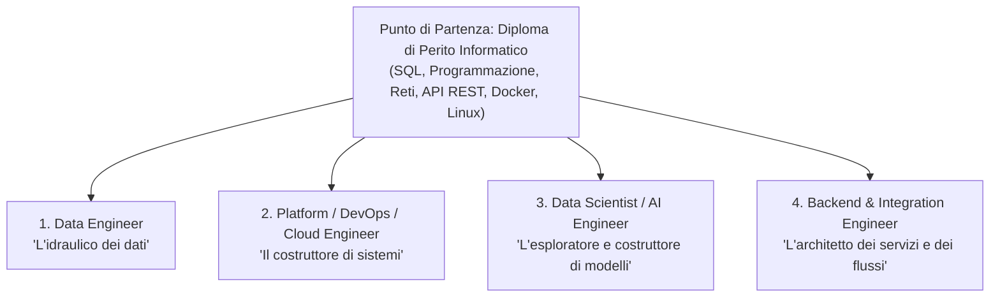

#### 1. Data Engineer ("L'idraulico dei dati")

Il **Data Engineer** costruisce e mantiene le "tubature" (*pipeline*) che trasportano i dati dalle sorgenti operative fino al Lakehouse e li trasformano in asset puliti, affidabili e pronti per l'analisi e l'Intelligenza Artificiale.

- **Attività quotidiane tipiche**:
  - Progettare pipeline **ELT** ed **ETL** orchestrate tramite DAG (es. Apache Airflow, Spark).
  - Configurare connettori **CDC** (*Change Data Capture*) e flussi su **Apache Kafka** / **Kafka Connect**.
  - Modellare tabelle analitiche in **Apache Iceberg** o **Delta Lake** dentro un Lakehouse come **IBM watsonx.data**, ottimizzando partizionamento e formati colonnari (Parquet).
  - Applicare regole di qualità dei dati, controllo schemi (**Schema Registry**) e tracciabilità (**Data Lineage**).
- **Cosa sai già fare da scuola**:
  - Scrivere query SQL complesse (`JOIN`, `GROUP BY`, sottoquery, viste), comprendere la normalizzazione e la denormalizzazione, scrivere script di elaborazione dati e comprendere il *Binary Log* nella replicazione.
- **Cosa approfondire dopo il diploma**:
  - **SQL avanzato** (window functions, CTE) e motori distribuiti (**Presto / Trino**, **Apache Spark**).
  - **Python** orientato ai dati e **Apache Kafka** (concetti di partizioni, offset, SerDes, Avro).
  - Formati tabellari aperti (**Apache Iceberg**) e basi di **Data Governance**.

#### 2. Platform / DevOps / Cloud Engineer ("Il costruttore di sistemi")

Il **Platform / DevOps Engineer** progetta, automatizza e mantiene viva l'infrastruttura su cui girano tutti i microservizi, i cluster Kafka, i nodi del Data Fabric e i motori del Lakehouse, garantendo sicurezza, scalabilità e continuità operativa.

- **Attività quotidiane tipiche**:
  - Gestire cluster **Docker** e **Kubernetes** / **Red Hat OpenShift** su ambienti ibridi e multicloud (AWS, Azure, IBM Cloud).
  - Configurare infrastruttura come codice (**IaC**, ad esempio con **Terraform**, citato nelle fonti di IBM Event Streams[^5]).
  - Assicurare alta disponibilità (**SLA 99,99%**), replica geografica (*MirrorMaker 2*, *Cluster Linking*), backup e *Disaster Recovery*.
  - Implementare sicurezza di rete, cifratura TLS/SSL, gestione segreti/chiavi (**Key Protect**), **observability** e monitoraggio metriche (Prometheus, Grafana, IBM Cloud Monitoring).
- **Cosa sai già fare da scuola**:
  - Lavorare con [macchine virtuali e container Docker](../../../cloud/docs/virtualization-technologies/index.md), scrivere `Dockerfile` e `docker-compose.yml`, configurare reverse proxy [Nginx](../../../web/web-docs/distributed-systems/reverse-proxy/nginx/intro/index.md), monitorare servizi con [Prometheus e Grafana](../../../docker/docker-docs/local-dev/examples/educationalgames/index.md), gestire HTTPS/TLS e deployment cloud su [Azure Container Apps](../../../azure/containers/docs/aci-vs-aca/aci-vs-aca.md).
- **Cosa approfondire dopo il diploma**:
  - **Kubernetes** in produzione (Pod, Deployment, StatefulSet per database/broker, Ingress, Helm).
  - **Terraform** / Ansible e pipeline **CI/CD** (GitHub Actions, GitLab CI).
  - Networking cloud avanzato, certificati, **SASL/ACL** e architetture multizona.

#### 3. Data Scientist / AI Engineer ("L'esploratore e costruttore di AI")

Il **Data Scientist** e l'**AI Engineer** trasformano i dati governati raccolti dal Data Engineer in modelli predittivi, statistiche avanzate e applicazioni intelligenti basate su LLM e agenti autonomi.

- **Attività quotidiane tipiche**:
  - Analizzare dataset storici su **Apache Spark** o tramite notebook Python per estrarre correlazioni, addestrare modelli di Machine Learning (classificazione, previsione frodi, manutenzione predittiva) e valutarne le metriche.
  - Progettare architetture **RAG** e **OpenRAG** collegando **OpenSearch** (ricerca ibrida vettoriale e keyword) con modelli linguistici e dati in streaming (*Context Engineering*).
  - Creare flussi di **Agentic AI** (es. tramite **watsonx Orchestrate** e server **MCP**) verificando che le risposte rispettino trasparenza, privacy e requisiti dell'**AI Act**.
- **Cosa sai già fare da scuola**:
  - Basi di statistica e matematica, programmazione logica, fondamenti di [AI, Machine Learning, Deep Learning, LLM e AI Act](../../../civica/ai/index.md), interrogazione SQL per estrarre dataset puliti.
- **Cosa approfondire dopo il diploma**:
  - **Python** (pandas, scikit-learn, PyTorch) e calcolo distribuito con **PySpark**.
  - Tecniche di **embedding**, **database vettoriali** (OpenSearch), valutazione dei sistemi **RAG** e protocollo **MCP**.
  - **MLOps**: versionamento di modelli, dataset (anche tramite *Time Travel* di Iceberg!) e monitoraggio delle derive in produzione.

#### 4. Backend & Integration Engineer ("L'architetto dei servizi e dei flussi")

Il **Backend & Integration Engineer** costruisce le applicazioni operative, le Web API e le integrazioni asincrone tra microservizi, sistemi legacy e piattaforme SaaS esterne.

- **Attività quotidiane tipiche**:
  - Sviluppare microservizi REST ad alte prestazioni (in C# ASP.NET Core, Java Spring Boot o Node.js) affiancati da Producer e Consumer **Apache Kafka**.
  - Progettare integrazioni ibride con piattaforme **iPaaS** come **IBM App Connect** (sia via *Designer* sia via *Toolkit* in ESQL/Java), esponendo API sicure e azioni **MCP** per gli agenti AI.
  - Implementare pattern di resilienza (retry, dead-letter queue, idempotenza, gestione offset e transazioni) e sicurezza applicativa (**OAuth 2.0**, **OpenID Connect**, **JWT**).
- **Cosa sai già fare da scuola**:
  - Costruire [Minimal API ASP.NET Core](../../../asp.net/api-docs/minimal-api/getting-started/index.md), usare [EF Core](../../../asp.net/api-docs/minimal-api/use-databases-p1/index.md), implementare [caching con Redis](../../../asp.net/api-docs/minimal-api/configure-api-p7/index.md) e gestire autenticazione [JWT](../../../web/web-docs/user-identity/jwt-token-based-authentication-authorization/index.md) e [OAuth2/OIDC](../../../web/web-docs/oauth-oidc/index.md).
- **Cosa approfondire dopo il diploma**:
  - Architetture **Event-Driven** e librerie client Kafka per .NET (`Confluent.Kafka`) o Java/Python.
  - Pattern distribuiti (*Outbox Pattern*, *Saga*, *CQRS*, *Idempotenza*).
  - Piattaforme **iPaaS** e standard di integrazione per agenti AI (**MCP**).

#### Tabella di sintesi per l'orientamento

| Ruolo professionale | Metafora | Basi scolastiche principali | Strumenti enterprise incontrati nella guida |
| :--- | :--- | :--- | :--- |
| **Data Engineer** | L'idraulico dei dati | SQL, Normalizzazione, Replicazione / Binary Log | Apache Spark, Presto, **Apache Iceberg**, **IBM watsonx.data**, Kafka Connect, CDC, Airflow |
| **Platform / DevOps Engineer** | Il costruttore di sistemi | Docker, Compose, Nginx, Prometheus/Grafana, Azure | Kubernetes / OpenShift, **IBM Event Streams**, **Confluent Cloud (Kora)**, Terraform, TLS/ACL |
| **Data Scientist / AI Engineer** | L'esploratore | Matematica, Educazione Civica (AI/ML/LLM/AI Act), SQL | **OpenSearch**, **OpenRAG**, Spark ML, **Context Engineering**, watsonx Orchestrate, MCP |
| **Backend & Integration Engineer** | L'architetto dei flussi | ASP.NET Core Minimal API, HTTP, Redis, JWT, OAuth2 | **Apache Kafka** (Producer/Consumer/Streams), **IBM App Connect** (Designer/Toolkit/MCP), Schema Registry |

#### Laboratorio mentale (da provare con Docker Compose): come evolvere il progetto di classe

Per rendere concreto tutto questo senza dover acquistare server aziendali, pensa a come potresti evolvere già oggi sul tuo PC un'applicazione vista in laboratorio (come `EducationalGames` in [Docker Compose](../../../docker/docker-docs/local-dev/examples/educationalgames/index.md)) aggiungendo un primo tassello *Event-Driven*:

1. **Punto di partenza**: nel `docker-compose.yml` hai già il backend ASP.NET Core, il database MariaDB, Nginx e il monitoraggio Prometheus/Grafana.
2. **Passo 1 — Aggiungere un broker Kafka in modalità KRaft**:
   Con Kafka moderno (senza ZooKeeper!), basta un **singolo container Docker** (`apache/kafka`) nel `docker-compose.yml` per avere un bus di eventi funzionante in locale sulla porta `9092`:

```yaml
# Estratto concettuale per docker-compose.yml: singolo broker Apache Kafka in modalità KRaft (senza ZooKeeper)
services:
  kafka:
    image: apache/kafka:latest
    container_name: kafka-broker
    ports:
      - "9092:9092"
    environment:
      KAFKA_NODE_ID: 1
      KAFKA_PROCESS_ROLES: broker,controller
      KAFKA_LISTENERS: PLAINTEXT://:9092,CONTROLLER://:9093
      KAFKA_ADVERTISED_LISTENERS: PLAINTEXT://localhost:9092
      KAFKA_CONTROLLER_LISTENER_NAMES: CONTROLLER
      KAFKA_LISTENER_SECURITY_PROTOCOL_MAP: CONTROLLER:PLAINTEXT,PLAINTEXT:PLAINTEXT
      KAFKA_CONTROLLER_QUORUM_VOTERS: 1@kafka:9093
      KAFKA_OFFSETS_TOPIC_REPLICATION_FACTOR: 1
```

3. **Passo 2 — Pubblicare eventi dal backend senza bloccare l'utente (ASP.NET Core Minimal API)**:
   Quando uno studente completa un quiz o viene registrato un nuovo punteggio sulla Minimal API, il backend salva la transazione ACID su MariaDB e pubblica in parallelo un evento JSON sul topic `partita-completata` tramite la libreria client ufficiale `Confluent.Kafka`:

```csharp
// Esempio concettuale in ASP.NET Core Minimal API: salvataggio OLTP + pubblicazione evento su Kafka
app.MapPost("/api/partite", async (PartitaDto dto, AppDbContext db, IProducer<string, string> producer) =>
{
    var partita = new Partita { IdUtente = dto.IdUtente, Punteggio = dto.Punteggio, Data = DateTime.UtcNow };
    db.Partite.Add(partita);
    await db.SaveChangesAsync(); // Transazione ACID su MariaDB

    var eventoJson = JsonSerializer.Serialize(new
    {
        eventType = "PartitaCompletata",
        idPartita = partita.Id,
        idUtente = partita.IdUtente,
        punteggio = partita.Punteggio,
        timestamp = partita.Data
    });

    // La chiave (IdUtente) garantisce l'ordinamento degli eventi dello stesso utente nella stessa partizione
    await producer.ProduceAsync("partita-completata", new Message<string, string>
    {
        Key = partita.IdUtente.ToString(),
        Value = eventoJson
    });

    return Results.Created($"/api/partite/{partita.Id}", partita);
});
```

4. **Passo 3 — Consumer indipendenti in parallelo (Worker Services)**:
   Un primo *Worker* .NET (Consumer Group `gruppo-notifiche`) legge dal topic per inviare email di riepilogo tramite `MailKit`; un secondo servizio (Consumer Group `gruppo-analytics`) aggiorna una classifica in tempo reale su Redis o salva i dati in file Parquet per analisi successive:

```csharp
// Esempio concettuale di Consumer asincrono in un Worker .NET
consumer.Subscribe("partita-completata");

while (!stoppingToken.IsCancellationRequested)
{
    var result = consumer.Consume(stoppingToken);
    // Elabora l'evento result.Message.Value (es. invio email o aggiornamento statistiche)
    consumer.Commit(result); // Aggiorna l'Offset ("segnalibro") solo dopo aver elaborato con successo
}
```

   Se il servizio email si ferma per qualche minuto, gli utenti continuano a giocare senza accorgersene e nessuna notifica va persa: quando il worker riparte, riprende esattamente dall'ultimo *Offset* confermato. Hai appena sperimentato in piccolo i principi della **coreografia Event-Driven**!

#### Domande di autoverifica per lo studente (ripasso ed esame)

Prima di passare al glossario finale, prova a rispondere autonomamente a queste dodici domande chiave per verificare di aver collegato tutti i concetti della guida:

1. **Perché un singolo database relazionale (RDBMS) va in crisi se esegue contemporaneamente l'app di e-commerce (OLTP) e grandi analisi su 5 anni di storico (OLAP)?**

   *Sintesi*: le operazioni OLTP toccano poche righe alla volta e richiedono bassa latenza, indici B-Tree e lock minimi; le query OLAP scansionano milioni di righe, saturano CPU, I/O e *buffer pool* della RAM e bloccano o rallentano le transazioni operative degli utenti.

2. **Che differenza c'è tra memorizzazione *row-oriented* (per righe) e *columnar* (per colonne), e perché Apache Parquet è così veloce nelle query analitiche?**

   *Sintesi*: la memorizzazione per righe velocizza `INSERT`/`UPDATE` di record completi; quella colonnare (es. Apache Parquet) salva insieme i valori di ciascuna colonna dentro *Row Groups* corredati da statistiche min/max nel *Footer*, consentendo alta compressione, lettura delle sole colonne necessarie e salto di interi blocchi inutili (*predicate pushdown*).

3. **In che cosa un Data Lake differisce da un Data Warehouse, e perché un Data Lake privo di regole rischia di diventare una *Data Swamp*?**

   *Sintesi*: il Data Warehouse usa *Schema-on-Write* ed è ottimizzato per dati strutturati/BI; il Data Lake usa *Schema-on-Read* su Object Storage economico per qualsiasi tipo di dato (anche JSON, immagini, log), ma senza metadati e governance accumula *Dark Data* inutilizzabili.

4. **In che modo un Data Lakehouse (come IBM watsonx.data) supera la separazione tra Lake e Warehouse?**

   *Sintesi*: disaccoppia calcolo e storage, archivia i dati in formati aperti su Object Storage e applica sopra di essi un *Open Table Format* (Apache Iceberg, Delta Lake) che consente a motori specializzati (Presto, Spark, OpenSearch, Cassandra) di leggere gli stessi file *zero-copy* con garanzie ACID.

5. **Come fa Apache Iceberg a supportare `UPDATE`, `DELETE` e *Time Travel* sopra file `.parquet` immutabili?**

   *Sintesi*: non modifica i file esistenti sul posto; scrive nuovi file di dati o piccoli *delete file*, registra nuovi *Manifest* e aggiorna atomicamente il puntatore allo *Snapshot* corrente nel catalogo, conservando gli snapshot storici per il *Time Travel*.

6. **Che cos'è la *Data Gravity* e perché il Data Fabric non è "un altro database"?**

   *Sintesi*: la *Data Gravity* indica che più dati si accumulano, più diventa lento, costoso e rischioso spostarli; il Data Fabric è uno strato logico di collegamento, virtualizzazione, metadati attivi (Knowledge Graph) e governance automatizzata che lascia i dati dove risiedono.

7. **In che modo il Data Fabric, il Data Lineage e il mascheramento dinamico aiutano un'azienda a rispettare il GDPR e l'AI Act?**

   *Sintesi*: evitano copie incontrollate tramite la virtualizzazione, applicano automaticamente permessi e mascheramento sui campi personali prima che raggiungano l'utente o l'AI, e tracciano origine e trasformazioni di ogni dato (*Data Lineage*) per garantire trasparenza e verificabilità.

8. **Che differenza passa tra ETL, ELT e CDC (*Change Data Capture*)?**

   *Sintesi*: l'ETL trasforma prima di caricare; l'ELT carica i dati grezzi nel Lakehouse e li trasforma con Spark/Presto; il CDC legge in tempo reale il log transazionale interno del database (come il *binlog* di MariaDB) producendo un flusso continuo delle sole modifiche senza appesantire l'RDBMS.

9. **Perché Apache Kafka non è una semplice coda di messaggi tradizionale, e a cosa servono Partizioni e Offset?**

   *Sintesi*: a differenza di una coda che cancella il messaggio dopo la lettura, Kafka conserva un commit log *append-only* persistente su disco rileggibile da più Consumer Group; le partizioni abilitano il parallelismo distribuito e l'offset è il segnalibro tracciato da ogni consumer.

10. **Che cosa ha cambiato l'introduzione di KRaft e del Tiered Storage in Apache Kafka moderno (4.4.x)?**

    *Sintesi*: **KRaft** ha eliminato la dipendenza esterna da Apache ZooKeeper gestendo i metadati nativamente dentro Kafka; il **Tiered Storage** ha separato i dati recenti su dischi locali veloci dallo storico conservato su Object Storage economico.

11. **Qual è il ruolo specifico di una piattaforma iPaaS come IBM App Connect rispetto a Kafka e a watsonx.data?**

    *Sintesi*: App Connect orchestra integrazioni applicative ibride (SaaS, DB legacy, mainframe, Kafka) con connettori no-code (*Designer*) e sviluppo pro-code (*Toolkit*), accelera lo sviluppo con *Flow Pilot* ed espone oltre 2.800 azioni agli agenti AI tramite server **MCP**.

12. **Che cos'è lo *Streamhouse* e perché il *Context Engineering* è indispensabile per gli agenti AI aziendali?**

    *Sintesi*: lo Streamhouse fonde streaming continuo in tempo reale e tabelle aperte del Lakehouse superando la doppia infrastruttura Lambda; il *Context Engineering* assicura che sistemi OpenRAG e agenti AI ricevano dati aggiornati al millisecondo (non fermi al backup della notte precedente), completi di storia e governati.

---

### 6.4 Glossario ragionato degli acronimi e dei termini chiave

Questo glossario raccoglie in ordine alfabetico tutti gli acronimi e i concetti specialistici incontrati nella guida e nelle fonti ufficiali del modulo, con spiegazioni accessibili e raccordi immediati al percorso scolastico.

#### ACID (*Atomicity, Consistency, Isolation, Durability*)
- **Che cos'è**: l'insieme delle quattro proprietà fondamentali che garantiscono l'affidabilità delle transazioni su un database (tutto o niente, rispetto dei vincoli, isolamento tra utenti concorrenti, persistenza dopo il `COMMIT`).
- **Ruolo nell'architettura moderna**: caratteristica nativa degli RDBMS OLTP, oggi estesa anche ai file immutabili dei Data Lakehouse grazie agli *Open Table Formats* come Apache Iceberg e Delta Lake[^7].
- **Raccordo con il corso**: [Transazioni SQL](../../../sql/sql-docs/sql-p9/index.md).

#### ACL (*Access Control List*)
- **Che cos'è**: elenco granulare di autorizzazioni che stabilisce quali identità (utenti, microservizi, client) possono eseguire determinate operazioni (`READ`, `WRITE`, `DESCRIBE`) su specifiche risorse, come un topic Apache Kafka[^3] o una tabella nel Lakehouse.
- **Raccordo con il corso**: evolve i concetti di privilegi `GRANT`/`REVOKE` visti in [DBMS e sicurezza](../../../sql/sql-docs/sql-p4/index.md).

#### Agentic AI (*Intelligenza Artificiale Agentica*)
- **Che cos'è**: sistemi AI basati su modelli linguistici capaci non solo di rispondere a una domanda testuale, ma di pianificare sequenze di azioni, interrogare fonti esterne (es. tramite **OpenRAG** e server **MCP**) e interagire con applicazioni aziendali in autonomia controllata[^2][^4][^6].
- **Esempi nelle fonti**: *watsonx Orchestrate* (caso ViClinic), agenti AI di *IBM App Connect*[^2][^6].

#### Apache Avro
- **Che cos'è**: formato binario aperto di serializzazione dati orientato alle righe (*row-oriented*) che incorpora uno schema JSON per descrivere i tipi dei campi[^1][^2].
- **Ruolo nell'architettura moderna**: molto utilizzato in Apache Kafka insieme allo *Schema Registry* per trasmettere eventi compatti ed evolutivi, nonché supportato tra i formati aperti di IBM watsonx.data[^2][^4].

#### Apache Cassandra (e DataStax Astra DB)
- **Che cos'è**: database NoSQL distribuito basato su architettura senza singolo punto di guasto (*masterless*), progettato per letture e scritture velocissime e scalabilità lineare orizzontale[^2].
- **Ruolo nell'architettura moderna**: uno dei quattro motori integrati in **IBM watsonx.data** per servire workload operativi a bassa latenza e applicazioni web/mobile o GenAI in tempo reale[^2].

#### Apache Flink
- **Che cos'è**: motore distribuito open source ad alte prestazioni per l'elaborazione continua di flussi di dati (*stream processing*), capace di gestire join complessi, finestre temporali e stato su larga scala[^2][^4].
- **Ruolo nell'architettura moderna**: impiegato in piattaforme come Confluent per trasformare e governare eventi in tempo reale all'interno dell'architettura *Streamhouse*[^4].

#### Apache Hudi
- **Che cos'è**: *Open Table Format* open source originariamente sviluppato per abilitare aggiornamenti incrementali, cancellazioni e letture quasi in tempo reale sopra grandi dataset su Data Lake / Object Storage[^2].
- **Ruolo nell'architettura moderna**: supportato nativamente da **IBM watsonx.data** insieme ad Apache Iceberg e Delta Lake[^2].

#### Apache Iceberg
- **Che cos'è**: *Open Table Format* ad alte prestazioni progettato per enormi tabelle analitiche su Object Storage (S3, IBM COS)[^2][^7].
- **Perché è fondamentale**: attraverso un registro gerarchico di metadati (Manifest List, Manifest File, Snapshot), porta transazioni **ACID**, **Time Travel** e evoluzione dello schema sopra file Parquet immutabili, senza *vendor lock-in*[^7].

#### Apache Kafka
- **Che cos'è**: piattaforma open source (licenza Apache v2.0) diventata lo standard *de facto* per l'**Event Streaming** distribuito ad alte prestazioni[^3][^4][^5].
- **Come funziona**: conserva gli eventi in *Topic* divisi in *Partizioni* su un log distribuito *append-only* persistente su disco, consentendo a produttori e consumatori disaccoppiati di pubblicare e rileggere flussi continui in tempo reale[^3][^7].

#### Apache ORC (*Optimized Row Columnar*)
- **Che cos'è**: formato file colonnare aperto altamente compresso, pensato per ridurre l'occupazione su disco e accelerare le scansioni analitiche nei motori Big Data[^2].
- **Ruolo nell'architettura moderna**: supportato tra i formati aperti di IBM watsonx.data[^2].

#### Apache Parquet
- **Che cos'è**: il formato di archiviazione colonnare aperto più diffuso nell'ecosistema Data Lake e Lakehouse[^7].
- **Perché è fondamentale**: organizzando i dati per colonna anziché per riga, permette elevata compressione e letture selettive velocissime da parte di Presto e Spark su Object Storage[^7].

#### Apache Ranger e Apache Atlas
- **Che cos'è**: progetti open source per la governance dei dati nell'ecosistema Big Data: **Ranger** gestisce politiche centralizzate di controllo accessi e sicurezza; **Atlas** gestisce catalogazione dei metadati e *data lineage*[^1][^2].
- **Alternativa commerciale citata nelle fonti**: **Collibra** e **Alation**[^2].

#### Apache Spark e Gluten
- **Che cos'è**: **Apache Spark** è il motore unificato open source di riferimento per elaborazione dati distribuita su larga scala (ELT), ingegneria dei dati e training di modelli AI/ML[^2][^7]. **Gluten** è un acceleratore che esegue operazioni Spark tramite librerie native in **C++** per migliorare prestazioni ed efficienza[^2].

#### Append-Only Log
- **Che cos'è**: struttura dati su file in cui i nuovi record vengono scritti esclusivamente in coda senza modificare i dati già presenti[^7].
- **Perché è fondamentale**: è il segreto delle prestazioni altissime di Apache Kafka su disco e della base immutabile dei log transazionali usati dal CDC.

#### BI (*Business Intelligence*)
- **Che cos'è**: l'insieme di processi, dashboard, report e query SQL analitiche (**OLAP**) utilizzati dai manager e dagli analisti per monitorare le prestazioni aziendali e prendere decisioni basate sui dati storici[^1][^2][^7].

#### Broker (Kafka)
- **Che cos'è**: un nodo server (o container) all'interno di un cluster Apache Kafka che riceve gli eventi dai Producer, li salva nelle partizioni su disco, li replica verso altri broker e li serve ai Consumer[^3][^7].

#### BYOC (*Bring Your Own Cloud*)
- **Che cos'è**: modello di deployment in cui il software gestito dal fornitore (ad esempio il piano di controllo di IBM watsonx.data) elabora i dati direttamente all'interno dell'account cloud e della **VPC** (*Virtual Private Cloud*) controllati dal cliente, coniugando comodità SaaS e sovranità/sicurezza dei dati[^2].

#### CBR (*Context-Based Restrictions*)
- **Che cos'è**: restrizioni di accesso basate sul contesto (es. reti private autorizzate, indirizzo IP di provenienza, identità) offerte da servizi come **IBM Event Streams** per blindare l'accesso ai cluster di streaming[^5].

#### CDC (*Change Data Capture*)
- **Che cos'è**: tecnica di integrazione in tempo reale che cattura in modo non invasivo ogni operazione `INSERT`, `UPDATE` e `DELETE` leggendo il log transazionale interno di un RDBMS e pubblicandola subito come flusso di eventi[^1][^7].
- **Raccordo con il corso**: sfrutta lo stesso *Binary Log* incontrato nella [Replicazione MariaDB](../../../web/web-docs/distributed-systems/databases/scalability-falut-tolerance/index.md#31-replicazione-dei-dati).

#### Cluster Linking
- **Che cos'è**: funzionalità di **Confluent** che replica topic, offset e metadati in tempo reale tra cluster Kafka diversi senza componenti intermedi esterni, consentendo migrazioni zero-downtime e replica geografica[^4].

#### Columnar Storage (*Storage Colonnare*)
- **Che cos'è**: modalità di memorizzazione fisica in cui i valori della stessa colonna vengono salvati contiguamente su disco anziché riga per riga[^7].
- **Vantaggio**: compressione altissima e lettura delle sole colonne necessarie nelle query analitiche OLAP.

#### Confluent Intelligence
- **Che cos'è**: insieme di funzionalità di **Confluent** orientate all'Intelligenza Artificiale in tempo reale, progettate per collegare flussi di eventi governati, elaborazione continua e stato aggiornato agli agenti AI e alle applicazioni RAG[^4].

#### Confluent (e motore Kora)
- **Che cos'è**: piattaforma di *Data Streaming* fondata dai co-creatori di Apache Kafka (oggi società del gruppo IBM)[^4]. Su **Confluent Cloud** utilizza il motore cloud-native **Kora**, progettato per autoscaling elastico, SLA del 99,99% e riduzione significativa dei costi rispetto a Kafka autogestito[^4].
- **Nota**: da non confondere con *Confluence* (strumento wiki di collaborazione documentale)[^4].

#### Consumer e Consumer Group
- **Che cos'è**: un **Consumer** è un'applicazione che legge eventi da uno o più topic Kafka tracciando la propria posizione tramite l'**Offset**. Un **Consumer Group** è un insieme di istanze dello stesso servizio che si dividono automaticamente le partizioni di un topic per elaborare i messaggi in parallelo[^3][^7].

#### Context Engineering
- **Che cos'è**: la pratica ingegneristica di progettare pipeline di dati in tempo reale (streaming, Lakehouse, OpenSearch, server MCP) affinché modelli LLM e agenti AI dispongano sempre di un contesto aziendale aggiornato al secondo, verificato e governato, verificando ed evitando le allucinazioni[^4][^7].

#### CP4I (*IBM Cloud Pak for Integration*)
- **Che cos'è**: suite aziendale modulare basata su container (Red Hat OpenShift) che integra capacità di API management, integrazione applicativa (**IBM App Connect**) ed event streaming (**IBM Event Streams**)[^5][^6].

#### DAG (*Directed Acyclic Graph* — Grafo Aciclico Diretto)
- **Che cos'è**: grafo matematico orientato privo di cicli chiusi, utilizzato nei motori di orchestrazione dati (come Apache Airflow o le pipeline di Data Fabric) per rappresentare la sequenza ordinata e le dipendenze tra i task di estrazione, pulizia e trasformazione[^1].

#### Dark Data e Data Swamp
- **Che cos'è**: i **Dark Data** sono dati raccolti e conservati dall'azienda ma mai analizzati né trasformati in valore (stimati al **60%** dei dati aziendali secondo Splunk[^1][^8]). Una **Data Swamp** (*palude di dati*) è ciò in cui degenera un Data Lake quando manca di metadati, catalogazione e governance[^7].

#### Data Catalog e Metadati Attivi Federati
- **Che cos'è**: un **Data Catalog** è l'inventario ricercabile degli asset dati aziendali. I **Metadati Attivi Federati** superano i cataloghi manuali statici utilizzando grafi di conoscenza (*Knowledge Graphs*) e AI/ML per scoprire, classificare, profilare e collegare automaticamente i metadati attraverso tutte le piattaforme senza spostare i dati[^1].

#### Data Fabric
- **Che cos'è**: approccio architetturale logico e unificato — *non un singolo database* — che collega ambienti on-premise, multicloud e SaaS lasciando i dati dove si trovano, grazie a **virtualizzazione dei dati**, **metadati attivi federati** e **automazione ML**, per democratizzare l'accesso self-service e automatizzare la governance[^1][^7].

#### Data Governance e Data Lineage
- **Che cos'è**: la **Data Governance** definisce regole, ruoli, sicurezza, qualità e conformità normativa sull'intero ciclo di vita dei dati. Il **Data Lineage** (*lignaggio dei dati*) traccia visivamente origine, passaggi intermedi e trasformazioni subite da ogni dato per audit, debugging e trasparenza AI[^1][^2].

#### Data Gravity (*Gravità dei Dati*)
- **Che cos'è**: fenomeno per cui, al crescere del volume dei dati accumulati, diventa sempre più lento, costoso (per banda e costi egress cloud) e legalmente rischioso spostarli fisicamente; conviene quindi portare il calcolo e la virtualizzazione verso i dati anziché copiare continuamente i dati altrove[^1][^2][^7].

#### Data Lake
- **Che cos'è**: repository centralizzato (quasi sempre su Object Storage come AWS S3 o IBM COS) progettato per archiviare grandi volumi di dati strutturati, semi-strutturati e non strutturati nella loro forma grezza (*Schema-on-Read*) a basso costo, ideale per Big Data e Machine Learning[^1][^7].

#### Data Lakehouse
- **Che cos'è**: architettura convergente che combina l'economicità e la flessibilità di storage del Data Lake con le prestazioni SQL, la governance e le transazioni ACID del Data Warehouse, grazie al disaccoppiamento calcolo-storage, ai formati tabellari aperti (*Apache Iceberg*, *Delta Lake*) e all'accesso *zero-copy*[^1][^2][^7].

#### Data Mart
- **Che cos'è**: sottoinsieme tematico di un Data Warehouse (o modello analitico dedicato) focalizzato sui dati e sugli indicatori di un singolo reparto aziendale, come Vendite, Finanza o Risorse Umane[^1].

#### Data Mesh e Data Product
- **Che cos'è**: il **Data Mesh** è un modello architetturale e organizzativo decentralizzato che affida la proprietà dei dati ai singoli domini aziendali invece che a un unico team centrale[^1]. Ogni dominio pubblica i propri dati curati e documentati come **Data Product** (*prodotto di dati*) riutilizzabile, spesso automatizzato tramite un Data Fabric[^1].

#### Data Observability e Data Quality
- **Che cos'è**: la **Data Quality** misura l'idoneità dei dati attraverso dimensioni quali accuratezza, integrità e affidabilità; la **Data Observability** monitora costantemente lo stato di salute, la freschezza e le anomalie delle pipeline dati per prevenire decisioni o modelli AI basati su dati errati o obsoleti[^1][^2].

#### DataOps e MLOps
- **Che cos'è**: estensione dei principi DevOps di automazione, test continuo e collaborazione rispettivamente al ciclo di vita delle pipeline di dati (**DataOps**) e all'addestramento, rilascio e monitoraggio dei modelli di Machine Learning (**MLOps**)[^1].

#### Data Virtualization (*Virtualizzazione dei Dati*)
- **Che cos'è**: tecnologia cardine del Data Fabric che consente di interrogare in tempo reale fonti eterogenee distribuite tramite un livello logico unificato (*Viste*), senza dover estrarre né duplicare fisicamente i dati[^1][^7].
- **Raccordo con il corso**: estende il concetto di `CREATE VIEW` studiato in [Viste SQL](../../../sql/sql-docs/sql-p8/index.md).

#### Data Warehouse (DWH)
- **Che cos'è**: sistema analitico centralizzato distribuito (**MPP**), basato su *Schema-on-Write* e storage colonnare, ottimizzato per query **OLAP** complesse e reportistica **BI** su grandi volumi di dati storici strutturati[^1][^7].

#### Data Wrangling
- **Che cos'è**: processo di pulizia, ristrutturazione e arricchimento di dati grezzi disordinati o eterogenei per renderli pronti all'analisi statistica, alla BI o al Machine Learning[^1].

#### Delta Lake
- **Che cos'è**: *Open Table Format* open source che porta transazioni ACID, gestione dei metadati scalabile e *Time Travel* sopra file Parquet su Object Storage, supportato nativamente anche da IBM watsonx.data[^1][^2][^7].

#### EDA (*Event-Driven Architecture*)
- **Che cos'è**: stile architetturale in cui applicazioni e microservizi comunicano reagendo in modo asincrono a flussi continui di eventi tramite un bus distribuito, sostituendo l'accoppiamento rigido delle chiamate sincrone punto-a-punto[^4][^5][^7].

#### ELR (*Eligible Leader Replicas*)
- **Che cos'è**: meccanismo introdotto nelle versioni recenti di Apache Kafka (4.4.x) per tracciare con maggiore rigore quali repliche siano effettivamente idonee a diventare Leader di una partizione dopo un guasto, aumentando la durabilità contro la perdita di dati[^3].

#### ELT vs ETL
- **Che cos'è**: nell'**ETL** (*Extract, Transform, Load*) i dati vengono trasformati su un server intermedio *prima* di essere caricati nel Data Warehouse; nell'**ELT** (*Extract, Load, Transform*) i dati grezzi vengono caricati *subito* nel Data Lakehouse e trasformati *dopo* sfruttando la potenza elastica di motori come Spark e Presto[^1][^7].

#### ESQL (*Extended Structured Query Language*)
- **Che cos'è**: linguaggio procedurale e dichiarativo utilizzato negli strumenti pro-code di **IBM App Connect Toolkit** per manipolare, instradare e trasformare alberi di messaggi eterogenei (XML, JSON, tracciati legacy) all'interno dei flussi di integrazione[^6].

#### GPU Acceleration (in Presto / watsonx.data)
- **Che cos'è**: uso di unità di elaborazione grafica (GPU) per accelerare l'esecuzione parallela di query SQL analitiche su grandi volumi di dati (disponibile in anteprima tecnica per Presto su **IBM watsonx.data**) riducendo tempi e costi[^2].

#### HIPAA, PCI-DSS, SOC 2 Type 2, ISO 27001
- **Che cos'è**: standard e certificazioni internazionali di sicurezza e conformità (sanitaria negli USA per HIPAA, pagamenti con carta per PCI-DSS, controlli di sicurezza cloud per SOC 2 e ISO 27001/27017) supportati da piattaforme enterprise come **IBM Event Streams** e **Confluent**[^4][^5].

#### IBM App Connect (Designer, Toolkit, Flow Pilot)
- **Che cos'è**: piattaforma **iPaaS** ibrida di IBM per collegare applicazioni SaaS, database, mainframe, IBM MQ, Kafka e API REST[^6]. Offre sviluppo no-code/low-code (*Designer*, 200+ connettori e mappatura AI), pro-code (*Toolkit*, ESQL/Java), assistenza AI al codice (*Flow Pilot*), agenti conversazionali operativi e un server **MCP** con oltre 2.800 azioni per agenti AI[^6].

#### IBM Event Streams
- **Che cos'è**: piattaforma di event streaming enterprise basata su Apache Kafka, offerta come servizio gestito su IBM Cloud e on-premise su Red Hat OpenShift (*Event Automation* / CP4I)[^5]. Include SLA del 99,99% su 3 zone in 10 regioni multizona, Schema Registry, Kafka Connect (50+ connettori), MirrorMaker 2, REST API dedicate, crittografia avanzata e certificazioni (GDPR, PCI-DSS, HIPAA, SOC 2 Type 2, ISO 27001/27017)[^5].

#### IBM Key Protect e Hyper Protect Crypto Services
- **Che cos'è**: servizi di gestione delle chiavi crittografiche e moduli hardware di sicurezza (**HSM**) su IBM Cloud integrati con **IBM Event Streams** per cifrare in modo sicuro i dati in transito e a riposo[^5].

#### IBM StreamSets e IBM webMethods Hybrid Integration
- **Che cos'è**: soluzioni complementari nell'ecosistema IBM: **StreamSets** consente di progettare e gestire pipeline di dati in streaming tramite interfaccia grafica su ambienti ibridi e multicloud[^1]; **webMethods Hybrid Integration** offre un'esperienza SaaS gestita per estendere ed eseguire i carichi di lavoro di **IBM App Connect**[^6].

#### IBM watsonx.data
- **Che cos'è**: piattaforma **Data Lakehouse aperta e ibrida** (deploy SaaS, on-premise, VPC, BYOC) che esegue carichi di AI, BI, ricerca e operativi con approccio multi-motore (**Presto**, **Spark**, **OpenSearch**, **Cassandra**), accesso *zero-copy* su formati aperti (Iceberg, Delta Lake, Hudi, ORC, Avro) e governance integrata[^2][^7].

#### iPaaS (*Integration Platform as a Service*)
- **Che cos'è**: piattaforma cloud o ibrida per progettare, orchestrare ed eseguire flussi di integrazione tra applicazioni, API e basi di dati eterogenee senza scrivere codice infrastrutturale da zero[^6][^7].

#### JSON Schema e Protobuf (*Protocol Buffers*)
- **Che cos'è**: formati standard di descrizione degli schemi dei messaggi supportati (insieme ad Apache Avro) dallo **Schema Registry** di Confluent e IBM Event Streams per validare la struttura degli eventi in movimento[^4][^5].

#### Kafka Connect (Source & Sink)
- **Che cos'è**: framework standardizzato di Apache Kafka per importare dati da sorgenti esterne (**Source Connectors**, es. database via CDC) ed esportarli verso destinazioni finali (**Sink Connectors**, es. Object Storage / Lakehouse) tramite configurazione dichiarativa[^3][^5][^7].

#### Kafka Streams (Streams DSL, Processor API, SerDes)
- **Che cos'è**: libreria client di Apache Kafka per elaborare, filtrare, unire (*join*) e aggregare flussi di dati in tempo reale direttamente dentro applicazioni standard, sfruttando l'API dichiarativa *Streams DSL* o la *Processor API*, *Interactive Queries* e serializzatori *SerDes*[^3][^7].

#### Knowledge Graph (*Grafo di Conoscenza*)
- **Che cos'è**: struttura dati a grafo (nodi = concetti/entità, archi = relazioni semantiche) utilizzata nei cataloghi di metadati attivi del **Data Fabric** per collegare automaticamente tabelle, definizioni aziendali, proprietari e regole di sicurezza[^1].

#### KRaft (*Kafka Raft Metadata Mode*)
- **Che cos'è**: protocollo di consenso interno basato su Raft introdotto in Apache Kafka moderno per gestire i metadati del cluster direttamente dentro Kafka, eliminando completamente la dipendenza storica da Apache ZooKeeper[^3].

#### ksqlDB
- **Che cos'è**: database e motore di elaborazione flussi legato all'ecosistema Confluent/Kafka che consente di interrogare e trasformare stream di eventi in tempo reale utilizzando una sintassi simile all'SQL[^4].

#### Lambda Architecture e Kappa Architecture
- **Che cos'è**: l'**Architettura Lambda** combina due pipeline separate — uno *Speed Layer* in streaming e un *Batch Layer* sullo storico — per rispondere a esigenze miste, pagando però il prezzo di codice duplicato e discrepanze; l'**Architettura Kappa** prova a usare solo lo streaming log. Entrambe vengono oggi superate dall'unificazione **Streamhouse**[^7].

#### Lightning Tables e Tableflow
- **Che cos'è**: funzionalità della piattaforma Confluent nello stack **Streamhouse**: **Tableflow** materializza in pochi clic i topic Kafka in tabelle aperte Apache Iceberg o Delta Lake; **Lightning Tables** serve rapidamente lo stato corrente delle entità aziendali a bassissima latenza per app e agenti AI[^4].

#### MCP (*Model Context Protocol*)
- **Che cos'è**: protocollo aperto standardizzato che permette agli agenti AI e ai modelli LLM di scoprire e invocare in modo sicuro strumenti, API e fonti dati aziendali esterne. Nel contesto IBM, il server MCP di **App Connect** espone oltre 2.800 azioni dei connettori esistenti agli agenti AI sotto controllo e governance[^6].

#### MirrorMaker 2
- **Che cos'è**: strumento dell'ecosistema Apache Kafka utilizzato (anche nativamente in **IBM Event Streams**) per replicare continuamente topic e offset tra cluster situati in regioni geografiche diverse, abilitando *Disaster Recovery* e architetture multi-regione[^3][^5].

#### MPP (*Massively Parallel Processing*)
- **Che cos'è**: architettura di calcolo distribuita in cui un nodo coordinatore suddivide l'esecuzione di una query analitica pesante su decine o centinaia di nodi di calcolo indipendenti che lavorano simultaneamente su porzioni diverse dei dati[^7].

#### MVCC (*Multi-Version Concurrency Control*)
- **Che cos'è**: tecnica di controllo della concorrenza (usata negli RDBMS moderni e concettualmente analoga agli snapshot di Apache Iceberg) che mantiene più versioni coerenti dei dati affinché i lettori non vengano bloccati dagli scrittori.

#### Object Storage (AWS S3, IBM COS)
- **Che cos'è**: modello di archiviazione che salva dati non strutturati e file binari come oggetti immutabili dotati di chiave univoca e metadati dentro *bucket*, offrendo scalabilità pressoché infinita e costi molto inferiori rispetto ai dischi dei database tradizionali[^2][^7].

#### Offset (Kafka)
- **Che cos'è**: numero intero progressivo univoco assegnato a ogni messaggio all'interno di una singola partizione Kafka. Funge da "segnalibro" tracciato dal Consumer per riprendere esattamente dal punto di interruzione dopo un riavvio o per rieseguire il *replay* dello storico[^7].

#### OLAP vs OLTP
- **Che cos'è**: **OLTP** (*Online Transaction Processing*) indica l'elaborazione di moltissime brevi transazioni operative puntuali (es. inserimento ordini su RDBMS); **OLAP** (*Online Analytical Processing*) indica l'analisi storica e aggregata di enormi volumi di dati (es. report BI su Data Warehouse o Lakehouse)[^1][^7].

#### OpenSearch
- **Che cos'è**: motore di ricerca e analytics distribuito open source che unisce ricerca testuale per parole chiave (*keyword*) e ricerca vettoriale semantica. È integrato in **IBM watsonx.data** per alimentare **OpenRAG** e applicazioni AI sensibili al contesto[^1][^2][^7].

#### Open Table Format (OTF)
- **Che cos'è**: livello logico aperto di metadati (come **Apache Iceberg**, **Delta Lake** e **Apache Hudi**) sovrapposto ai file immutabili su Object Storage per fornire semantica di tabella SQL completa: transazioni ACID, *Time Travel*, *Schema Evolution* e accesso multi-motore *zero-copy*[^2][^7].

#### PII (*Personally Identifiable Information*) e Data Masking
- **Che cos'è**: **PII** indica qualsiasi dato che permette di identificare direttamente o indirettamente una persona fisica (nome, codice fiscale, email, IP). Il **Data Masking** oscura dinamicamente questi campi sulla base delle regole di governance prima che un utente non autorizzato o un'AI li legga[^1][^7].
- **Raccordo con il corso**: [Cenni al GDPR](../../../web/web-docs/gdpr/index.md).

#### Presto e Presto C++
- **Che cos'è**: motore di query SQL distribuito open source ad alte prestazioni per l'analisi interattiva su Data Lakehouse e per la federazione di query tra fonti eterogenee. In **IBM watsonx.data** è disponibile anche nella variante accelerata **Presto C++** e in anteprima con accelerazione **GPU**[^1][^2].

#### Pub/Sub (*Publish/Subscribe*)
- **Che cos'è**: modello di messaggistica asincrona in cui i produttori pubblicano messaggi verso un canale logico senza conoscere i destinatari, mentre uno o più consumatori interessati si iscrivono (*subscribe*) per riceverli in modo indipendente[^7].

#### RAG e OpenRAG
- **Che cos'è**: **RAG** (*Retrieval-Augmented Generation*) è una tecnica che collega un LLM a basi di conoscenza verificate per ridurne le allucinazioni[^4][^7]. **OpenRAG**, integrato in IBM watsonx.data, supera il RAG puramente vettoriale combinando elaborazione documentale, ricerca ibrida (vettori + keyword su OpenSearch), recupero agentico e orchestrazione[^2].

#### RBAC vs ABAC (*Role-Based* vs *Attribute-Based Access Control*)
- **Che cos'è**: modelli di autorizzazione: **RBAC** assegna i permessi ai ruoli (es. `Analista_Vendite`), mentre **ABAC** decide l'accesso valutando attributi dinamici e metadati (es. classificazione del dato `PII`, reparto utente, località) come avviene nel Data Fabric[^1].

#### SASL (*Simple Authentication and Security Layer*)
- **Che cos'è**: framework standard per l'autenticazione sicura dei client verso servizi di rete come Apache Kafka (in combinazione con la cifratura SSL/TLS e il controllo autorizzazioni ACL)[^3].

#### Schema-on-Read vs Schema-on-Write
- **Che cos'è**: nello **Schema-on-Write** (RDBMS, Data Warehouse) struttura e tipi delle colonne vanno definiti *prima* di salvare il dato; nello **Schema-on-Read** (Data Lake) i dati vengono salvati grezzi e la struttura viene applicata *al momento della lettura/analisi*[^7].

#### Schema Registry
- **Che cos'è**: servizio centralizzato (presente in Confluent e IBM Event Streams) che archivia, versiona e valida gli schemi degli eventi (Avro, Protobuf, JSON Schema) per garantire che modifiche dei Producer non rompano i Consumer a valle[^4][^5].

#### Share Consumer
- **Che cos'è**: modalità di consumo introdotta nell'evoluzione recente di Apache Kafka per consentire a più consumatori di cooperare su una stessa partizione con semantica simile a una coda condivisa quando non serve un ordinamento rigido esclusivo[^3].

#### SLA (*Service Level Agreement*) e MZR (*Multi-Zone Region*)
- **Che cos'è**: lo **SLA** è l'impegno contrattuale sul livello minimo di disponibilità garantito da una piattaforma cloud (es. **99,99%** per Confluent Cloud e IBM Event Streams[^4][^5]); una **MZR** distribuisce i nodi su più zone fisiche indipendenti (*3 zone* in IBM Event Streams) per resistere al guasto di un intero data center[^5].

#### Streamhouse (e Streamhouse Working Group)
- **Che cos'è**: architettura dati unificata che fonde **Event Streaming** e **Data Lakehouse**, catturando, governando ed elaborando gli eventi in tempo reale mentre li rende immediatamente disponibili per analisi storiche e AI in formati aperti[^4][^7]. Il concetto è promosso dallo **Streamhouse Working Group** (Aiven, Confluent, Redpanda, StreamNative, Ververica)[^13].

#### Terraform
- **Che cos'è**: strumento open source di **Infrastructure as Code (IaC)** che consente di definire, creare e versionare in modo dichiarativo risorse cloud, cluster Kafka (es. **IBM Event Streams**[^5]) e reti tramite file di configurazione.

#### Tiered Storage
- **Che cos'è**: funzionalità di Apache Kafka moderno che conserva i segmenti recenti sui dischi locali veloci dei broker e sposta automaticamente lo storico più vecchio su Object Storage economico remoto, mantenendolo comunque leggibile dai consumer[^3].

#### Time Travel
- **Che cos'è**: capacità degli *Open Table Formats* (come Apache Iceberg e Delta Lake) di interrogare esattamente lo stato passato di una tabella a un preciso timestamp o ID di snapshot, utile per audit, recupero errori e riproducibilità ML[^7].

#### Topic e Partizioni (Kafka)
- **Che cos'è**: un **Topic** è il canale logico tematico in cui vengono raccolti gli eventi di una categoria; per scalare orizzontalmente, ogni Topic è diviso in **Partizioni** ordinate e distribuite su più broker del cluster[^3][^7].

#### Vendor Lock-in
- **Che cos'è**: situazione di forte dipendenza tecnologica ed economica da un singolo fornitore proprietario, che rende molto costoso o complesso migrare dati e applicazioni verso altre piattaforme. L'uso di standard e formati aperti (Iceberg, Parquet, Kafka) serve proprio a evitarlo[^2][^7].

#### VPC (*Virtual Private Cloud*)
- **Che cos'è**: porzione isolata e privata di un cloud pubblico controllata dall'azienda cliente, in cui possono essere eseguiti in sicurezza servizi dati, broker Kafka o motori **IBM watsonx.data** (anche in modalità BYOC)[^2].

#### WAL / Binary Log
- **Che cos'è**: registri sequenziali interni in cui un RDBMS annota ogni modifica prima o durante il commit (*Binary Log* in MariaDB/MySQL, *Write-Ahead Log* in PostgreSQL). Sono la sorgente tecnica sia della replicazione sia del **Change Data Capture (CDC)**[^1].

#### WarpStream
- **Che cos'è**: opzione di deployment nell'ecosistema Confluent che esegue un'architettura compatibile con il protocollo Apache Kafka direttamente sopra Object Storage all'interno del cloud privato del cliente[^4].

#### Zero-Copy Access
- **Che cos'è**: principio architetturale per cui più motori di calcolo diversi (es. Presto, Spark, OpenSearch) accedono esattamente agli stessi file aperti sullo storage condiviso — oppure dati distribuiti vengono interrogati tramite virtualizzazione — **senza creare copie fisiche ridondanti**[^1][^2][^7].

---

### 6.5 Conclusioni

Il passaggio dalle applicazioni studiate in aula alle architetture dati enterprise non richiede di dimenticare ciò che abbiamo imparato, ma di **collocarlo nel contesto giusto**:

- Il database relazionale **RDBMS** e l'**SQL** restano insostituibili per le transazioni operative (**OLTP**) e rappresentano la grammatica universale con cui ancora oggi interroghiamo i Data Lakehouse distribuiti (**Presto**, **Spark SQL**, **Data Virtualization**).
- Il **Data Lakehouse** aperto (come **IBM watsonx.data**) e gli **Open Table Formats** (**Apache Iceberg**, **Delta Lake**) risolvono la frattura storica tra Data Warehouse rigidi e Data Lake disordinati, portando transazioni **ACID** e accessi *zero-copy* sopra Object Storage economici e multi-motore.
- Il **Data Fabric** e piattaforme **iPaaS** come **IBM App Connect** abbattono i silos informativi e la *Data Gravity*, combinando virtualizzazione, metadati attivi, automazione AI, connettori ibridi e sicurezza automatizzata conforme al GDPR.
- Le architetture **Event-Driven** basate su **Apache Kafka** (e piattaforme gestite come **Confluent** e **IBM Event Streams**) superano i limiti delle catene REST sincrone, mentre la convergenza **Streamhouse** fonde il tempo reale con la memoria storica per offrire **contesto fresco, verificato e governato** ai modelli di Machine Learning, all'**OpenRAG** e agli agenti di **Intelligenza Artificiale**.

Per uno studente che si affaccia al mondo del lavoro o all'università, comprendere come dialogano questi tasselli significa acquisire la visione d'insieme che distingue chi sa soltanto scrivere codice isolato da chi sa progettare sistemi affidabili su scala reale.

---

## Riferimenti bibliografici e fonti

[^1]: IBM Think (Alexandra Jonker, Tom Krantz). *"Cos'è il Data Fabric?"*. Disponibile presso: <https://www.ibm.com/it-it/think/topics/data-fabric>

[^2]: IBM. *"IBM watsonx.data — Data lakehouse ibrido e aperto"*. Disponibile presso: <https://www.ibm.com/it-it/products/watsonx-data>

[^3]: Apache Software Foundation. *"Apache Kafka 4.4.x Documentation"*. Disponibile presso: <https://kafka.apache.org/44/>

[^4]: Confluent. *"Real-Time Data Streaming Platform & Streamhouse"*. Disponibile presso: <https://www.confluent.io/> e <https://www.confluent.io/streamhouse>

[^5]: IBM. *"IBM Event Streams — Sfrutta gli eventi con Apache Kafka per le aziende"*. Disponibile presso: <https://www.ibm.com/it-it/products/event-streams>

[^6]: IBM. *"IBM App Connect — Collega app e dati tra ambienti ibridi"*. Disponibile presso: <https://www.ibm.com/it-it/products/app-connect>

[^7]: Presentazione didattica del modulo. *"Oltre l'App: L'Architettura dei Dati Moderna — Architetture Dati Enterprise (30 slide)"*. Documento locale: [Architetture_Dati_Enterprise.pdf](./Architetture_Dati_Enterprise.pdf)

[^8]: Splunk (2019). *"The State of Dark Data"* (citato in IBM Think Data Fabric: stima del 60% dei dati aziendali inutilizzati). Disponibile presso: <https://www.splunk.com/en_us/form/the-state-of-dark-data.html>

[^9]: IBM Institute for Business Value (IBV, 2025). *"CEO Study"* (citato in IBM Think Data Fabric: il 50% dei CEO segnala tecnologia disconnessa). Disponibile presso: <https://www.ibm.com/thought-leadership/institute-business-value/c-suite-study/ceo>

[^10]: IBM Institute for Business Value (IBV, 2024). *"CFO & CxO Studies"* (citato in IBM Think Data Fabric: 67% dei CFO vs 29% dei leader tecnologici sulla prontezza dei dati per l'AI generativa). Disponibile presso: <https://www.ibm.com/thought-leadership/institute-business-value/report/cxo>

[^11]: Forrester (2020/2022). *"The Forrester Wave™: Enterprise Data Fabric"* / *"Enterprise Data Fabric Enables DataOps"* (architettura a 6 componenti del Data Fabric). Disponibile presso: <https://www.forrester.com/report/the-forrester-wave-enterprise-data-fabric-q2-2020/RES157288>

[^12]: Forrester (31 luglio 2024). *"Millions Lost In 2023 Due To Poor Data Quality, Potential For Billions To Be Lost With AI Without Intervention"* (citato in IBM watsonx.data). Disponibile presso: <https://www.forrester.com/report/millions-lost-in-2023-due-to-poor-data-quality-potential-for-billions-to-be-lost-with-ai-without-intervention/RES181258>

[^13]: Confluent / Streamhouse Working Group (Aiven, Confluent, Redpanda, StreamNative, Ververica). *"Aiven, Confluent, Redpanda, StreamNative, and Ververica form Streamhouse Working Group"*. Disponibile presso: <https://www.confluent.io/blog/aiven-confluent-redpanda-streamnative-and-ververica-form-streamhouse-working-group/>

[^14]: Confluent (2026). *"The 2026 Data Streaming Report"* (studio su 4.625 leader IT). Disponibile presso: <https://www.confluent.io/resources/report/2026-data-streaming-report/>

[^15]: Progetti e standard open source richiamati nelle fonti e nella presentazione del modulo:
    - Apache Iceberg: <https://iceberg.apache.org/>
    - Delta Lake: <https://delta.io/>
    - Apache Spark: <https://spark.apache.org/>
    - Presto: <https://prestodb.io/>
    - OpenSearch: <https://opensearch.org/>
    - Apache Cassandra: <https://cassandra.apache.org/>
    - Docker & Kubernetes: <https://www.docker.com/> e <https://kubernetes.io/>
